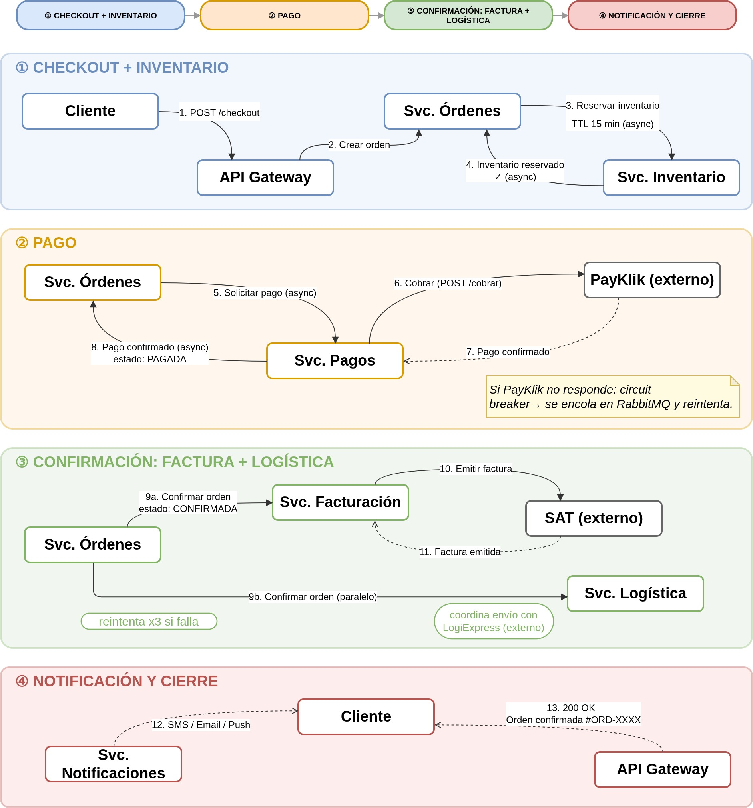
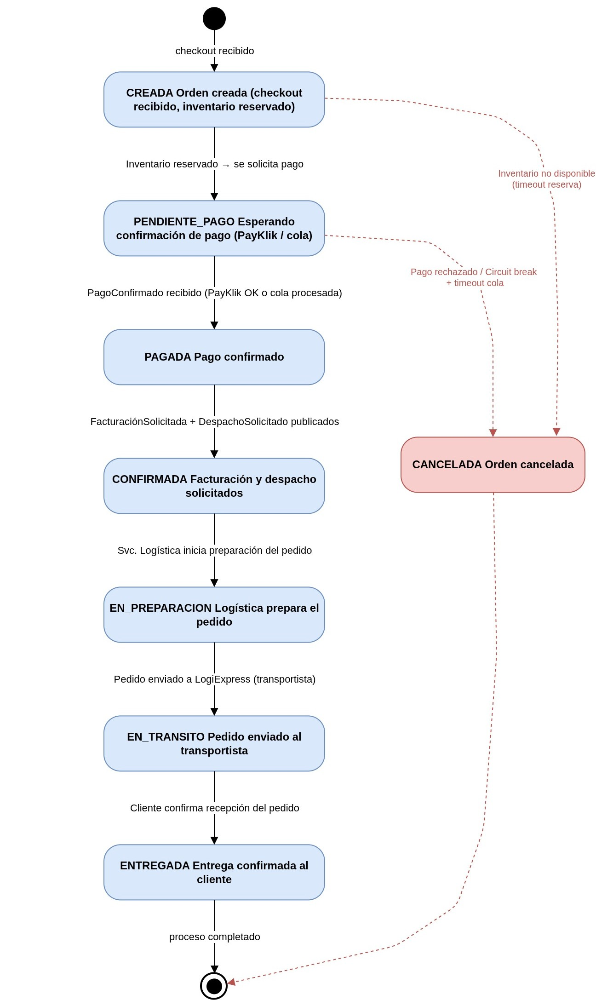

# Flujo Principal del Sistema — SGO-Logic

Este documento describe el flujo principal de operación de SGO-Logic: una compra omnicanal completa, desde que el cliente decide comprar hasta que recibe su pedido. Es la narrativa end-to-end que une todos los servicios de la arquitectura.

---

## Diagrama de Secuencia — Flujo Principal

El siguiente diagrama muestra la interacción entre todos los servicios de SGO-Logic durante una compra omnicanal. Las flechas sólidas representan mensajes síncronos (REST); las flechas punteadas representan mensajes asíncronos (eventos en RabbitMQ) o respuestas.

 

---

## Diagrama de Estados de la Orden

El siguiente diagrama muestra los estados por los que pasa una orden durante su ciclo de vida y las condiciones de transición entre cada uno.

---

## Flujo Completo: Compra Omnicanal

### Paso 1 — Identificación del Cliente

El cliente accede al sistema desde cualquier canal: web (navegador), app móvil (Android o iOS), tienda física (el empleado usa el POS que se comunica con SGO-Logic) o call center (el agente usa la interfaz de atención). El API Gateway (Kong) recibe la solicitud y la enruta al Servicio de Órdenes. El módulo de Identidad/Cliente dentro de ese servicio identifica al usuario por su login, token de sesión o número de cliente. Si no existe, crea el perfil.

### Paso 2 — Navegación del Catálogo y Carrito

El cliente explora productos. SGO-Logic consulta al Catálogo Comercial (sistema externo) para obtener productos, precios, promociones y combos. Cuando agrega productos, estos se guardan en el carrito unificado almacenado en Redis (en memoria, acceso ultra rápido), asociado al ID del cliente y no al canal ni al dispositivo. Si el cliente agrega algo desde el celular y luego va a la tienda, su carrito está intacto.

### Paso 3 — Checkout: Creación de la Orden

El cliente decide confirmar la compra. Selecciona método de pago (tarjeta de crédito/débito via PayKlik, transferencia bancaria o billetera digital) y tipo de entrega (envío desde Centro de Distribución, envío desde tienda más cercana o recogida en tienda). El Servicio de Órdenes crea la orden con estado CREADA y publica el evento OrdenCreada en RabbitMQ.

### Paso 4 — Reserva de Inventario

El Servicio de Inventario escucha el evento OrdenCreada, verifica disponibilidad en la vista unificada (2 CDs + 32 tiendas) y reserva las unidades con un TTL de 15 minutos usando lock optimista en PostgreSQL. Publica el evento InventarioReservado. Si no hay stock, publica InventarioNoDisponible y la orden se cancela. Si no se completa el pago en 15 minutos, el job de limpieza libera la reserva automáticamente. El Servicio de Órdenes recibe InventarioReservado y cambia el estado a PENDIENTE_PAGO.

### Paso 5 — Procesamiento del Pago

El Servicio de Pagos escucha el evento PagoSolicitado. En el escenario normal (PayKlik disponible), llama a PayKlik vía REST, recibe confirmación y publica PagoConfirmado. Cada intento queda registrado: orden, canal, fecha, resultado y monto. En el escenario de falla (PayKlik caído o timeout), el Circuit Breaker (Resilience4j) detecta la falla, la solicitud de pago se encola en RabbitMQ (cola durable, persiste en disco) y el cliente recibe notificación de que su orden está guardada y el pago se procesará en breve. Cuando PayKlik se recupera, el circuito se cierra y la cola se procesa automáticamente. Cero órdenes perdidas. El Servicio de Órdenes recibe PagoConfirmado y cambia el estado a PAGADA.

### Paso 6 — Confirmación de la Orden

El Servicio de Órdenes cambia el estado a CONFIRMADA y publica simultáneamente los eventos FacturacionSolicitada y DespachoSolicitado.

### Paso 7 — Facturación Electrónica (asíncrona)

El Servicio de Facturación escucha FacturacionSolicitada, genera la factura en formato XML con CUI y serie autorizada (requisito SAT) y la envía a la SAT vía HTTPS. Si la SAT responde correctamente, guarda el evento FacturaEmitida en el registro inmutable (Event Sourcing) y asocia la factura a la orden. Si la SAT no responde o da error, reintenta hasta 3 veces con backoff exponencial. Si sigue fallando, la solicitud va a la Dead Letter Queue para intervención manual del equipo de Finanzas. La orden no se bloquea: ya está confirmada. Cada 30 minutos, el Adaptador ERP toma las ventas confirmadas, genera archivos CSV/XML y los deposita vía SFTP al ERP-Core (AS/400) sin modificar el AS/400.

### Paso 8 — Fulfillment y Despacho

El Servicio de Logística escucha DespachoSolicitado, determina desde dónde despachar (CD1, CD2 o tienda más cercana con stock) y genera la guía de envío llamando a LogiExpress vía REST. Si LogiExpress da timeout (ocurre en ~2% de solicitudes), aplica retry con backoff exponencial hasta 3 intentos. Si sigue fallando, va a la DLQ para revisión manual del equipo de Logística. Actualiza el estado de la orden a EN_PREPARACION y publica PedidoEnPreparacion. El cliente puede cambiar el método de entrega incluso después de la confirmación.

### Paso 9 — Notificaciones al Cliente

El Servicio de Notificaciones escucha eventos del bus y notifica al cliente en cada cambio de estado. Si el proveedor de notificaciones falla, la operación continúa normalmente. Las notificaciones se encolan y reintentan en background (fire-and-forget): ninguna notificación fallida bloquea una venta.

| Evento | Notificación al cliente |
|--------|------------------------|
| OrdenConfirmada | Tu orden #XXXX fue confirmada |
| PedidoEnPreparacion | Estamos preparando tu pedido |
| PedidoEnTransito | Tu pedido está en camino |
| PedidoEntregado | Tu pedido fue entregado |
| IncidenciaRegistrada | Hay un problema con tu orden, te contactamos |

### Paso 10 — Consulta de Estado

El cliente o el agente de call center puede consultar el estado de la orden desde cualquier canal en menos de 5 segundos. El Servicio de Órdenes usa el patrón CQRS: las consultas van a una vista materializada (PostgreSQL, actualizada por eventos) sin tocar el modelo de escritura ni generar carga en las transacciones activas.

---

## Flujo de Devolución

Si el cliente solicita una devolución, el agente de call center o el cliente desde la app inicia la solicitud. El Servicio de Órdenes verifica el historial consolidado y publica eventos compensatorios: ReembolsoSolicitado hacia el Servicio de Pagos, NotaCreditoSolicitada hacia el Servicio de Facturación y DevolucionInventarioSolicitada hacia el Servicio de Inventario. El ERP recibe la nota de crédito en el siguiente batch de 30 minutos.

---

## Resumen del Flujo

| Paso | Quién actúa | Qué ocurre | Estado de la Orden |
|------|------------|-----------|-------------------|
| 1 | Cliente + API Gateway | Identificación omnicanal | — |
| 2 | Cliente + Catálogo externo | Navega y agrega al carrito (Redis) | — |
| 3 | Servicio de Órdenes | Crea la orden | CREADA |
| 4 | Servicio de Inventario | Reserva con TTL 15 min | PENDIENTE_PAGO |
| 5 | Servicio de Pagos + PayKlik | Cobro (o encola si PayKlik falla) | PAGADA |
| 6 | Servicio de Órdenes | Confirma la orden | CONFIRMADA |
| 7 | Servicio de Facturación + SAT | Emite factura XML (asíncrono) | CONFIRMADA + factura asociada |
| 8 | Servicio de Logística + LogiExpress | Genera guía, asigna despacho | EN_PREPARACION / EN_TRANSITO |
| 9 | Servicio de Notificaciones | Notifica al cliente en cada paso | — |
| 10 | Servicio de Órdenes (CQRS) | Cliente consulta estado en < 5 s | ENTREGADA |
