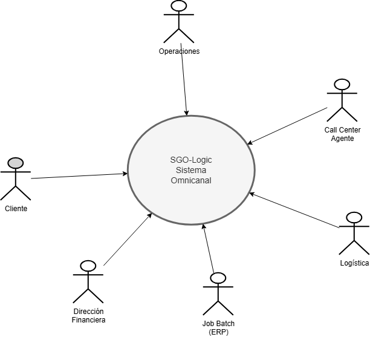
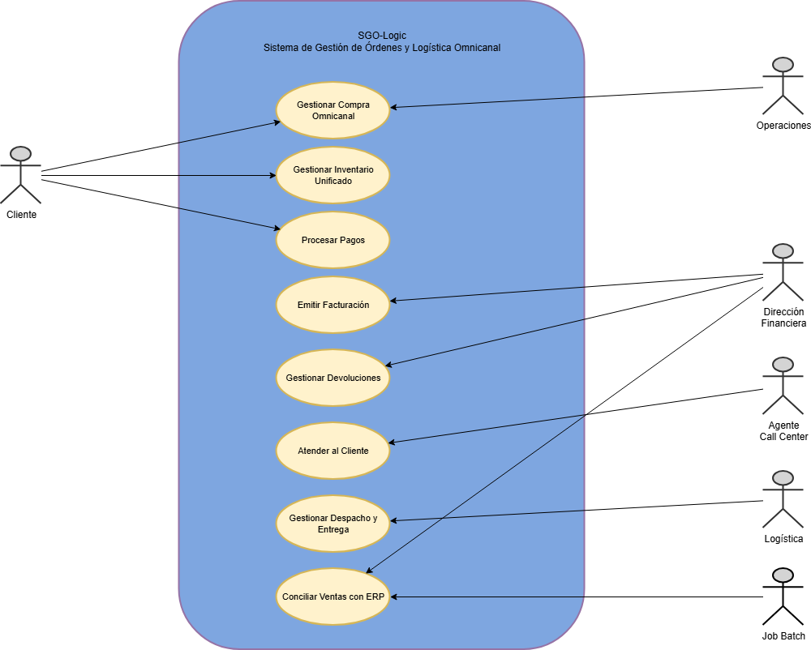
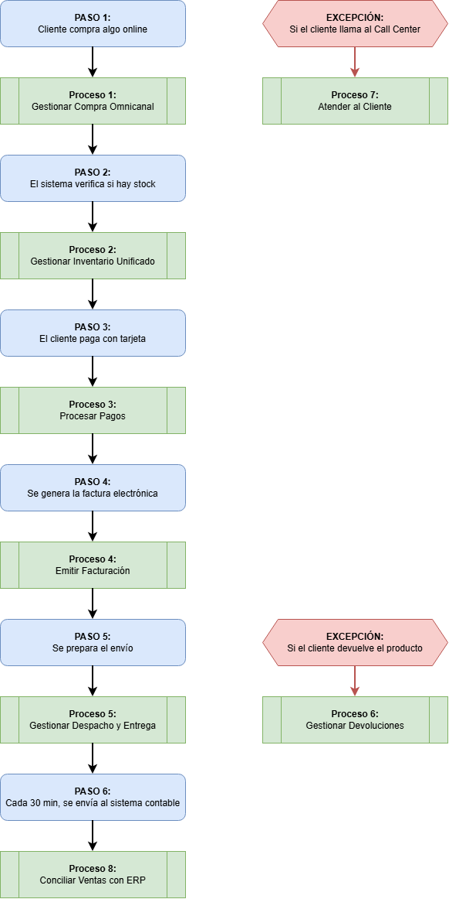
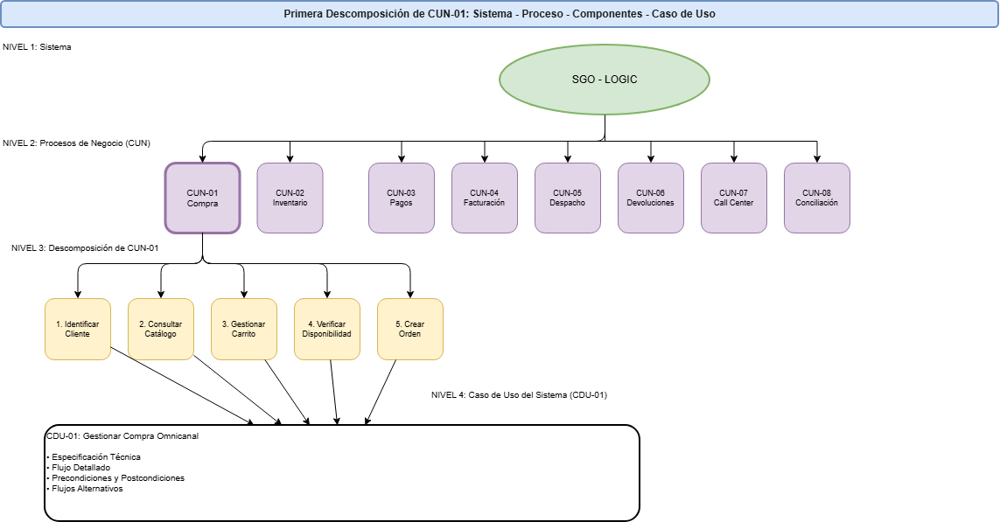

# Identificación del caso de negocio

## 1.1 ¿Quién es MegaStore y Por Qué Necesita Este Sistema?

MegaStore es una cadena de tiendas que vende productos en tres países: Guatemala, El Salvador y Costa Rica. Tiene **32 tiendas físicas** distribuidas en esas ubicaciones y vende aproximadamente **USD $450 millones al año**.

Actualmente, MegaStore permite que sus clientes compren de varias maneras:
- **En la tienda física**: Yendo directamente a cualquiera de sus 32 sucursales
- **Por internet**: A través de un sitio web
- **Por teléfono**: Llamando a un call center para que un agente tome la orden
- **Por aplicación móvil**: Usando una app en el celular

**El problema**: Cada uno de estos canales de venta funciona de forma separada. No se comunican entre sí. Esto causa problemas como:

- **Inventario desincronizado**: Si un cliente ve un producto disponible en la web, podría llegar a la tienda y no estar disponible
- **Información incompleta**: No hay un historial unificado de todas las compras de un cliente en los diferentes canales
- **Procesos manuales**: Las facturas se generan manualmente (lo que es lento y propenso a errores)
- **Sin rastreo**: Los clientes no saben dónde está su paquete cuando lo envían
- **Falta de coordina**: La logística, finanzas y tiendas no se comunican automáticamente

---

### 1.2 La Solución: SGO-Logic

**SGO-Logic** (Sistema de Gestión de Órdenes y Logística Omnicanal) es el nuevo sistema que MegaStore necesita para conectar todos estos canales de venta en uno solo.

¿Qué significa "omnicanal"? Simplemente que el cliente puede **comprar de cualquier forma** (tienda, web, app, teléfono) y el sistema lo **maneja como si fuera una sola tienda** centralizada.

**Principales beneficios de SGO-Logic:**

1. **Inventario unificado**: Todas las tiendas ve el mismo inventario en tiempo real
2. **Una sola orden**: No importa dónde compre el cliente, su orden se registra en un único lugar
3. **Pagos seguros**: Sistema automático que valida pagos sin errores
4. **Facturas automáticas**: Se generan electrónicamente (conforme a la ley de Guatemala)
5. **Entregas rastreables**: El cliente sabe exactamente dónde está su paquete
6. **Devoluciones fáciles**: El proceso de devoluciones es automático y sin papeleos
7. **Atención integrada**: El call center puede ver todo el historial del cliente
8. **Contabilidad automática**: Los datos de ventas se sincronizan automáticamente con el sistema contable

---
## 2. Diagrama Alto Nivel: Sistema y Actores
 
Este diagrama muestra la visión más simple del proyecto: el sistema central y quiénes interactúan con él.
 

 
**Figura 1**: Diagrama Alto Nivel - SGO-Logic con sus 6 actores principales
 

### 2.1 ¿Qué Es Este Diagrama?
 
Este es el diagrama **más simple y general** del proyecto. Muestra:
 
- **Centro:** SGO-Logic - El sistema omnicanal que une todo
- **Alrededor:** 6 actores (usuarios/roles) que interactúan con el sistema

### 2.2 Los 6 Actores Principales
 
| Actor | Rol | Interacción |
|-------|-----|-------------|
| **Cliente** | El que compra | Realiza compras desde web, app, tienda o teléfono |
| **Operaciones** | Vendedor de tienda | Gestiona compras en punto de venta (POS) |
| **Dirección Financiera** | Gerencia de finanzas | Revisa facturas, ventas, conciliación |
| **Logística** | Área de envíos | Prepara, empaca y despacha órdenes |
| **Call Center** | Agente de atención | Atiende llamadas y crea órdenes por teléfono |
| **Job Batch** | Proceso automático | Sincroniza datos con el sistema contable cada 30 min |
 
### 2.3 ¿Por Qué Este Diagrama Es Importante?
 
 Muestra quiénes usan el sistema
 Muestra que todos interactúan con UN SOLO sistema (omnicanal)
 Es la vista más general para que gerencia y stakeholders entiendan el proyecto

---

## 3. Primera Descomposición: Sistema, Procesos de Negocio y Actores
 
Este diagrama muestra la estructura completa: el sistema central, los 8 procesos de negocio (CUN) que contiene, y los 6 actores que interactúan con él.
 

 
**Figura DS**: Primera Descomposición - SGO-Logic con sus 8 procesos de negocio (CUN) y 6 actores
 

### 3.1 ¿Qué Es Esta Descomposición?
 
La **descomposición** es un desglose visual que muestra:
 
- **Centro:** El sistema SGO-Logic (azul)
- **Adentro del sistema:** Los 8 procesos de negocio que realiza (óvalos amarillos)
- **Alrededor:** Los 6 actores que interactúan con el sistema (stick figures)
Es el paso intermedio entre la vista simple (solo sistema + actores) y la vista detallada (4 niveles con especificación técnica).
 
### 3.2 Los 8 Procesos de Negocio (CUN - Casos de Uso de Negocio)
 
Son los **8 procesos principales** que MegaStore realiza. Describen **QUÉ HACE EL NEGOCIO**, sin importar si se hace manualmente o con software.
 
**Los 8 CUN:**
 
1. **CUN-01: Gestionar Compra Omnicanal**
   - El cliente compra desde cualquier canal
   - Se crea una orden única
2. **CUN-02: Gestionar Inventario Unificado**
   - Las 32 tiendas comparten el mismo inventario
   - El cliente siempre ve disponibilidad correcta
3. **CUN-03: Procesar Pagos**
   - El cliente paga con tarjeta, transferencia o billetera digital
   - El pago se valida automáticamente
4. **CUN-04: Emitir Facturación**
   - Se genera factura electrónica
   - Se envía a la SAT (autoridad tributaria)
5. **CUN-05: Gestionar Despacho y Entrega**
   - El sistema decide desde dónde enviar
   - Se genera guía de envío con LogiExpress
   - Cliente rastrea su paquete
6. **CUN-06: Gestionar Devoluciones y Reembolsos**
   - Cliente puede devolver dentro de 30 días
   - El dinero se devuelve automáticamente
7. **CUN-07: Atender al Cliente**
   - Agentes del call center atienden llamadas
   - Pueden crear órdenes y resolver problemas
8. **CUN-08: Conciliar Ventas con ERP**
   - Cada 30 minutos se sincronizan datos de ventas
   - El sistema contable se actualiza automáticamente

### 3.3 Relación Entre Actores y Procesos
 
Cada actor interactúa con ciertos procesos:
 
- **Cliente:** CUN-01 (Compra), CUN-02 (Inventario), CUN-03 (Pagos)
- **Operaciones:** CUN-01 (Compra)
- **Dirección Financiera:** CUN-04 (Facturación), CUN-06 (Devoluciones)
- **Logística:** CUN-05 (Despacho)
- **Call Center:** CUN-07 (Atender Cliente), CUN-01 (Crear Compras)
- **Job Batch:** CUN-08 (Conciliación con ERP)

### 3.4 Tabla de Descomposición: Los 8 CUN y Sus CDU Correspondientes
 
| # | Proceso de Negocio (CUN) | Código | Caso de Uso del Sistema (CDU) | Lo que el Sistema Hace |
|---|--------------------------|--------|-------------------------------|----------------------|
| 1 | Gestionar Compra Omnicanal | CDU-01 | Gestionar Compra Omnicanal | Cliente compra en cualquier canal. Sistema unifica en una orden |
| 2 | Gestionar Inventario Unificado | CDU-02 | Gestionar Inventario Unificado | Sistema sincroniza 32 tiendas en tiempo real. Cliente siempre ve disponibilidad correcta |
| 3 | Procesar Pagos | CDU-03 | Procesar Pagos | Sistema valida y autoriza pagos (tarjeta, transferencia, billetera). Reintenta automáticamente si falla |
| 4 | Emitir Facturación | CDU-04 | Facturación Electrónica | Sistema genera XML automáticamente, lo envía a SAT, emite comprobante al cliente |
| 5 | Gestionar Despacho y Entrega | CDU-05 | Gestionar Despacho y Entrega | Sistema genera guía de envío, coordina con LogiExpress, cliente rastrea su paquete |
| 6 | Gestionar Devoluciones | CDU-06 | Gestionar Devoluciones y Reembolsos | Sistema procesa devoluciones automáticamente, valida condiciones, devuelve dinero |
| 7 | Atender al Cliente | CDU-07 | Atender al Cliente | Agente de call center puede crear compras, consultar estado, resolver problemas |
| 8 | Conciliar Ventas con ERP | CDU-08 | Conciliar Ventas con ERP | Sistema envía datos de ventas al sistema contable cada 30 minutos |
 
### 3.5 ¿Por Qué Esta Descomposición Es Importante?
 
**Visibilidad completa:** Se ve el sistema, sus 8 procesos y quiénes lo usan
 
**Mapeo de responsabilidades:** Cada actor sabe con qué procesos interactúa
 
**Estructura clara:** Muestra que todos los procesos están dentro del mismo sistema omnicanal
 
**Transición a especificación técnica:** Cada CUN será especificado en detalle en un CDU correspondiente
 
---

### 3.6 Cómo Se Relacionan Estos 8 Procesos

Imaginemos que un cliente realiza una compra. Aquí es lo que sucede:

**Figura RL**: la relación de los 8 procesos.

---

## 4. Quiénes Usan Este Sistema

SGO-Logic tiene diferentes usuarios, cada uno con un rol específico:

**Cliente (El que compra)**
- Puede comprar desde web, app, tienda o teléfono
- Ve su inventario disponible
- Rastrear su pedido
- Solicitar devoluciones

**Vendedor de Tienda**
- Ayuda a clientes a comprar en la tienda física
- Usa la caja registradora (POS) conectada al sistema

**Agente de Call Center**
- Atiende llamadas de clientes
- Puede crear órdenes, consultar estado, procesar devoluciones
- Ve todo el historial del cliente

**Área de Logística**
- Prepara y empaca los pedidos
- Genera guías de envío
- Rastrean entregas

**Dirección de Finanzas**
- Ve reportes de ventas
- Verifica que las facturas se enviaron a la SAT
- Revisa la conciliación con el sistema contable

**Gerencia**
- Ve reportes de inventario
- Analiza qué productos se venden más
- Toma decisiones basada en datos

---

## 5. Descomposición de CUN-01: De Proceso a Especificación Técnica
 
Este diagrama muestra los **4 NIVELES de profundidad** que desglosan un proceso de negocio hasta la especificación técnica completa del sistema.

 
**Figura DS**: Primera Descomposición - SGO-Logic con sus 8 procesos de negocio (CUN) y 6 actores
 

 
### 5.1 Los 4 Niveles Explicados
 
Este es el nivel más detallado del análisis. Toma **CUN-01 (Gestionar Compra Omnicanal)** y lo desglosa en 4 niveles:
 
**Nivel 1:** El sistema general  
**Nivel 2:** El proceso de negocio específico  
**Nivel 3:** Sus componentes/pasos  
**Nivel 4:** La especificación técnica (CDU)  
 
**Analogía:** Es como armar un auto:
- Nivel 1: "Necesitamos un auto"
- Nivel 2: "Necesitamos el subsistema de propulsión"
- Nivel 3: "El motor necesita cilindros, pistones, válvulas"
- Nivel 4: "Especificación técnica exacta de cada pieza con tolerancias y materiales"

### 5.2 NIVEL 3: Los 5 Componentes de CUN-01
 
Cuando MegaStore dice **"Gestionar Compra Omnicanal"** (CUN-01), en realidad significa que el proceso se divide en 5 componentes/actividades específicas:
 
#### **1. Identificar Cliente**
El cliente se registra o inicia sesión en el sistema
- ¿Es cliente nuevo o existente?
- ¿Qué información necesitamos?
- ¿Cómo validamos su identidad?
#### **2. Consultar Catálogo**
El cliente navega y busca productos
- ¿Qué productos están disponibles?
- ¿Cuáles son sus precios?
- ¿Cuáles tienen stock?
#### **3. Gestionar Carrito**
El cliente agrega/quita productos a su carrito
- ¿Cuántos de cada producto?
- ¿Puedo cambiar después?
- ¿Se guarda si cierro sesión?
#### **4. Verificar Disponibilidad**
El sistema valida si realmente hay stock
- ¿Hay suficiente cantidad?
- ¿En qué tienda está?
- ¿En qué centro de distribución?
#### **5. Crear Orden**
El sistema genera la orden oficial
- Se asigna número único
- Se reserva el inventario
- Se registra en el sistema

### 5.3 NIVEL 4: La Especificación Técnica (CDU-01)
 
Estos 5 componentes se convierten en la **especificación técnica completa** del **CDU-01: Gestionar Compra Omnicanal**.
 
**CDU-01** describe **EXACTAMENTE** cómo el software debe implementar el proceso:
 
- **9 pasos detallados** (más de los 5 componentes, porque incluye pago y entrega)
- **5 actores involucrados** (cliente, operaciones, sistema, etc.)
- **Precondiciones** (qué debe ser verdad ANTES de ejecutar)
- **Postcondiciones** (qué cambia DESPUÉS de ejecutar)
- **3 flujos alternativos** (qué pasa si falla algo, si el cliente cancela, etc.)

---

## 6. Los Sistemas Externos Que Se Conectan

SGO-Logic no funciona solo. Se conecta con otros sistemas:

| Sistema Externo | ¿Para qué? | Protocolo |
|-----------------|-----------|----------|
| **PayKlik** | Autorizar pagos con tarjeta | Conexión directa por internet |
| **SAT** | Validar y registrar facturas fiscales | XML por internet |
| **LogiExpress** | Generar guías y rastrear envíos | Conexión por internet |
| **ERP-Core (AS/400)** | Sincronizar datos contables | Archivos CSV cada 30 minutos |
| **Sistemas POS (32 tiendas)** | Sincronizar inventario | Archivos CSV cada hora |
