# Documento de Definición de Arquitectura (DDA)


## Identificación del caso de negocio (Diagrama de Casos de Uso de negocio de alto nivel y primera descomposición).

### 1.1 ¿Quién es MegaStore y Por Qué Necesita Este Sistema?

MegaStore es una cadena de tiendas que vende productos en tres países: Guatemala, El Salvador y Costa Rica. Tiene **32 tiendas físicas** distribuidas en esas ubicaciones y vende aproximadamente **USD $450 millones al año**.

Actualmente, MegaStore permite que sus clientes compren de varias maneras:
- **En la tienda física**: Yendo directamente a cualquiera de sus 32 sucursales
- **Por internet**: A través de un sitio web
- **Por teléfono**: Llamando a un call center para que un agente tome la orden
- **Por aplicación móvil**: Usando una app en el celular

**El problema**: Cada uno de estos canales de venta funciona de forma separada. No se comunican entre sí. Esto causa problemas como:

- **Inventario desincronizado**: Si un cliente ve un producto disponible en la web, podría llegar a la tienda y no estar disponible
- **Información incompleta**: No hay un historial unificado de todas las compras de un cliente en los diferentes canales
- **Procesos manuales**: Las facturas se generan manualmente (lo que es lento y propenso a errores)
- **Sin rastreo**: Los clientes no saben dónde está su paquete cuando lo envían
- **Falta de coordina**: La logística, finanzas y tiendas no se comunican automáticamente

---

### 1.2 La Solución: SGO-Logic

**SGO-Logic** (Sistema de Gestión de Órdenes y Logística Omnicanal) es el nuevo sistema que MegaStore necesita para conectar todos estos canales de venta en uno solo.

¿Qué significa "omnicanal"? Simplemente que el cliente puede **comprar de cualquier forma** (tienda, web, app, teléfono) y el sistema lo **maneja como si fuera una sola tienda** centralizada.

**Principales beneficios de SGO-Logic:**

1. **Inventario unificado**: Todas las tiendas ve el mismo inventario en tiempo real
2. **Una sola orden**: No importa dónde compre el cliente, su orden se registra en un único lugar
3. **Pagos seguros**: Sistema automático que valida pagos sin errores
4. **Facturas automáticas**: Se generan electrónicamente (conforme a la ley de Guatemala)
5. **Entregas rastreables**: El cliente sabe exactamente dónde está su paquete
6. **Devoluciones fáciles**: El proceso de devoluciones es automático y sin papeleos
7. **Atención integrada**: El call center puede ver todo el historial del cliente
8. **Contabilidad automática**: Los datos de ventas se sincronizan automáticamente con el sistema contable

---

## 2. Visión General: Los 8 Procesos Principales

Pensemos en SGO-Logic como un "director" que coordina 8 procesos principales de negocio:

<div align="center">

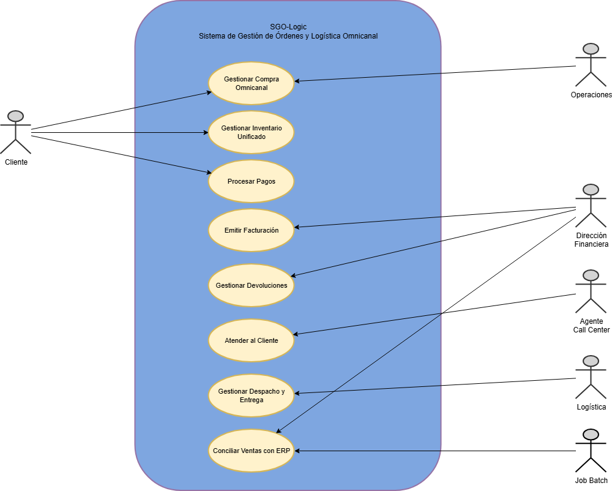

**Figura 0**: Los 8 procesos principales de SGO-Logic y sus actores

</div>

### 2.1 Los 8 Procesos Explicados en Simple

**1. Gestionar Compra Omnicanal**
- El cliente puede comprar desde cualquier lugar (tienda, web, app, teléfono)
- Agrega productos al carrito, elige cómo pagar y dónde recibir
- Todo se registra en una sola orden unificada

**2. Gestionar Inventario Unificado**
- Las 32 tiendas comparten un mismo inventario
- Cuando vende un producto en la web, automáticamente las tiendas lo ven
- El cliente siempre ve la disponibilidad correcta

**3. Procesar Pagos**
- El cliente elige cómo pagar (tarjeta, transferencia, billetera digital)
- El sistema valida y autoriza el pago automáticamente
- Si falla, lo reintenta automáticamente

**4. Emitir Facturación**
- Se genera automáticamente una factura electrónica XML
- Se envía a la SAT (organismo tributario) automáticamente
- El cliente recibe su factura por email

**5. Gestionar Despacho y Entrega**
- El sistema decide de dónde enviar (desde qué tienda o centro de distribución)
- Genera automáticamente la guía de envío con LogiExpress (empresa de envíos)
- El cliente recibe un enlace para rastrear su paquete

**6. Gestionar Devoluciones y Reembolsos**
- El cliente puede devolver un producto dentro de 30 días
- El sistema valida automáticamente si es válida
- El dinero se devuelve automáticamente a la tarjeta del cliente

**7. Atender al Cliente**
- Los agentes del call center pueden crear órdenes, consultar estado, procesar devoluciones
- Todos pueden ver el historial completo del cliente
- Se registra cada interacción para consulta futura

**8. Conciliar Ventas con ERP**
- Cada 30 minutos, el sistema envía automáticamente todos los datos de ventas al sistema contable (AS/400)
- Esto mantiene la contabilidad siempre actualizada
- No hay que hacer nada manual

---

## 3. Cómo Se Relacionan Estos 8 Procesos

Imaginemos que un cliente realiza una compra. Aquí es lo que sucede:

<div align="center">

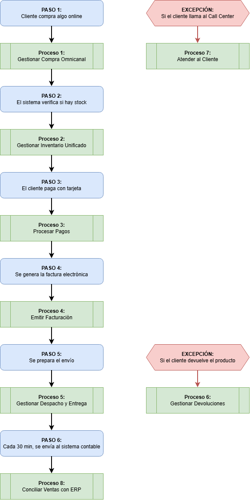

**Figura RL**: la relación de los 8 procesos.

</div>

---

## 4. Quiénes Usan Este Sistema

SGO-Logic tiene diferentes usuarios, cada uno con un rol específico:

**Cliente (El que compra)**
- Puede comprar desde web, app, tienda o teléfono
- Ve su inventario disponible
- Rastrear su pedido
- Solicitar devoluciones

**Vendedor de Tienda**
- Ayuda a clientes a comprar en la tienda física
- Usa la caja registradora (POS) conectada al sistema

**Agente de Call Center**
- Atiende llamadas de clientes
- Puede crear órdenes, consultar estado, procesar devoluciones
- Ve todo el historial del cliente

**Área de Logística**
- Prepara y empaca los pedidos
- Genera guías de envío
- Rastrean entregas

**Dirección de Finanzas**
- Ve reportes de ventas
- Verifica que las facturas se enviaron a la SAT
- Revisa la conciliación con el sistema contable

**Gerencia**
- Ve reportes de inventario
- Analiza qué productos se venden más
- Toma decisiones basada en datos

---

## 5. Primera Descomposición: De CUN (Procesos de Negocio) a CDU (Casos de Uso del Sistema)

<div align="center">
 
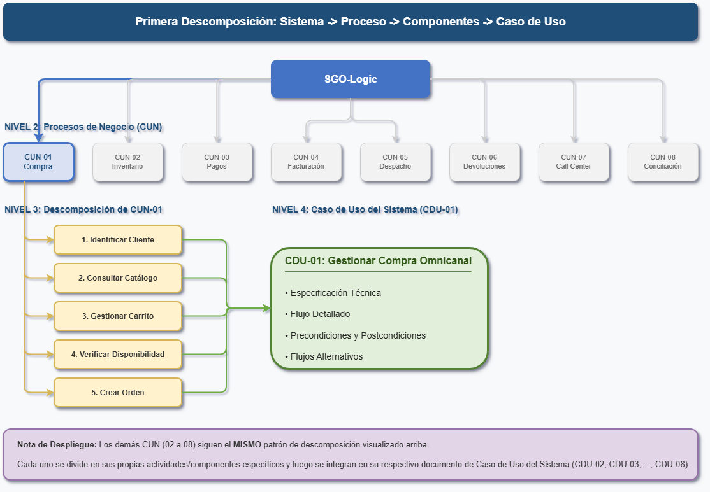

**Figura PD**: Diagrama de descomposición mostrando los 4 niveles (Sistema -> Procesos -> Componentes -> Casos de Uso)

</div>

### 5.1 ¿Qué Es la Descomposición?
 
Cuando planteamos un proceso de negocio (como "Gestionar Compra Omnicanal"), ese proceso es muy general. 
 
La **descomposición** es pasar de ese proceso general a especificar **exactamente qué debe hacer el sistema paso a paso**.
 
**Ejemplo:**
- **CUN (General)**: "Gestionar Compra Omnicanal"
- **CDU (Detallado)**: "El sistema debe permitir que un cliente identifique su usuario, agregue productos al carrito, valide disponibilidad, cree una orden, seleccione método de pago, elija modalidad de entrega y confirme la compra"
### 5.2 Tabla de Descomposición: Cómo Cada Proceso Se Divide en Casos de Uso
 
**Cada Proceso de Negocio (CUN) se convierte en un Caso de Uso del Sistema (CDU)**
 
| # | Proceso de Negocio (CUN) | Código | Caso de Uso del Sistema (CDU) | Lo que el Sistema Hace |
|---|--------------------------|--------|-------------------------------|----------------------|
| 1 | Gestionar Compra Omnicanal | CDU-01 | Gestionar Compra Omnicanal | Cliente compra en cualquier canal (web, app, tienda, call center). Sistema unifica todas las compras |
| 2 | Gestionar Inventario Unificado | CDU-02 | Gestionar Inventario Unificado | Sistema sincroniza inventario de 32 tiendas en tiempo real. Cliente siempre ve disponibilidad correcta |
| 3 | Procesar Pagos | CDU-03 | Procesar Pagos | Sistema valida y autoriza pagos (tarjeta, transferencia, billetera). Reintenta automáticamente si falla |
| 4 | Emitir Facturación | CDU-04 | Facturación Electrónica | Sistema genera XML automáticamente, lo envía a SAT y emite comprobante al cliente |
| 5 | Gestionar Despacho y Entrega | CDU-05 | Gestionar Despacho y Entrega | Sistema genera guía de envío, coordina con LogiExpress, cliente puede rastrear su paquete |
| 6 | Gestionar Devoluciones | CDU-06 | Gestionar Devoluciones y Reembolsos | Sistema procesa devoluciones automáticamente, valida condiciones, devuelve dinero al cliente |
| 7 | Atender al Cliente | CDU-07 | Atender al Cliente | Agente de call center puede crear compras, consultar estado, resolver problemas del cliente |
| 8 | Conciliar Ventas con ERP | CDU-08 | Conciliar Ventas con ERP | Sistema envía automáticamente datos de ventas al sistema contable cada 30 minutos |
 
### 5.3 ¿Por Qué Esta Descomposición Es Importante?
 
Esta descomposición garantiza que:
 
**Nada queda sin especificar**: Cada proceso de negocio tiene su definición detallada en el sistema
 
**El equipo de desarrollo sabe qué hacer**: Los programadores tienen especificaciones claras de lo que deben construir
 
**Se puede probar**: Cada caso de uso puede ser probado para verificar que funciona correctamente
 
**Facilita mantenimiento**: Si algo falla, sabes exactamente en qué caso de uso buscar el problema
 
---

## 6. Los Sistemas Externos Que Se Conectan

SGO-Logic no funciona solo. Se conecta con otros sistemas:

| Sistema Externo | ¿Para qué? | Protocolo |
|-----------------|-----------|----------|
| **PayKlik** | Autorizar pagos con tarjeta | Conexión directa por internet |
| **SAT** | Validar y registrar facturas fiscales | XML por internet |
| **LogiExpress** | Generar guías y rastrear envíos | Conexión por internet |
| **ERP-Core (AS/400)** | Sincronizar datos contables | Archivos CSV cada 30 minutos |
| **Sistemas POS (32 tiendas)** | Sincronizar inventario | Archivos CSV cada hora |

---


## Listado de Stakeholders y preocupaciones arquitectónicas
## Características del sistema priorizadas
## Drivers Requisitos Funcionales

### Diagramas de Casos de Uso Expandidos (CDU) - SGO-Logic

---
## Requisitos Funcionales

### ¿Qué Son los Requisitos Funcionales?

Los Requisitos Funcionales definen **QUÉ DEBE HACER el sistema**. En SGO-Logic, son las 8 capacidades principales que hacen funcionar todo el negocio.

### Los 8 Requisitos Funcionales

| # | Requisito | Descripción |
|---|-----------|-------------|
| **RF-01** | Gestionar Compra Omnicanal | Permitir compras desde web, app, tienda y call center de forma unificada |
| **RF-02** | Gestionar Inventario Unificado | Sincronizar inventario en tiempo real en las 32 tiendas |
| **RF-03** | Procesar Pagos | Autorizar pagos automáticamente (tarjeta, transferencia, billetera digital) |
| **RF-04** | Emitir Facturación Electrónica | Generar facturas XML y enviarlas a SAT automáticamente |
| **RF-05** | Gestionar Despacho y Entrega | Organizar envíos con LogiExpress y permitir rastreo en tiempo real |
| **RF-06** | Gestionar Devoluciones y Reembolsos | Procesar devoluciones automáticamente y reembolsar dinero |
| **RF-07** | Atender al Cliente | Permitir que call center cree órdenes y resuelva problemas |
| **RF-08** | Conciliar Ventas con ERP | Sincronizar datos de ventas con sistema contable cada 30 minutos |

### Relación: Requisitos Funcionales vs Drivers vs CDU

```
Requisito Funcional (QUÉ)
        |
Driver de Requisito Funcional (Los más críticos)
        |
CDU (Especificación detallada con diagramas y flujos)
```

**Ejemplo:**
- **RF**: "El sistema debe permitir que clientes compren"
- **Driver RF**: "Gestionar Compra Omnicanal es crítico para el negocio"
- **CDU-01**: Especificación con 9 pasos, actores, flujos alternativos, etc.


---
### ¿Qué Son los Drivers de Requisitos Funcionales?

Los **Drivers de Requisitos Funcionales** especifican **QUÉ DEBE HACER el sistema**. Es decir, definen todas las funcionalidades que el sistema SGO-Logic debe tener para satisfacer las necesidades del negocio.

Estos requisitos se expresan mediante **Casos de Uso del Sistema (CDU)**, diagramas y descripciones detalladas que explican paso a paso cómo el sistema interactúa con sus usuarios y sistemas externos.

#### ¿Cuál Es la Diferencia Entre CUN y CDU?

| Aspecto | CUN | CDU |
|--------|-----|-----|
| **Nivel** | Alto nivel, general | Técnico, detallado |
| **Audiencia** | Gerentes, clientes, stakeholders | Desarrolladores, testers, arquitectos |
| **Contenido** | "Qué necesita el negocio" | "Cómo el sistema lo hace" |
| **Ejemplo** | "Gestionar Compra Omnicanal" | "CDU-01: Flujo paso a paso de compra con validaciones" |
| **Detalle** | Mínimo | Completo (flujo, precondiciones, alternativas) |

**Relación:**
```
CUN (Visión de Negocio)
        |
   DESCOMPOSICIÓN
        |
CDU (Especificación Técnica del Sistema)
```

#### ¿Qué Contiene Cada CDU?

Cada Caso de Uso del Sistema está especificado con:

1. **Diagrama UML**: Visualización de actores, sistema y relaciones
2. **Descripción General**: Explicación en palabras simples
3. **Actores Involucrados**: Quiénes interactúan y sus roles
4. **Flujo Principal**: Los pasos que ocurren cuando todo funciona correctamente
5. **Precondiciones**: Qué debe ser verdad ANTES de que comience
6. **Postcondiciones**: Qué cambia DESPUÉS de que termina
7. **Flujos Alternativos**: Qué pasa si falla o el usuario elige otra opción

#### Importancia de los CDU

Los CDU son críticos porque:

**Especificación Clara**: El equipo de desarrollo sabe exactamente qué construir sin ambigüedades

**Pruebas Sistemáticas**: Cada CDU se puede probar para verificar que funciona según lo especificado

**Trazabilidad Completa**: Se puede rastrear cada requisito de negocio hasta su implementación en código

**Comunicación Uniforme**: Desarrolladores, testers, gerentes y stakeholders hablan el mismo idioma

**Mantenimiento Eficiente**: Si algo falla en producción, se sabe exactamente en qué CDU buscar el problema

---

## 1. Introducción

Los Requisitos Funcionales representan todas las capacidades y funcionalidades que el sistema SGO-Logic debe implementar para satisfacer las necesidades del negocio. Estos requisitos se expresan a través de Casos de Uso del Sistema (CDU), que son descripciones detalladas de cómo el sistema interactúa con sus actores (usuarios, sistemas externos) para lograr objetivos específicos.

### 1.1 Propósito de este Documento

Este documento presenta los 8 Casos de Uso principales del sistema SGO-Logic, acompañados de:
- **Diagramas UML**: Representación visual de los actores, casos de uso y relaciones
- **Descripciones textuales**: Explicación detallada del flujo de cada proceso
- **Especificaciones**: Precondiciones, postcondiciones y flujos alternativos

### 1.2 Alcance

El sistema SGO-Logic (Sistema de Gestión de Órdenes y Logística Omnicanal) cubre:
- Gestión integral de compras omnicanal (web, móvil, tienda física, call center)
- Inventario centralizado y sincronizado
- Procesamiento seguro de pagos
- Facturación electrónica automática
- Gestión logística de despachos y entregas
- Atención al cliente integrada
- Conciliación automática con sistemas contables

---

## 2. Diagrama de Casos de Uso de Negocio (CUN) - Visión de Alto Nivel

<div align="center">

### Sistema SGO-Logic: Visión General


**Figura 1**: Diagrama de Casos de Uso de Negocio (CUN) - Descomposición de alto nivel

</div>

### 2.1 Descripción de la Visión de Alto Nivel

El diagrama anterior muestra los 8 procesos de negocio principales que soporta SGO-Logic, sus actores principales y las relaciones básicas entre ellos. Estos procesos representan las operaciones críticas de la cadena retail omnicanal:

| Actor | Procesos Asociados | Responsabilidad |
|-------|-------------------|-----------------|
| **Cliente** | Compra, Inventario, Pagos | Realiza compras y consultas |
| **Operaciones** | Gestionar Compra | Crea órdenes en tienda |
| **Dirección Financiera** | Facturación, Devoluciones, Conciliación | Gestiona aspectos fiscales y financieros |
| **Logística** | Despacho y Entrega | Administra envíos y distribución |
| **Call Center** | Atender Cliente | Soporte y gestión de compras remotas |

---

## 3. Casos de Uso del Sistema (CDU) - Especificaciones Detalladas

---

## CDU-01: Gestionar Compra Omnicanal

<div align="center">

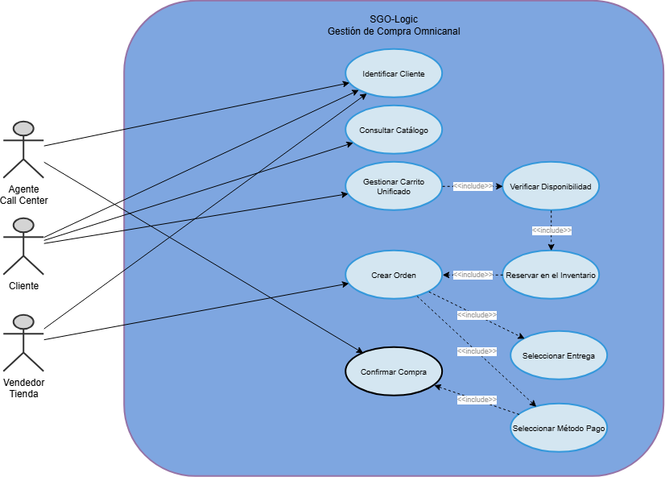

**Figura 2**: Diagrama de Caso de Uso CDU-01

</div>

### 3.1.1 Descripción General

Este caso de uso permite a los clientes realizar compras a través de múltiples canales de distribución (en línea, tienda física, aplicación móvil o call center). El sistema SGO-Logic gestiona de manera centralizada todas las compras sin importar el canal de origen, garantizando una experiencia consistente y uniforme para el cliente. El proceso incluye desde la identificación del cliente hasta la confirmación final de la compra y la iniciación del proceso de pago.

### 3.1.2 Actores Involucrados

- **Cliente**: Usuario final que realiza la compra
- **Vendedor de Tienda**: Personal de tienda que asiste en la compra presencial
- **Agente de Call Center**: Representante que asiste compras telefónicas
- **Sistema de Inventario**: Verifica disponibilidad de productos
- **Pasarela de Pagos**: Procesa métodos de pago

### 3.1.3 Flujo Principal (Happy Path)

1. **Identificación de Cliente**: El cliente se identifica en el sistema mediante credenciales o como usuario nuevo
2. **Consulta de Catálogo**: Navega y consulta el catálogo de productos disponibles
3. **Gestión de Carrito**: Agrega productos al carrito unificado (válido en cualquier canal)
4. **Verificación de Disponibilidad**: El sistema consulta el inventario centralizado
5. **Reserva de Inventario**: Los productos se reservan con estado "pendiente"
6. **Creación de Orden**: Se genera número único de orden (OD-XXXXX)
7. **Selección de Método de Pago**: Cliente elige entre tarjeta, transferencia o billetera digital
8. **Selección de Modalidad de Entrega**: Cliente elige entre domicilio, pickup en tienda o despacho desde CD
9. **Confirmación de Compra**: Se genera comprobante y se inicia proceso de pago

### 3.1.4 Precondiciones

- El cliente debe estar registrado o crear perfil en el sistema
- Al menos un producto debe estar disponible en inventario
- El cliente debe aceptar los términos y condiciones
- Debe haber un método de pago válido configurado

### 3.1.5 Postcondiciones

- Número de orden generado y asignado
- Reserva de inventario confirmada (24-48 horas)
- Cliente recibe confirmación por email/SMS
- Se inicia proceso de procesamiento de pago
- Estado de orden = "Pendiente de Pago"

### 3.1.6 Flujos Alternativos

**Alternativa A - Producto No Disponible**
- A1: Si no hay stock de un producto solicitado
- A2: Sistema sugiere productos similares o notifica cuándo estará disponible
- A3: Cliente puede elegir esperar o continuar sin ese producto

**Alternativa B - Pago Rechazado**
- B1: Si la validación de pago falla
- B2: Se notifica al cliente y se permite reintentar con otro método
- B3: Si reintentos fallan, se cancela automáticamente

**Alternativa C - Cliente Cancela**
- C1: Antes de confirmar: se descartan todos los datos
- C2: Después de confirmar: se libera la reserva de inventario inmediatamente

---

## CDU-02: Gestionar Inventario Unificado

<div align="center">

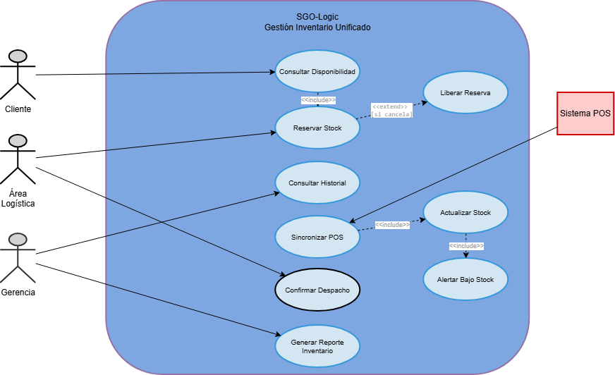

**Figura 3**: Diagrama de Caso de Uso CDU-02

</div>

### 3.2.1 Descripción General

Este caso de uso gestiona el inventario centralizado del sistema. Se sincroniza automáticamente con todos los Puntos de Venta (POS) de las 32 tiendas físicas, garantizando que la información de disponibilidad sea uniforme en todos los canales. El sistema mantiene visibilidad completa del stock en tiempo real.

### 3.2.2 Actores Involucrados

- **Cliente**: Consulta disponibilidad de productos
- **Área de Logística**: Gestiona movimientos de inventario
- **Gerencia**: Consulta reportes de inventario
- **Sistema POS**: Sincronización automática de tiendas
- **ERP-Core**: Sistema contable de referencia

### 3.2.3 Flujo Principal

1. Cliente consulta disponibilidad de un producto específico
2. Sistema consulta base de datos centralizada en tiempo real
3. Se obtiene: cantidad disponible, ubicaciones, reservas pendientes
4. Si hay compra: Se realiza reserva (estado "Reservado")
5. Cambios se sincronizan automáticamente a todos los POS (cada 5 minutos)
6. Sistema valida si hay stock mínimo y genera alertas
7. Gerencia recibe reportes automáticos de niveles críticos
8. Se mantiene historial de movimientos para auditoría

### 3.2.4 Precondiciones

- Producto debe estar en catálogo activo
- Conexión funcional entre servidor central y POS de tiendas
- Base de datos central accesible

### 3.2.5 Postcondiciones

- Información de inventario actualizada en tiempo real
- Todos los POS reflejan cambios dentro de 5 minutos
- Movimiento registrado en historial con timestamp
- Alertas generadas si stock ≤ mínimo configurado

### 3.2.6 Flujos Alternativos

**Alternativa A - Producto Agotado**
- A1: Stock llega a cero
- A2: Se marca como "No Disponible" automáticamente en todos los canales
- A3: Se notifica a gerencia y área de compras

**Alternativa B - Discrepancias de Inventario**
- B1: Diferencia entre POS y central detectada
- B2: Se genera reporte de auditoría inmediato
- B3: Se solicita conteo físico en tienda

**Alternativa C - Cancelación de Compra**
- C1: Cliente cancela compra
- C2: Reserva se libera inmediatamente
- C3: Stock se incremente en todos los canales

---

## CDU-03: Procesar Pagos

<div align="center">

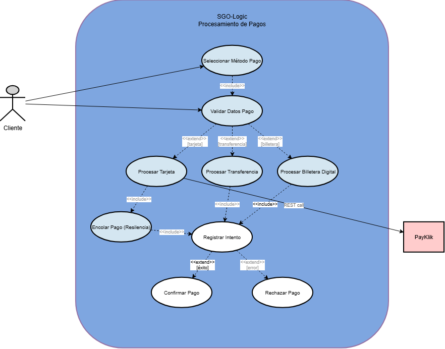

**Figura 4**: Diagrama de Caso de Uso CDU-03

</div>

### 3.3.1 Descripción General

Este caso de uso gestiona el procesamiento seguro de pagos en múltiples métodos. Integra la pasarela de pagos PayKlik para autorización de tarjetas y soporta transferencias bancarias y billeteras digitales. Incluye mecanismos de resiliencia (encolamiento y reintentos automáticos) para garantizar confiabilidad.

### 3.3.2 Actores Involucrados

- **Cliente**: Selecciona método de pago
- **Sistema de Validación**: Verifica datos
- **PayKlik**: Pasarela de pagos externa
- **Cola de Procesamiento**: Resiliencia (RabbitMQ)
- **Banco**: Confirmación de transferencias

### 3.3.3 Flujo Principal

1. Cliente selecciona método de pago durante checkout
2. Sistema valida formato y datos básicos del pago
3. Según método de pago seleccionado:
   - **Tarjeta**: Se envía a PayKlik con datos encriptados
   - **Transferencia**: Se registra como "Pendiente" en el sistema
   - **Billetera Digital**: Se procesa llamada directa a billetera
4. Pago se encola en sistema de resiliencia
5. Se registra intento en audit log con timestamp
6. Sistema espera respuesta de PayKlik (timeout: 30 segundos)
7. Si es exitoso (status=200): Estado = "Confirmado"
8. Si falla: Estado = "Rechazado"

### 3.3.4 Precondiciones

- Cliente ha completado proceso de checkout
- Datos de pago válidos según formato esperado
- Conexión a PayKlik disponible (si es tarjeta)
- Orden existe en estado "Pendiente de Pago"

### 3.3.5 Postcondiciones

- Intento de pago registrado con ID único
- Comprobante de pago generado
- Estado de orden actualizado
- Si exitoso: Se inicia proceso de facturación y despacho
- Notificación enviada al cliente vía email

### 3.3.6 Flujos Alternativos

**Alternativa A - Tarjeta Rechazada**
- A1: PayKlik devuelve estado "Rechazada"
- A2: Cliente recibe notificación de rechazo
- A3: Se permite reintentar (máximo 3 intentos)
- A4: Cliente puede cambiar a otro método

**Alternativa B - PayKlik No Responde**
- B1: Timeout de 30 segundos sin respuesta
- B2: Pago se encola automáticamente para reintentos
- B3: Se reintentan cada 5 minutos (máximo 5 veces)
- B4: Después de 5 fallos: Se notifica a gerencia

**Alternativa C - Transferencia Bancaria**
- C1: Se registra como "Pendiente Confirmación"
- C2: Sistema espera confirmación del banco
- C3: Cuando se confirma: Estado = "Confirmado"
- C4: Si pasan 24 horas sin confirmar: Se cancela automáticamente

---

## CDU-04: Facturación Electrónica

<div align="center">

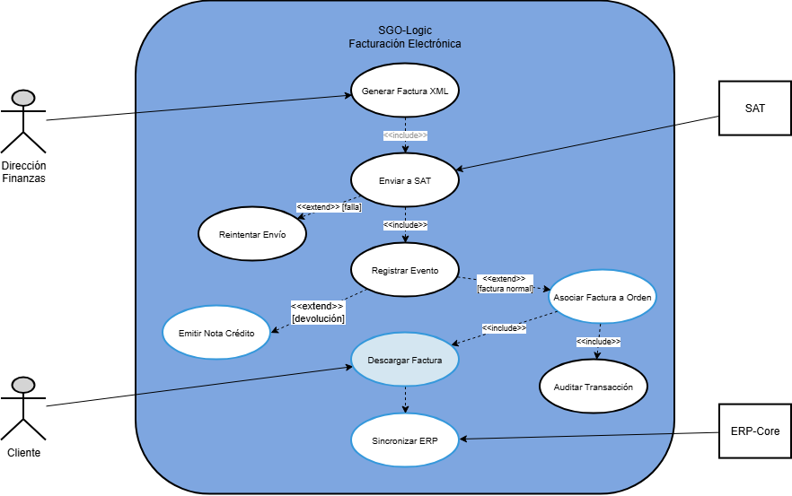

**Figura 5**: Diagrama de Caso de Uso CDU-04

</div>

### 3.4.1 Descripción General

Genera automáticamente facturas electrónicas en formato XML conforme a estándares fiscales y las envía a la SAT. Sincroniza información con ERP-Core para mantener registros contables actualizados. Cumple con requisitos legales de Guatemala.

### 3.4.2 Flujo Principal

1. Pago confirmado → Sistema genera factura XML automáticamente
2. Se envía a SAT para registro fiscal (integración SOAP/REST)
3. SAT devuelve folio fiscal único si es válida
4. Se registra evento con resultado en audit log
5. Se asocia folio a número de orden original
6. Si es devolución: Se emite Nota de Crédito con referencia
7. Datos se sincronizan a ERP-Core vía interfaz batch CSV
8. Se registra timestamp de sincronización
9. Cliente recibe factura en email y puede descargar PDF

### 3.4.3 Precondiciones

- Pago confirmado (CDU-03 exitoso)
- Datos fiscales válidos en sistema
- Conexión a SAT disponible
- Empresa registrada ante SAT con credenciales activas

### 3.4.4 Postcondiciones

- Folio fiscal único generado por SAT
- Factura visible en historial del cliente
- Datos en ERP actualizados (máximo 1 hora)
- Auditoría completa registrada

### 3.4.5 Flujos Alternativos

**Alternativa A - SAT Rechaza Factura**
- A1: SAT devuelve error de validación
- A2: Sistema reintentas automáticamente cada 10 min (máx. 5 veces)
- A3: Si falla definitivamente: Notifica a Dirección Financiera

**Alternativa B - Nota de Crédito (Devolución)**
- B1: Se emite automáticamente al procesar devolución
- B2: Referencia factura original con folio
- B3: Se envía a SAT como "Anulación" o "Nota de Crédito"

**Alternativa C - Error en ERP**
- C1: Datos no se sincronizan en 1 hora
- C2: Se genera alerta para corrección manual
- C3: Factura sigue siendo válida, pero se requiere ajuste contable

---

## CDU-05: Gestionar Despacho y Entrega

<div align="center">

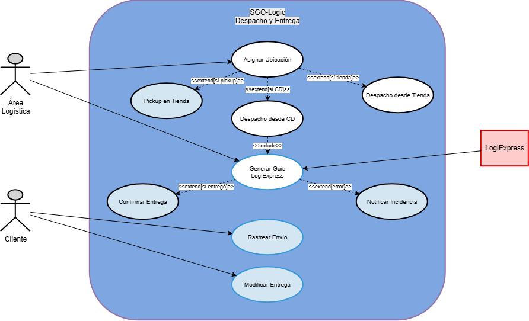

**Figura 6**: Diagrama de Caso de Uso CDU-05

</div>

### 3.5.1 Descripción General

Organiza y controla el despacho de productos desde centro de distribución, tiendas o preparación para pickup. Integra con LogiExpress para logística de envío. Proporciona rastreo en tiempo real al cliente.

### 3.5.2 Flujo Principal

1. Sistema asigna ubicación óptima (CD, tienda local, o pickup)
2. Se genera guía de envío LogiExpress automáticamente
3. Según canal: Despacho desde CD, Tienda o Pickup en tienda
4. Productos se empacan y se escanean
5. LogiExpress recibe envío y lo integra a su sistema
6. Cliente recibe enlace de rastreo en tiempo real
7. Evento de entrega: Cliente recibe notificación
8. Si hay incidencia: Sistema notifica e inicia protocolo
9. Entrega confirmada: Inventario se actualiza final

### 3.5.3 Precondiciones

- Orden confirmada y pagada
- Productos disponibles en ubicación de despacho
- LogiExpress accesible (API funcional)
- Cliente ha seleccionado modalidad de entrega

### 3.5.4 Postcondiciones

- Guía generada con número único
- Cliente tiene acceso a rastreo
- LogiExpress tiene orden integrada
- Inventario actualizado en ubicación receptora

### 3.5.5 Flujos Alternativos

**Alternativa A - Pickup en Tienda**
- A1: Cliente selecciona retiro en tienda
- A2: Se prepara en bodega de tienda específica
- A3: Notificación a cliente cuando esté listo
- A4: Cliente retira en horario de atención

**Alternativa B - Problema en Envío**
- B1: LogiExpress reporta incidencia (daño, dirección incorrecta)
- B2: Sistema notifica a cliente y ofrece opciones
- B3: Reenvío o devolución según caso

**Alternativa C - Cliente Modifica Entrega**
- C1: Antes de despacho: cambio de dirección/tienda permitido
- C2: Sistema actualiza guía automáticamente
- C3: Después de despacho: coordinación con LogiExpress

---

## CDU-06: Gestionar Devoluciones y Reembolsos

<div align="center">

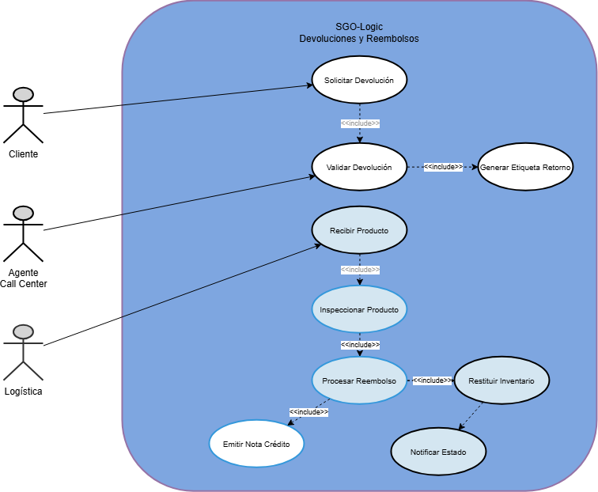

**Figura 7**: Diagrama de Caso de Uso CDU-06

</div>

### 3.6.1 Descripción General

Gestiona solicitudes de devolución dentro de plazo permitido (30 días). Valida condiciones, genera etiqueta de retorno LogiExpress, recibe producto e inmediatamente procesa reembolso automático.

### 3.6.2 Flujo Principal

1. Cliente inicia solicitud de devolución en sistema
2. Valida: plazo (máx. 30 días), condiciones (original, sin uso)
3. Se genera número de devolución (DEV-XXXXX)
4. Se crea etiqueta retorno LogiExpress automáticamente
5. Cliente imprime etiqueta y envía producto
6. Logística recibe en bodega y escanea etiqueta
7. Se inspecciona condición física del producto
8. Si cumple: Procesa reembolso a cuenta original
9. Se emite nota de crédito fiscal
10. Actualiza inventario y notifica al cliente

### 3.6.3 Precondiciones

- Orden de compra debe existir en historial
- Dentro de plazo de devolución (≤ 30 días)
- Producto cumple condiciones: original, sin daño
- Cliente tiene acceso a etiqueta de retorno

### 3.6.4 Postcondiciones

- Número de devolución asignado
- Reembolso procesado (1-3 días hábiles)
- Nota de crédito emitida a SAT
- Inventario incrementado
- Cliente recibe confirmación

### 3.6.5 Flujos Alternativos

**Alternativa A - Producto Fuera de Plazo**
- A1: Compra hace más de 30 días
- A2: Sistema rechaza automáticamente
- A3: Se notifica a cliente con opciones de garantía

**Alternativa B - Producto no Cumple Condiciones**
- B1: Inspección detecta daño o uso
- B2: Devolución se rechaza
- B3: Se ofrece opciones de reparación

**Alternativa C - Producto con Defecto**
- C1: Inspección detecta defecto del fabricante
- C2: Se ofrece: Reemplazo nuevo o reembolso
- C3: Cliente elige opción y se procesa

---

## CDU-07: Atender al Cliente

<div align="center">

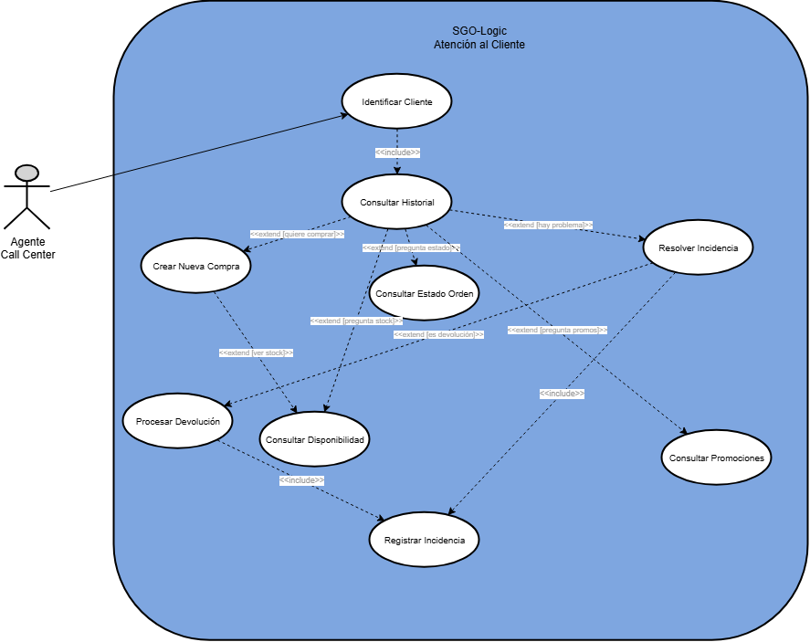

**Figura 8**: Diagrama de Caso de Uso CDU-07

</div>

### 3.7.1 Descripción General

Agente del Call Center ejecuta operaciones en nombre del cliente. Puede crear compras, consultar estado de órdenes, resolver incidencias y procesar devoluciones. Todas las interacciones se registran para historial y calidad.

### 3.7.2 Flujo Principal

1. Agente identifica cliente con teléfono/número de orden
2. Busca historial de compras en sistema
3. Según solicitud del cliente:
   - **Nueva Compra**: Crea orden igual a CDU-01
   - **Consultar Orden**: Muestra estado completo con tracking
   - **Resolver Incidencia**: Abre ticket de soporte
   - **Procesar Devolución**: Inicia CDU-06
   - **Consultar Disponibilidad**: Verifica inventario real
   - **Promociones**: Información vigente del período
4. Agente ejecuta acción solicitada
5. Se registra interacción completa con timestamp
6. Cliente recibe confirmación verbal y por email

### 3.7.3 Precondiciones

- Cliente identificado en sistema
- Agente con credenciales válidas y activas
- Sistema de órdenes accesible
- Conexión telefónica establecida

### 3.7.4 Postcondiciones

- Interacción registrada en historial
- Acción completada (compra, ticket, etc.)
- Cliente informado de resultado
- Ticket generado si fue necesario

### 3.7.5 Flujos Alternativos

**Alternativa A - Problema Técnico**
- A1: Sistema no responde durante la llamada
- A2: Agente registra los datos manualmente
- A3: Se crea ticket para sincronizar después

**Alternativa B - Escalamiento a Gerencia**
- B1: Cliente solicita hablar con supervisor
- B2: Se transfiere llamada a gerencia
- B3: Se registra como "Escalamiento" en ticket

**Alternativa C - Cliente Irado/Reclamo**
- C1: Se crea ticket de "Reclamo" automáticamente
- C2: Se asigna a equipo de atención especial
- C3: Se da seguimiento dentro de 24 horas

---

## CDU-08: Conciliar Ventas con ERP

<div align="center">

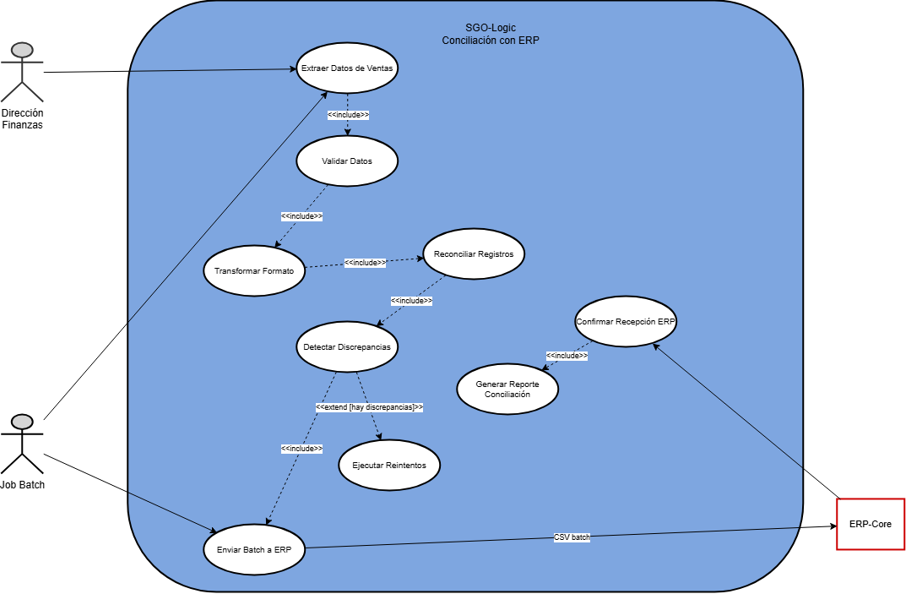

**Figura 9**: Diagrama de Caso de Uso CDU-08

</div>

### 3.8.1 Descripción General

Proceso automático que se ejecuta cada 30 minutos para sincronizar datos de ventas SGO-Logic con ERP-Core. Garantiza registros contables actualizados. Ejecutado por Job Batch sin intervención humana.

### 3.8.2 Flujo Principal

1. Job Batch se ejecuta automáticamente cada 30 minutos
2. Extrae datos de todas las ventas del período (últimas 30 min)
3. Valida integridad: sin valores nulos, formatos correctos
4. Transforma al formato ERP (CSV batch o XML)
5. Compara con último envío para evitar duplicados
6. Reconcilia: busca discrepancias (diferencias de montos, cantidades)
7. Si todas las validaciones OK: Envía batch a ERP-Core vía SFTP
8. Espera confirmación de recepción (timeout: 5 minutos)
9. Registra resultado en audit log
10. Genera reporte con estadísticas de conciliación

### 3.8.3 Precondiciones

- Ventas registradas en período
- Conexión a ERP-Core disponible
- Credenciales SFTP válidas
- Datos de ventas completamente validados

### 3.8.4 Postcondiciones

- Datos sincronizados a ERP (máximo 1 hora)
- Reporte de conciliación generado
- Event log actualizado
- Registros contables del ERP reflejan ventas

### 3.8.5 Flujos Alternativos

**Alternativa A - Discrepancias Detectadas**
- A1: Diferencia en monto o cantidad
- A2: Sistema ejecuta reintentos automáticos (máx. 5 veces, cada 5 min)
- A3: Si persiste: Alerta a Dirección Financiera para revisión manual
- A4: Se genera reporte detallado de la discrepancia

**Alternativa B - ERP-Core No Responde**
- B1: Sin respuesta después de 5 minutos
- B2: Se encola para reintentar próxima ejecución (30 min)
- B3: Máximo 3 reintentos
- B4: Si falla definitivamente: Notificación a IT

**Alternativa C - Error en Datos**
- C1: Validación rechaza datos inválidos
- C2: Se registra en log de errores
- C3: Se genera alerta para corrección manual
- C4: Se reintenta en siguiente ejecución

---

## 4. Conclusión y Resumen
 
### 4.1 Integración del Sistema

Cada CDU está diseñado para interactuar coherentemente con los demás:
- CDU-01 inicia el flujo
- CDU-02 y CDU-03 se ejecutan en paralelo
- CDU-04 genera registros fiscales
- CDU-05 gestiona distribución
- CDU-06 cubre devoluciones
- CDU-07 proporciona soporte integral
- CDU-08 sincroniza con backend contable

### 4.2 Garantías de Calidad

El sistema garantiza:
- **Trazabilidad completa**: Todos los procesos se registran en audit log
- **Resilencia**: Reintentos automáticos en operaciones críticas
- **Validación**: Múltiples niveles de validación en cada CDU
- **Disponibilidad**: Soporte multicanal 24/7
- **Seguridad**: Encriptación y validación de datos de pago
- **Conformidad**: Cumplimiento con normativas fiscales (SAT)

---


## Drivers de Calidad (Escenarios de Atributos de Calidad - EAC)

A continuación se presentan los Escenarios de Atributos de Calidad estructurados en seis partes (Fuente, Estímulo, Artefacto, Entorno, Respuesta y Medida de Respuesta). 

### QA-01: Escalabilidad (Picos de Demanda)
*   **Fuente del estímulo:** Usuarios finales (Clientes).
*   **Estímulo:** La concurrencia aumenta repentinamente generando una demanda hasta 8 veces superior a la de un día normal (40,000 órdenes/día).
*   **Artefacto:** Servicios críticos (Órdenes, Pagos) y API Gateway (Kong).
*   **Entorno:** Operación en eventos comerciales extremos (Black Friday).
*   **Respuesta:** El sistema orquesta el escalado horizontal levantando nuevas instancias de los contenedores críticos y el API Gateway balancea el tráfico para evitar sobrecarga.
*   **Medida de respuesta:** El tiempo de respuesta se mantiene en $\le$ 5 segundos bajo la carga 8x sin denegación de servicio.

### QA-02: Disponibilidad y Tolerancia a Fallos (Pagos)
*   **Fuente del estímulo:** Proveedor externo de pasarela de pagos (PayKlik).
*   **Estímulo:** La pasarela presenta latencias superiores a 5 segundos, timeout o caída total (indisponibilidad de hasta 45 minutos).
*   **Artefacto:** Adaptador de PayKlik en el Servicio de Pagos y Message Broker.
*   **Entorno:** Operación en condiciones de alta demanda o falla externa.
*   **Respuesta:** El sistema interrumpe las llamadas al proveedor (abre el circuito), encola las transacciones pendientes de pago de forma persistente y las procesa automáticamente cuando el proveedor se recupera.
*   **Medida de respuesta:** 0 órdenes perdidas por la caída del proveedor; el 100% de los intentos fallidos quedan auditados.

### QA-03: Rendimiento (Consulta de Órdenes)
*   **Fuente del estímulo:** Cliente o Personal de Atención (Call Center).
*   **Estímulo:** Solicita consultar el estado actualizado o el historial de una orden.
*   **Artefacto:** Módulo de consultas del Servicio de Órdenes (Base de datos).
*   **Entorno:** Operación bajo concurrencia normal y picos de tráfico.
*   **Respuesta:** El sistema elude la carga de los componentes transaccionales leyendo directamente desde una vista materializada optimizada (patrón CQRS).
*   **Medida de respuesta:** La información se presenta en la interfaz en menos de 5 segundos desde cualquier dispositivo.

### QA-04: Rendimiento y Auditabilidad (Búsqueda Financiera)
*   **Fuente del estímulo:** Directora de Finanzas.
*   **Estímulo:** Ejecuta una búsqueda para recuperar la evidencia y trazabilidad de una transacción específica.
*   **Artefacto:** Base de datos inmutable de eventos y motor de indexación (ELK Stack).
*   **Entorno:** Operación normal durante actividades de conciliación o cierre mensual.
*   **Respuesta:** El sistema procesa la consulta cruzando el identificador del cliente o de la orden a través del registro centralizado de logs y eventos inmutables.
*   **Medida de respuesta:** La evidencia completa (quién, cuándo y qué cambió) se recupera en menos de 1 segundo.

### QA-05: Resiliencia (Despacho Logístico)
*   **Fuente del estímulo:** Proveedor logístico (LogiExpress).
*   **Estímulo:** La API del proveedor devuelve errores de "Timeout" al intentar generar una guía de envío.
*   **Artefacto:** Adaptador de LogiExpress en el Servicio de Logística.
*   **Entorno:** Operación continua (se presenta en 2% de las solicitudes).
*   **Respuesta:** El sistema reintenta la comunicación aplicando un retroceso exponencial (backoff). Si falla definitivamente, traslada el mensaje a una cola de mensajes muertos (DLQ) para intervención.
*   **Medida de respuesta:** 0 guías perdidas; se ejecutan un máximo de 3 reintentos automáticos antes de requerir acción manual.

### QA-06: Resiliencia (Notificaciones)
*   **Fuente del estímulo:** Proveedor externo de SMS y correos.
*   **Estímulo:** El proveedor de notificaciones se encuentra inaccesible.
*   **Artefacto:** Servicio de Notificaciones y Bus de Eventos.
*   **Entorno:** Operación continua.
*   **Respuesta:** El flujo principal de SGO-Logic continúa sin interrupciones. Las notificaciones fallidas se retienen en el broker para envío diferido.
*   **Medida de respuesta:** 0 ventas afectadas o bloqueadas debido a fallas en el envío de notificaciones.

### QA-07: Auditabilidad y Cumplimiento (SAT)
*   **Fuente del estímulo:** Entidad reguladora (SAT).
*   **Estímulo:** Requiere la reconstrucción de las operaciones realizadas en una ventana de tiempo durante una auditoría anual.
*   **Artefacto:** Repositorios de datos del Servicio de Facturación y Órdenes.
*   **Entorno:** Auditoría externa en operación normal.
*   **Respuesta:** El sistema extrae el historial basado en la técnica de almacenamiento de eventos (Event Sourcing) asegurando que no se han alterado registros pasados.
*   **Medida de respuesta:** 100% de las transacciones son reconstruibles, manteniendo el CUI y serie autorizada.

### QA-08: Interoperabilidad
*   **Fuente del estímulo:** Restricción de Gobernanza / Junta Directiva.
*   **Estímulo:** Necesidad de sincronizar SGO-Logic con sistemas Legacy (AS/400 y 32 instancias POS).
*   **Artefacto:** Capa Anticorrupción (Adaptadores batch/CSV/XML).
*   **Entorno:** Despliegue e integración en infraestructura de TI existente.
*   **Respuesta:** SGO-Logic consume e inyecta archivos en los intervalos de tiempo definidos a través de los adaptadores sin invadir la lógica de los sistemas Legacy.
*   **Medida de respuesta:** 0 modificaciones a los sistemas ERP-Core y POS actuales.

### QA-09: Mantenibilidad
*   **Fuente del estímulo:** Gerencia de TI.
*   **Estímulo:** Pase a producción y transferencia operativa al equipo interno.
*   **Artefacto:** Repositorio de código y scripts de infraestructura.
*   **Entorno:** Fase de adopción tecnológica y mantenimiento evolutivo.
*   **Respuesta:** La arquitectura se diseña en un stack tecnológico ya dominado por el personal (Java, .NET, Docker básico) evitando orquestadores hiper-complejos (ej. Kubernetes).
*   **Medida de respuesta:** El equipo interno es capaz de operar y mantener la solución de forma autónoma, sin requerir presupuesto de consultoría o capacitación externa.

### QA-10: Portabilidad
*   **Fuente del estímulo:** Crecimiento esperado de la operación comercial.
*   **Estímulo:** Decisión de migrar la infraestructura local hacia un entorno Cloud para absorber la expansión regional.
*   **Artefacto:** Contenedores de software (Imágenes Docker).
*   **Entorno:** Transición planificada futura.
*   **Respuesta:** Los servicios se empaquetan de forma agnóstica a la infraestructura subyacente.
*   **Medida de respuesta:** La migración a servicios gestionados en la nube (ej. Cloud Run/ECS) requiere 0 reescritura del código fuente de los microservicios.

---


## Drivers de Restricción
## Matrices de Trazabilidad
