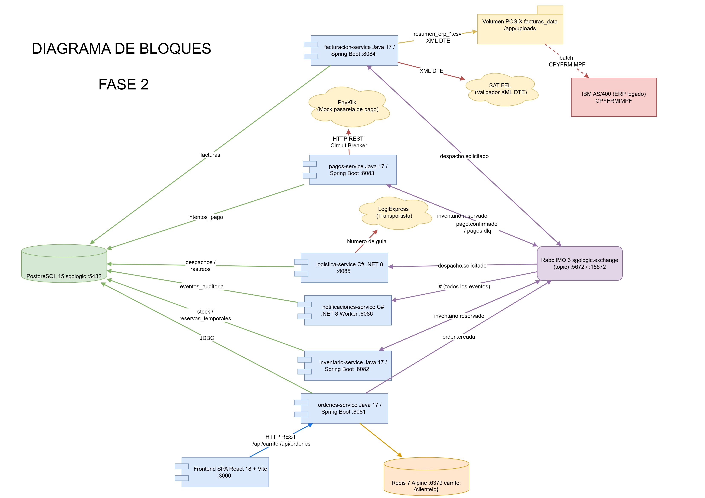
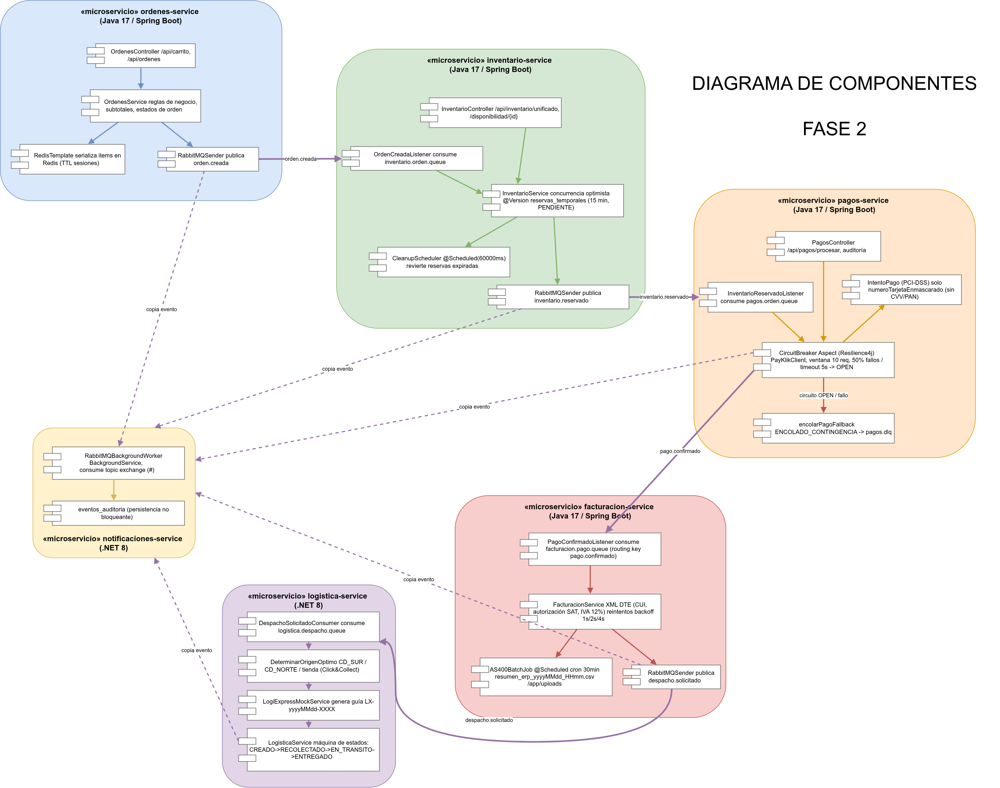
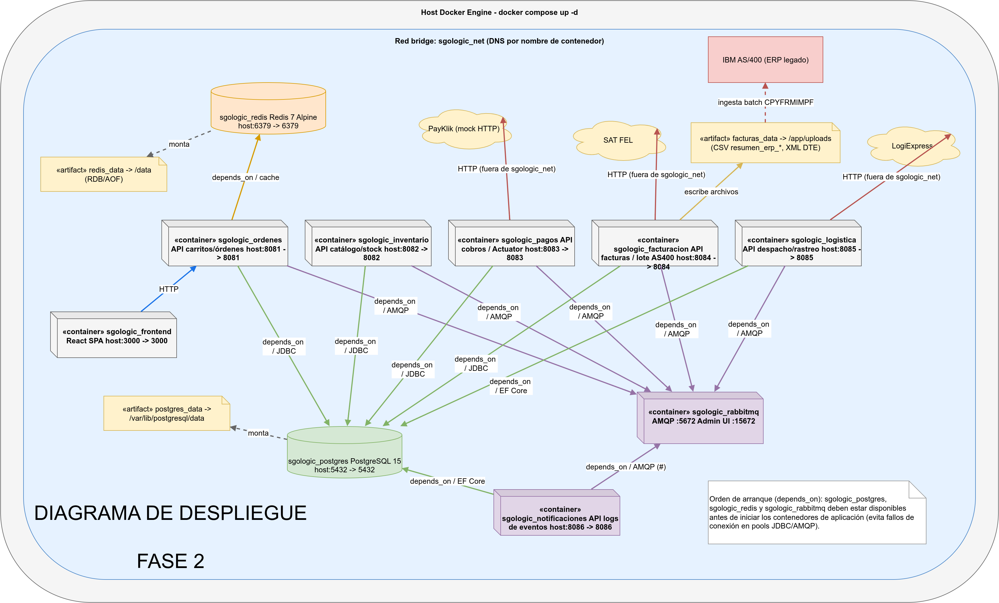

# Actualización de Diagramas de Arquitectura — SGO-Logic Fase 2

**Proyecto:** Sistema de Gestión de Órdenes y Logística Omnicanal (SGO-Logic)  

**Equipo No. 11**  

---

## Propósito y Guía de Interpretación Técnica

Este documento presenta los **3 diagramas de arquitectura esenciales** que reflejan la evolución técnica del sistema SGO-Logic entre la Fase 1 y la Fase 2, en estricto cumplimiento de la rúbrica de evaluación:

## 1. Diagrama de Bloques — Arquitectura Global del Sistema

---

## 2. Diagrama de Componentes — Estructura Interna de Microservicios

---

## 3. Diagrama de Despliegue — Topología Docker Compose

