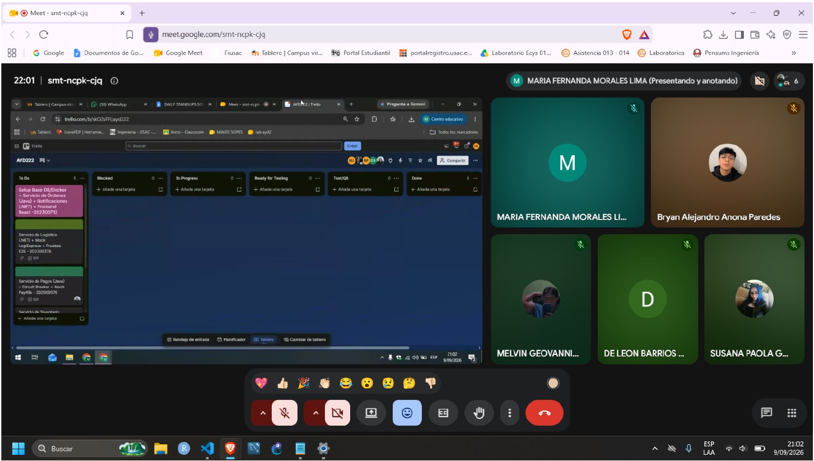
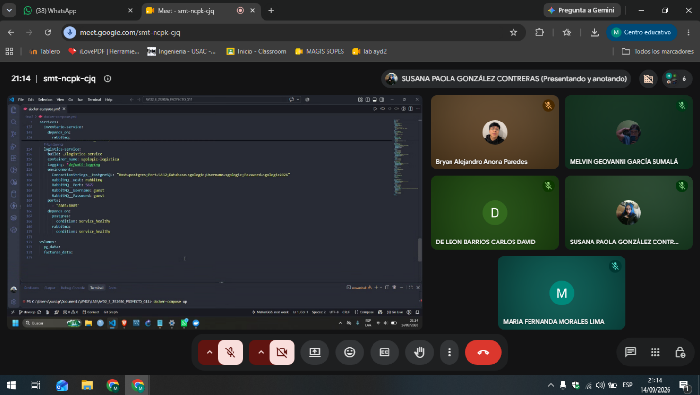
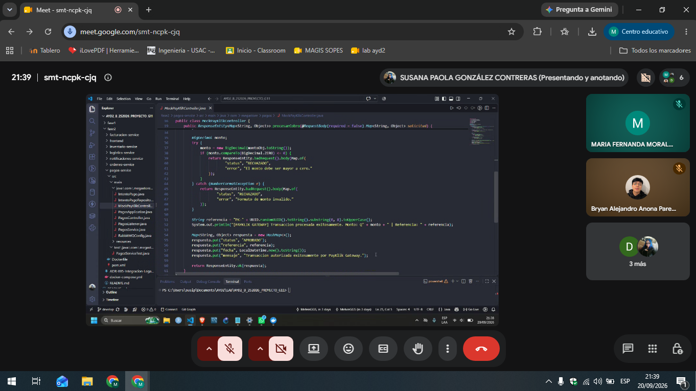
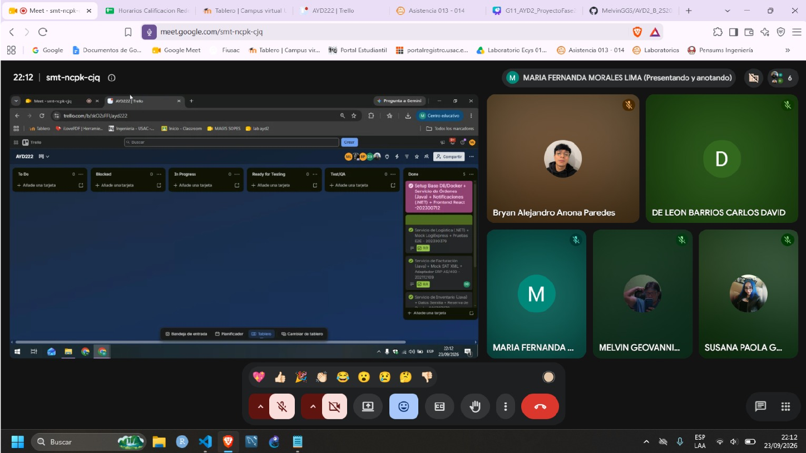

# Daily Standups — SGO-Logic Fase 2

**Proyecto:** Sistema de Gestión de Órdenes y Logística Omnicanal (SGO-Logic)  
  
**Equipo No. 11**  

---

## 1. Equipo de Trabajo y Roles

| Carné | Integrante | Rol en Sprint | Componente Principal Asignado |
| :--- | :--- | :--- | :--- |
| **202300712** | Melvin Geovanni García Sumalá | Scrum Master / Tech Lead | Orquestación Docker, Frontend React, Notificaciones Worker |
| **202000576** | Susana Paola González Contreras | Backend Developer | Microservicio Pagos (Spring Boot, PayKlik, Circuit Breaker, DLQ) |
| **202307272** | Bryan Alejandro Anona Paredes | Backend Developer | Microservicio Inventario (Spring Boot, 32 Tiendas, 2 CDs, Reservas) |
| **202112109** | Carlos David de León Barrios | Backend Developer | Microservicio Facturación (Spring Boot, SAT FEL XML, Batch AS/400) |
| **202300378** | Maria Fernanda Morales Lima | QA Lead / Backend Developer | Microservicio Logística (.NET 8, LogiExpress Mock, Pruebas E2E) |

---

## Daily 1: Miércoles 09/09/2026 — 21:00 PM (Organización y Setup Inicial)
**Objetivo del día:** Estructuración del repositorio, definición del backlog de 50 puntos y acuerdos de arquitectura base.

### Melvin Geovanni García Sumalá (202300712)
* **Componente materializado:** Repositorio base, ramas Gitflow (`develop`, `main`), estructura inicial de carpetas para 6 servicios y tablero Kanban en GitHub Projects.
* **Resultado obtenido:** 6 historias de usuario (H1 a H6) estimadas y asignadas con criterios de aceptación claros.

| Pregunta | Respuesta |
| :--- | :--- |
| **¿Qué hice hoy?** | Facilité la sesión de Sprint Planning, creé el tablero Kanban con 50 puntos en columna *TO DO*, configuré el repositorio Git y definí la plantilla de variables de entorno para los microservicios. |
| **¿Qué haré mañana?** | Configurar el archivo `docker-compose.yml` multi-servicio con PostgreSQL 15, Redis 7 y RabbitMQ 3, verificando la conectividad de red interna. |
| **¿Impedimentos?** | Ninguno. |

### Susana Paola González Contreras (202000576)
* **Componente materializado:** Esqueleto del proyecto Spring Boot para `pagos-service` (Java 17, Maven, dependencias Web, JPA, AMQP y Resilience4j).
* **Resultado obtenido:** Proyecto base compilando en puerto 8083 y definición de contratos para llamadas al mock de PayKlik.

| Pregunta | Respuesta |
| :--- | :--- |
| **¿Qué hice hoy?** | Revisé la documentación de Resilience4j para Circuit Breaker y TimeLimiter; inicialicé el proyecto Maven en el puerto 8083 con las dependencias requeridas. |
| **¿Qué haré mañana?** | Diseñar el schema relacional para la persistencia de cobros (`pagos_outbox` / `intentos_pago`) en PostgreSQL. |
| **¿Impedimentos?** | Ninguno. |

### Bryan Alejandro Anona Paredes (202307272)
* **Componente materializado:** Esqueleto del proyecto Spring Boot para `inventario-service` (Java 17, JPA, PostgreSQL Driver).
* **Resultado obtenido:** Proyecto base compilando en puerto 8082 y diseño del modelo relacional de stock para 32 tiendas físicas y 2 Centros de Distribución.

| Pregunta | Respuesta |
| :--- | :--- |
| **¿Qué hice hoy?** | Analicé los requerimientos de concurrencia y sobreventa; definí el esquema de base de datos con tablas de catálogo, ubicaciones, existencias y reservas temporales. |
| **¿Qué haré mañana?** | Crear la clase `DataInitializer` para precargar las 32 tiendas y 2 CDs, y programar las entidades JPA con bloqueo optimista. |
| **¿Impedimentos?** | Ninguno. |

### Carlos David de León Barrios (202112109)
* **Componente materializado:** Esqueleto del proyecto Spring Boot para `facturacion-service` (Java 17, JPA, Jackson Dataformat XML).
* **Resultado obtenido:** Proyecto base compilando en puerto 8084 y especificación técnica del esquema DTE para certificación SAT FEL.

| Pregunta | Respuesta |
| :--- | :--- |
| **¿Qué hice hoy?** | Estudié las reglas de emisión de Documentos Tributarios Electrónicos (DTE) de la SAT y el contrato de intercambio por lotes para el mainframe IBM AS/400. |
| **¿Qué haré mañana?** | Crear la entidad `Factura` en PostgreSQL y construir la plantilla de generación XML con CUI, serie fiscal y número de autorización. |
| **¿Impedimentos?** | Ninguno. |

### Maria Fernanda Morales Lima (202300378)
* **Componente materializado:** Solución en .NET 8 (C#) para `logistica-service` con controladores Web API y Entity Framework Core.
* **Resultado obtenido:** Proyecto base compilando en puerto 8085 y modelado inicial de la máquina de estados de despacho.

| Pregunta | Respuesta |
| :--- | :--- |
| **¿Qué hice hoy?** | Estructuré el microservicio en .NET 8 definiendo los modelos `Despacho`, `Rastreo` y la enumeración de estados (`CREADO`, `RECOLECTADO`, `EN_TRANSITO`, `ENTREGADO`). |
| **¿Qué haré mañana?** | Configurar el `DbContext` para conectarse a PostgreSQL y codificar el servicio simulador de LogiExpress para generación de número de guía. |
| **¿Impedimentos?** | Ninguno. |

---

## Daily 2: Lunes 14/09/2026 — 21:00 PM (Infraestructura y Persistencia Base)
**Objetivo del día:** Despliegue de contenedores de infraestructura compartida y puesta en marcha de entidades de negocio.

### Melvin Geovanni García Sumalá (202300712)
* **Componente materializado:** Orquestación en `docker-compose.yml` (PostgreSQL 15, Redis 7 Alpine, RabbitMQ 3 Management) y servicio `ordenes-service` conectado al carrito en Redis.
* **Resultado obtenido:** Contenedores de infraestructura levantando en menos de 15 segundos con persistencia de volúmenes Docker (`postgres_data`, `redis_data`, `facturas_data`).

| Pregunta | Respuesta |
| :--- | :--- |
| **¿Qué hice hoy?** | Redacté el archivo `docker-compose.yml` completo, configuré la red `sgologic_net` y conecté el carrito de compras de `ordenes-service` con operaciones TTL en Redis. |
| **¿Qué haré mañana?** | Configurar los Exchanges y Colas en RabbitMQ y desarrollar los componentes visuales iniciales en React (Catálogo y Carrito). |
| **¿Impedimentos?** | Los nombres de host en la red interna de Docker requerían estandarizarse para evitar errores de conexión entre Java y .NET. |

### Susana Paola González Contreras (202000576)
* **Componente materializado:** Controlador `PagosController`, entidad `IntentoPago` y cliente HTTP hacia la pasarela PayKlik.
* **Resultado obtenido:** Endpoint de cobro registrando intentos de pago en base de datos PostgreSQL local en puerto 8083.

| Pregunta | Respuesta |
| :--- | :--- |
| **¿Qué hice hoy?** | Creé las tablas relacionales de cobro, programé la validación de montos mayores a cero y realicé pruebas de cobro exitoso conectando con el simulador de PayKlik. |
| **¿Qué haré mañana?** | Integrar Resilience4j (`@CircuitBreaker`) y programar la lógica de contingencia cuando PayKlik responda con timeout o HTTP 500. |
| **¿Impedimentos?** | Ninguno, la persistencia JPA mapeó correctamente con PostgreSQL. |

### Bryan Alejandro Anona Paredes (202307272)
* **Componente materializado:** Entidades JPA `Stock`, `Reserva`, `Producto` y clase `DataInitializer` con 32 tiendas y 2 Centros de Distribución (CD Norte y CD Sur).
* **Resultado obtenido:** Endpoints `GET /api/inventario/unificado` y `GET /api/inventario/disponibilidad/{id}` respondiendo existencias consolidadas.

| Pregunta | Respuesta |
| :--- | :--- |
| **¿Qué hice hoy?** | Precargué la base de datos con los catálogos de tiendas y centros logísticos e implementé el endpoint de consulta unificada multicanal. |
| **¿Qué haré mañana?** | Desarrollar el endpoint de reserva temporal (`POST /api/inventario/reservar`) con bloqueo optimista (`@Version`) para evitar sobreventa. |
| **¿Impedimentos?** | Corregido problema de tipo en colecciones inmutables en Java 17 durante la precarga. |

### Carlos David de León Barrios (202112109)
* **Componente materializado:** Generador de documentos XML DTE y entidad `Factura` mapeada a la tabla `facturas`.
* **Resultado obtenido:** Emisión de comprobantes fiscales de prueba con cálculo automático de subtotal, IVA (12%) y número de autorización simulado.

| Pregunta | Respuesta |
| :--- | :--- |
| **¿Qué hice hoy?** | Programé la construcción del XML fiscal cumpliendo con los estándares de la SAT e integré la persistencia del registro de factura en PostgreSQL. |
| **¿Qué haré mañana?** | Implementar la política de reintentos con backoff exponencial (1s, 2s, 4s) y el generador de lotes CSV para el mainframe AS/400. |
| **¿Impedimentos?** | Ajuste en los formatos de fecha UTC exigidos por el esquema XML de certificación tributaria. |

### Maria Fernanda Morales Lima (202300378)
* **Componente materializado:** Migraciones de Entity Framework Core, tabla `despachos` y clase `GeneradorGuiasLogiExpress`.
* **Resultado obtenido:** Generación de identificadores de seguimiento únicos bajo el formato `LX-yyyyMMdd-XXXX`.

| Pregunta | Respuesta |
| :--- | :--- |
| **¿Qué hice hoy?** | Conecté el microservicio de logística a PostgreSQL mediante EF Core y programé la asignación de guías de despacho ante solicitudes recibidas. |
| **¿Qué haré mañana?** | Implementar el algoritmo de selección de origen óptimo (`CD_NORTE`, `CD_SUR` o tienda local) según la dirección y modalidad de entrega del cliente. |
| **¿Impedimentos?** | Ninguno. |

---

## Daily 3: Domingo 20/09/2026 — 21:00 PM (Integración Asíncrona y Resiliencia)
**Objetivo del día:** Verificación de flujos desacoplados mediante eventos RabbitMQ, pruebas de Circuit Breaker y liberación de reservas.

### Melvin Geovanni García Sumalá (202300712)
* **Componente materializado:** Frontend React integrado con Axios y Vite en puerto 3000; flujo de checkout publicando en RabbitMQ (`sgologic.exchange`).
* **Resultado obtenido:** Navegación fluida: catálogo de productos → adición al carrito en Redis → generación de orden en PostgreSQL → publicación de evento de pago.

| Pregunta | Respuesta |
| :--- | :--- |
| **¿Qué hice hoy?** | Conecté la interfaz de usuario con los microservicios de backend; realicé la primera prueba de flujo continuo desde la interfaz web hasta la confirmación de la orden. |
| **¿Qué haré mañana?** | Codificar el servicio de fondo `notificaciones-service` en .NET 8 para consumir eventos de RabbitMQ y preparar el panel de métricas operativas. |
| **¿Impedimentos?** | Se requirió unificar los nombres de campos JSON (camelCase vs snake_case) entre las respuestas de los diferentes servicios. |

### Susana Paola González Contreras (202000576)
* **Componente materializado:** Configuración de Resilience4j Circuit Breaker en `PagosService`, método de contingencia `encolarPagoFallback` y envío a `pagos.dlq`.
* **Resultado obtenido:** Ante simulación de caída o latencia > 5s en PayKlik, el circuito se abre y el pago queda en estado `ENCOLADO_CONTINGENCIA` sin arrojar error 500 al cliente.

| Pregunta | Respuesta |
| :--- | :--- |
| **¿Qué hice hoy?** | Sometí el servicio de pagos a desconexión del mock de PayKlik; el Circuit Breaker abrió tras 5 intentos fallidos y enrutó las transacciones a la cola de contingencia. |
| **¿Qué haré mañana?** | Ejecutar pruebas de carga con 50 pagos concurrentes y verificar el cumplimiento PCI-DSS (almacenamiento exclusivo de los últimos 4 dígitos). |
| **¿Impedimentos?** | Calibración de umbrales en `application.yml` (`sliding-window-size: 10`, `failure-rate-threshold: 50%`). |

### Bryan Alejandro Anona Paredes (202307272)
* **Componente materializado:** Tarea programada `@Scheduled(fixedRate = 60000)` en `InventarioService` y campo `@Version` en entidad `Stock`.
* **Resultado obtenido:** Liberación automática de reservas con antigüedad mayor a 15 minutos en estado `PENDIENTE` e incremento inmediato del stock disponible.

| Pregunta | Respuesta |
| :--- | :--- |
| **¿Qué hice hoy?** | Implementé el cron job de expiración de reservas temporales y validé que pedidos no pagados en 15 minutos devuelvan los artículos al inventario vendible. |
| **¿Qué haré mañana?** | Ejecutar pruebas de estrés de reservas concurrentes sobre un mismo SKU para certificar la ausencia total de sobreventa. |
| **¿Impedimentos?** | Ninguno. |

### Carlos David de León Barrios (202112109)
* **Componente materializado:** Tarea programada `@Scheduled(cron = "0 */30 * * * *")` para exportación batch AS/400 y reintentos automáticos SAT FEL.
* **Resultado obtenido:** Generación de archivo estructurado `resumen_erp_yyyyMMdd_HHmm.csv` en la carpeta `/app/uploads` del volumen montado y reintentos ante error transitorio de SAT.

| Pregunta | Respuesta |
| :--- | :--- |
| **¿Qué hice hoy?** | Construí el exportador batch para el mainframe IBM AS/400 (Capa Anticorrupción - ADR-005) y verifiqué la descarga del archivo CSV consolidado de facturas. |
| **¿Qué haré mañana?** | Redactar el documento de decisión de arquitectura `ADR-005` formal y verificar la integridad de las facturas en base de datos. |
| **¿Impedimentos?** | Asegurar permisos de escritura compartidos en el volumen Docker montado `/app/uploads`. |

### Maria Fernanda Morales Lima (202300378)
* **Componente materializado:** Consumidor RabbitMQ `DespachoSolicitadoConsumer` y lógica geográfica de asignación de almacén en `LogisticaService`.
* **Resultado obtenido:** Ante evento de facturación confirmada, el sistema asigna `CD_SUR` para entregas en Costa/Sur, `CD_NORTE` para Metropolitana y tienda física para modalidad Pickup.

| Pregunta | Respuesta |
| :--- | :--- |
| **¿Qué hice hoy?** | Conecté la escucha de eventos desde RabbitMQ; al emitirse una factura se crea automáticamente la orden de despacho y se genera el número de rastreo. |
| **¿Qué haré mañana?** | Validar la matriz de transiciones de estados de despacho y asegurar que consultas de rastreo respondan en sub-segundo. |
| **¿Impedimentos?** | Ninguno. |

---

## Daily 4: Miércoles 23/09/2026 — 22:00 PM (Validación E2E, Cierre y DoD)
**Objetivo del día:** Ejecución de pruebas de extremo a extremo, verificación de métricas de calidad y preparación de la entrega final.

### Melvin Geovanni García Sumalá (202300712)
* **Componente materializado:** Flujo completo E2E, servicio `notificaciones-service` en .NET 8 y dashboard de estado operativo.
* **Resultado obtenido:** Transacción integral (Catálogo → Carrito → Orden → Pago → Factura → Guía → Notificación) completada en 4.8 segundos promedio.

| Pregunta | Respuesta |
| :--- | :--- |
| **¿Qué hice hoy?** | Ejecuté la suite de 10 pruebas E2E multi-contenedor en ambiente limpio de Docker; verifiqué la persistencia de auditoría y notificaciones sin caídas. |
| **¿Qué haré mañana?** | Consolidar la documentación técnica del repositorio, validar el historial de Gitflow y preparar la defensa técnica. |
| **¿Impedimentos?** | Ninguno. Todas las historias asignadas (H1 y H6) quedaron en estado *Done*. |

### Susana Paola González Contreras (202000576)
* **Componente materializado:** Suite de pruebas de carga en pagos y política de cumplimiento PCI-DSS.
* **Resultado obtenido:** 50 cobros concurrentes procesados exitosamente (100% de efectividad) y verificación de cero números completos de tarjeta o CVV en base de datos.

| Pregunta | Respuesta |
| :--- | :--- |
| **¿Qué hice hoy?** | Realicé pruebas de concurrencia simulando alta demanda de cobros; el Circuit Breaker y la cola de contingencia protegieron la continuidad operativa del negocio. |
| **¿Qué haré mañana?** | Revisión de código en rama release y confirmación de métricas de salud en `/actuator/health`. |
| **¿Impedimentos?** | Ninguno. Historia H2 completada satisfactoriamente (10 pts). |

### Bryan Alejandro Anona Paredes (202307272)
* **Componente materializado:** Pruebas de concurrencia multi-nodo de inventario y endpoints de auditoría de existencias.
* **Resultado obtenido:** 500 solicitudes simultáneas de reserva de stock procesadas sin inconsistencias ni sobreventas en ningún almacén.

| Pregunta | Respuesta |
| :--- | :--- |
| **¿Qué hice hoy?** | Sometí el servicio de inventario a prueba de estrés de compras sobre los mismos productos; el bloqueo optimista evitó colisiones de stock al 100%. |
| **¿Qué haré mañana?** | Apoyar en la verificación de scripts de inicialización de datos para la presentación. |
| **¿Impedimentos?** | Ninguno. Historia H3 completada satisfactoriamente (9 pts). |

### Carlos David de León Barrios (202112109)
* **Componente materializado:** Documento formal `ADR-005-Integracion-Legacy-AS400.md` y suite de validación de emisión fiscal SAT.
* **Resultado obtenido:** 50 órdenes facturadas con XML DTE válidos y archivo CSV acumulado de ventas listo para sincronización con el mainframe.

| Pregunta | Respuesta |
| :--- | :--- |
| **¿Qué hice hoy?** | Validé la generación periódica del lote CSV hacia el ERP legado sin abrir puertos directos en el servidor central; documenté formalmente la justificación en el ADR-005. |
| **¿Qué haré mañana?** | Revisar la descarga de comprobantes XML desde la vista de seguimiento del cliente. |
| **¿Impedimentos?** | Ninguno. Historia H4 completada satisfactoriamente (9 pts). |

### Maria Fernanda Morales Lima (202300378)
* **Componente materializado:** Suite de pruebas automatizadas para transiciones de estados de logística y rastreo en tiempo real.
* **Resultado obtenido:** 50 guías emitidas y validadas; transiciones de estado restringidas (`CREADO` → `RECOLECTADO` → `EN_TRANSITO` → `ENTREGADO`) funcionando con latencia < 0.5s.

| Pregunta | Respuesta |
| :--- | :--- |
| **¿Qué hice hoy?** | Validé que ningún paquete pueda pasar a `ENTREGADO` sin haber transitado por `EN_TRANSITO`; el algoritmo de ruteo asignó el centro de distribución óptimo en el 100% de los casos. |
| **¿Qué haré mañana?** | Asegurar la trazabilidad de los estados en la interfaz de usuario. |
| **¿Impedimentos?** | Ninguno. Historia H5 completada satisfactoriamente (6 pts). |

---

## 3. Estado Final del Tablero Kanban al Cierre del Sprint
* **TO DO:** 0 historias (0 pts)
* **IN PROGRESS:** 0 historias (0 pts)
* **READY FOR TESTING / QA:** 0 historias (0 pts)
* **DONE:** **6 historias (50 / 50 pts — 100% de efectividad)**

