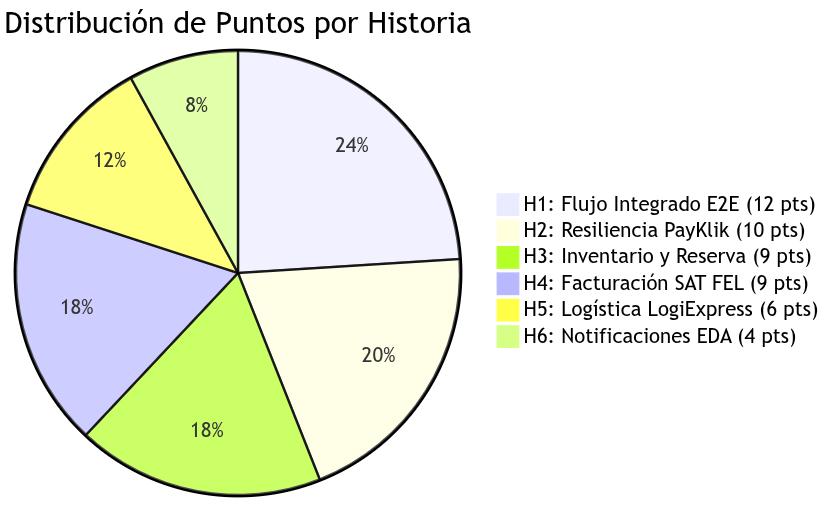
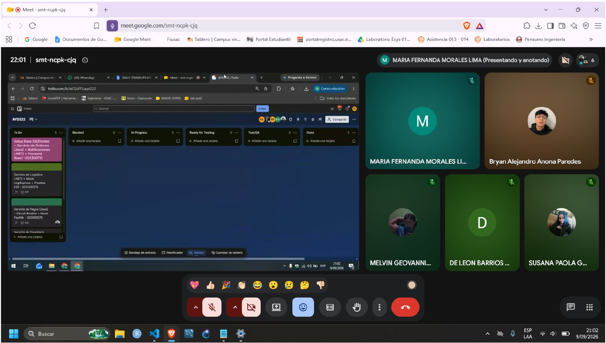

# Sprint Planning — SGO-Logic Fase 2

**Proyecto:** Sistema de Gestión de Órdenes y Logística Omnicanal (SGO-Logic)  

**Fecha de Sprint Planning:** 08/09/2026  

**Duración del Sprint:** 09/09/2026 al 23/09/2026 (15 días) 
 
**Entrega Final:** 23/09/2026  

---

## 1. Equipo y Asignaciones

| Carné | Nombre | Rol | Responsabilidad Principal |
| :--- | :--- | :--- | :--- |
| **202300712** | Melvin Geovanni García Sumalá | Scrum Master / Tech Lead | Arquitectura, Docker Compose, Frontend React y Notificaciones |
| **202300378** | Maria Fernanda Morales Lima | QA / Backend Logística | Microservicio Logística (.NET 8), Mock LogiExpress y Tests E2E |
| **202000576** | Susana Paola González Contreras | Backend Pagos | Microservicio Pagos (Java Spring Boot, PayKlik y Circuit Breaker) |
| **202307272** | Bryan Alejandro Anona Paredes | Backend Inventario | Microservicio Inventario (Java Spring Boot, 32 Tiendas y 2 CDs) |
| **202112109** | Carlos David de León Barrios | Backend Facturación | Microservicio Facturación (SAT FEL XML y Adaptador AS/400) |

---

## 2. Sprint Goal y Solución al Feedback de Fase 1

### ¿Qué se corrigió a partir del Feedback de la Fase 1?
1. **Evitar historias gigantes:** En Fase 1 las tareas eran ambiguas; para este sprint se dividieron en 6 historias atómicas de 4 a 12 puntos (50 puntos en total).
2. **Pruebas de integración tempranas:** Integrar mocks de servicios externos en los primeros 3 días para no encontrar fallos al final.
3. **Cero modificación a sistemas legados:** Se planificó formalmente la Capa Anticorrupción (ACL) para el ERP IBM AS/400 vía lotes batch CSV cada 30 minutos, respetando las restricciones de la empresa.
4. **Prevención de sobreventa:** Se diseñó el bloqueo temporal de reservas de inventario a 15 minutos con bloqueo optimista.

---

## 3. Sprint Backlog (50 Puntos Totales)

### HISTORIA 1: Validación e Integración del Flujo E2E Omnicanal
* **Responsable:** Melvin Geovanni García Sumalá (202300712)
* **Puntos:** 12 pts | **Estado:** Done
* **Descripción:** Conectar todos los microservicios mediante RabbitMQ para que el flujo de compra funcione de punta a punta: Catálogo → Carrito → Orden → Pago → Factura → Despacho.
* **Criterios de Aceptación:** Orden visible en menos de 2s, compra completada sin timeouts, eventos RabbitMQ fluyendo correctamente.

### HISTORIA 2: Resiliencia en PayKlik — Circuit Breaker y Fallback
* **Responsable:** Susana Paola González Contreras (202000576)
* **Puntos:** 10 pts | **Estado:** Done
* **Descripción:** Implementar Circuit Breaker con Resilience4j para desacoplar el cobro ante caídas o latencias mayores a 5 segundos de PayKlik, desviando a cola de contingencia.
* **Criterios de Aceptación:** Circuito abre ante 50% de fallos, fallback encola en `pagos.dlq`, solo se guardan los últimos 4 dígitos de tarjeta (PCI-DSS).

### HISTORIA 3: Inventario Unificado y Bloqueo Temporal de Stock
* **Responsable:** Bryan Alejandro Anona Paredes (202307272)
* **Puntos:** 9 pts | **Estado:** Done
* **Descripción:** Vista unificada de existencias en 32 tiendas físicas y 2 Centros de Distribución. Reserva automática de stock que se libera a los 15 minutos si no se paga.
* **Criterios de Aceptación:** Reserva creada atómicamente, bloqueo optimista `@Version`, liberación periódica sin sobreventa.

### HISTORIA 4: Facturación Electrónica SAT (FEL) y Adaptador ERP AS/400
* **Responsable:** Carlos David de León Barrios (202112109)
* **Puntos:** 9 pts | **Estado:** Done
* **Descripción:** Generación asíncrona de XML DTE (CUI, serie y autorización SAT) con reintentos exponenciales (1s, 2s, 4s). Exportación batch CSV cada 30 minutos para AS/400.
* **Criterios de Aceptación:** XML descargable por orden, reintentos sin congelar el checkout, archivo CSV estructurado generado en volumen Docker.

### HISTORIA 5: Logística y Despacho con LogiExpress
* **Responsable:** Maria Fernanda Morales Lima (202300378)
* **Puntos:** 6 pts | **Estado:** Done
* **Descripción:** Consumir evento de orden facturada, seleccionar origen óptimo de despacho (CD Norte, Sur o Tienda) y generar guía oficial con LogiExpress.
* **Criterios de Aceptación:** Origen óptimo asignado según dirección, guía `LX-yyyyMMdd-XXXX` generada, máquina de estados funcional.

### HISTORIA 6: Servicio de Notificaciones Desacoplado
* **Responsable:** Melvin Geovanni García Sumalá (202300712)
* **Puntos:** 4 pts | **Estado:** Done
* **Descripción:** Worker en .NET 8 que consume eventos del bus para registrar bitácoras de notificación sin afectar la velocidad de la transacción principal.
* **Criterios de Aceptación:** Consumo asíncrono en `notificaciones.queue`, endpoint REST de consulta de logs disponible.

---

## 4. Definición de Hecho (Definition of Done - DoD)
* Código versionado en su rama de feature con formato `#carnet: descripción`.
* Contenedor Docker compilando y levantando de forma limpia en `docker compose up -d`.

---

## 5. Tablero Kanban Inicial (Día 1 - 09/09/2026)

