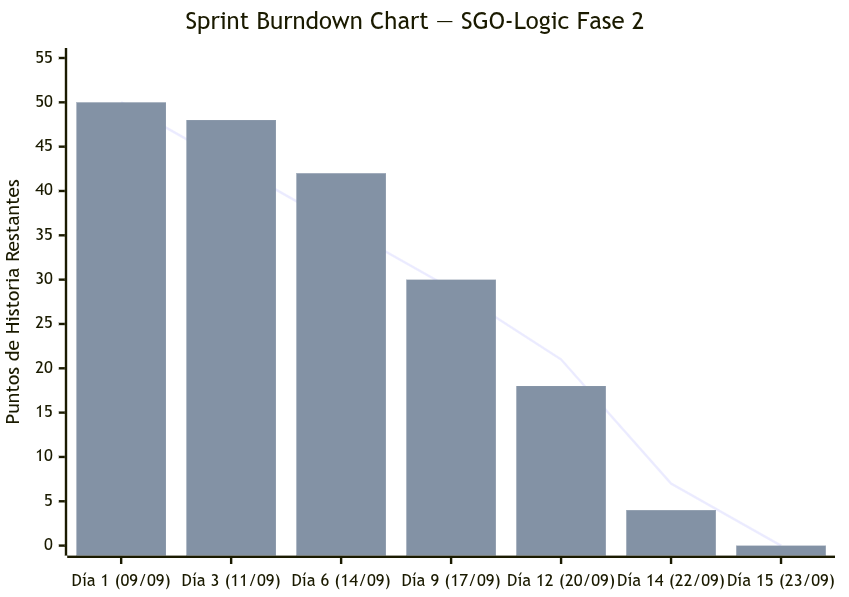
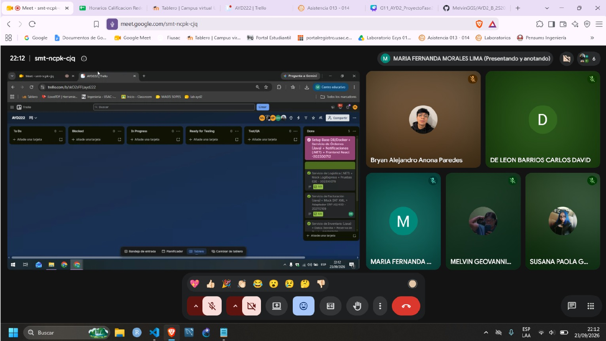

# Sprint Retrospective y Burndown Chart — SGO-Logic Fase 2

**Proyecto:** Sistema de Gestión de Órdenes y Logística Omnicanal (SGO-Logic)  
**Duración del Sprint:** 09/09/2026 al 23/09/2026 (15 días calendario)  
**Equipo No. 11**  

---

## 1. Retrospectiva Individual por Integrante

### Melvin Geovanni García Sumalá
* **Carné:** 202300712
* **Rol:** Scrum Master / Tech Lead
* **Responsabilidad Principal:** Orquestación con Docker Compose, Frontend React y Microservicio de Notificaciones (.NET 8).

| Dimensión | Análisis y Reflexión Técnica |
| :--- | :--- |
| **¿Qué hice bien?** | Logré orquestar con éxito los 6 microservicios y los 3 motores de persistencia e infraestructura (PostgreSQL, Redis y RabbitMQ) en un entorno homogéneo con Docker Compose. Además, integré la interfaz de usuario en React garantizando una experiencia omnicanal fluida que demuestra el flujo de compra y seguimiento en tiempo real de punta a punta. |
| **¿Qué hice mal / Dificultades?** | Al inicio del sprint se produjeron inconsistencias en el formato de los payloads JSON compartidos a través de RabbitMQ entre los servicios desarrollados en Java (Spring Boot) y los desarrollados en C# (.NET 8), requiriendo tiempo adicional para alinear convenciones de nombres (*camelCase* vs *snake_case*). |
| **¿Qué mejorar a futuro?** | Definir y versionar formalmente contratos de esquemas mediante especificaciones OpenAPI y AsyncAPI antes de iniciar la codificación concurrente de los diferentes servicios. |
| **Impacto en el Diseño y Tareas** | Se estableció el bus de eventos unificado con el Exchange de tipo Topic `sgologic.exchange` y routing keys normalizadas, lo que permitió conectar el worker de notificaciones sin acoplarse al pipeline transaccional de órdenes. |

---

### Susana Paola González Contreras
* **Carné:** 202000576
* **Rol:** Backend Developer
* **Responsabilidad Principal:** Microservicio de Pagos (Spring Boot, Integración PayKlik, Circuit Breaker y DLQ).

| Dimensión | Análisis y Reflexión Técnica |
| :--- | :--- |
| **¿Qué hice bien?** | Implementé el patrón Circuit Breaker mediante Resilience4j sobre las llamadas hacia la pasarela PayKlik, aislando al sistema ante caídas o latencias simuladas (> 5s). Además, diseñé la cola de contingencia (`pagos.dlq`) para salvaguardar la intención de pago sin interrumpir el flujo de compra del cliente. |
| **¿Qué hice mal / Dificultades?** | La parametrización inicial de los umbrales de fallo en `application.yml` era demasiado holgada, por lo que el circuito tardaba más de lo deseado en abrirse durante las pruebas de carga tempranas. |
| **¿Qué mejorar a futuro?** | Efectuar pruebas de estrés sintéticas en etapas tempranas para calibrar con precisión empírica los valores de ventana deslizante (`sliding-window-size`) y tasa de fallos (`failure-rate-threshold`). |
| **Impacto en el Diseño y Tareas** | Se protegió la disponibilidad del sistema frente a fallas de terceros y se garantizó el cumplimiento normativo PCI-DSS al persistir únicamente los últimos 4 dígitos del instrumento de pago en la base de datos. |

---

### Bryan Alejandro Anona Paredes
* **Carné:** 202307272
* **Rol:** Backend Developer
* **Responsabilidad Principal:** Microservicio de Inventario (Spring Boot, Gestión Multicanal de 32 Tiendas y 2 CDs, Bloqueo de Stock).

| Dimensión | Análisis y Reflexión Técnica |
| :--- | :--- |
| **¿Qué hice bien?** | Diseñé el modelo de persistencia consolidado para 32 tiendas físicas y 2 Centros de Distribución (CD Norte y CD Sur). Implementé el bloqueo optimista mediante la anotación `@Version` en la entidad `Stock` y un temporizador automático `@Scheduled` que libera reservas no pagadas a los 15 minutos exactos. |
| **¿Qué hice mal / Dificultades?** | En las versiones iniciales, la consulta unificada de existencias calculaba agregados en memoria en la capa de servicio, lo que incrementaba la latencia de respuesta al consultar catálogos voluminosos. |
| **¿Qué mejorar a futuro?** | Aprovechar vistas materializadas o consultas nativas indexadas en PostgreSQL desde el inicio para optimizar los tiempos de consulta a milisegundos. |
| **Impacto en el Diseño y Tareas** | Se erradicó por completo el riesgo de sobreventa (*overbooking*) en escenarios de alta concurrencia omnicanal sin recurrir a bloqueos pesimistas que degraden la base de datos. |

---

### Carlos David de León Barrios
* **Carné:** 202112109
* **Rol:** Backend Developer
* **Responsabilidad Principal:** Microservicio de Facturación (Spring Boot, Emisión SAT FEL XML y Capa Anticorrupción AS/400).

| Dimensión | Análisis y Reflexión Técnica |
| :--- | :--- |
| **¿Qué hice bien?** | Resolví la restricción operativa de negocio de no intervenir ni alterar el mainframe legado IBM AS/400 mediante una Capa Anticorrupción (ACL) documentada en el `ADR-005`, la cual consolida ventas en lotes batch CSV cada 30 minutos. Asimismo, programé la generación asíncrona de comprobantes XML DTE con reintentos exponenciales ante la SAT. |
| **¿Qué hice mal / Dificultades?** | El esquema XML de la SAT cuenta con reglas estrictas de estructura y campos condicionales que requirieron múltiples iteraciones de formateo antes de lograr una validación limpia contra el validador fiscal. |
| **¿Qué mejorar a futuro?** | Incorporar validación sintáctica directa contra esquemas formales XSD durante las pruebas unitarias automáticas de la capa de persistencia. |
| **Impacto en el Diseño y Tareas** | Se garantizó la soberanía e integridad del core contable centralizado sin comprometer la modernización ágil ni el rendimiento de los nuevos microservicios. |

---

### Maria Fernanda Morales Lima
* **Carné:** 202300378
* **Rol:** QA Lead / Backend Developer
* **Responsabilidad Principal:** Microservicio de Logística (.NET 8, Despacho, Algoritmo de Ruteo Óptimo y Simulador LogiExpress).

| Dimensión | Análisis y Reflexión Técnica |
| :--- | :--- |
| **¿Qué hice bien?** | Implementé la máquina de estados finitos que gobierna el ciclo de vida del despacho (`CREADO` → `RECOLECTADO` → `EN_TRANSITO` → `ENTREGADO`) y codifiqué el algoritmo de asignación de almacén de origen óptimo en función de la zona geográfica y la modalidad de entrega. |
| **¿Qué hice mal / Dificultades?** | Durante las primeras pruebas se identificó una brecha de transición que permitía actualizar un paquete directamente a `ENTREGADO` sin haber registrado su estado previo `EN_TRANSITO`, requiriendo un refactor de las reglas de validación. |
| **¿Qué mejorar a futuro?** | Definir tablas de transición de estados formales antes de la codificación y escribir suites de pruebas unitarias parametrizadas para cubrir todas las transiciones inválidas. |
| **Impacto en el Diseño y Tareas** | Se aseguró la trazabilidad auditada de los envíos con números de guía oficiales (`LX-yyyyMMdd-XXXX`) y consultas de seguimiento con latencias inferiores a 0.5 segundos. |

---

## 2. Burndown Chart del Sprint (50 Puntos de Historia)

El gráfico Burndown ilustra la reducción de los **50 Story Points** comprometidos durante los 15 días calendario del sprint (del 09/09/2026 al 23/09/2026). La línea ideal muestra una tasa de quema lineal constante, mientras que las barras representan el avance real medido al cierre de cada jornada de integración.

## 3. Tablero Kanban Final 

Al término del Sprint en la jornada del 23/09/2026, la totalidad de los 50 puntos de historia asignados alcanzaron la columna **DONE**, cumpliendo con la *Definition of Done (DoD)* establecida:

