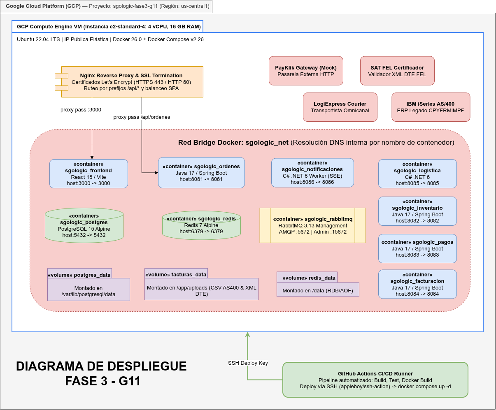
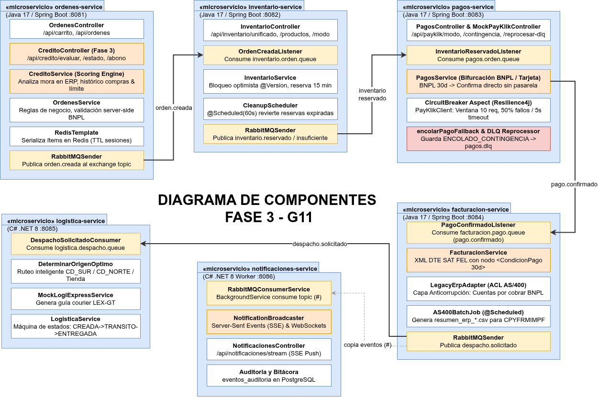
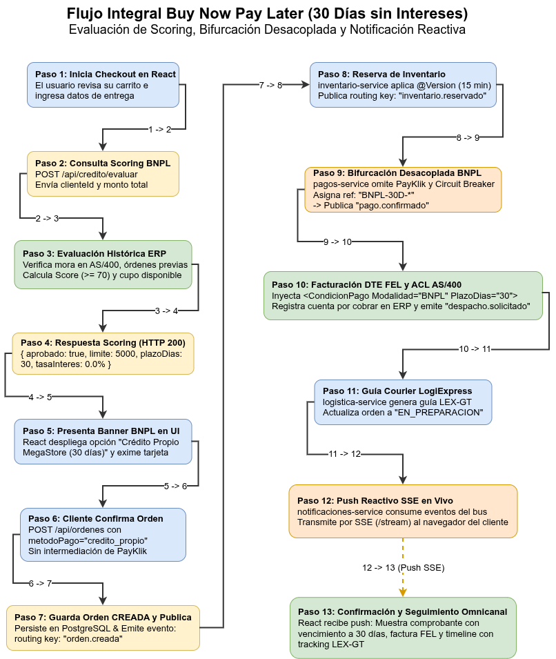
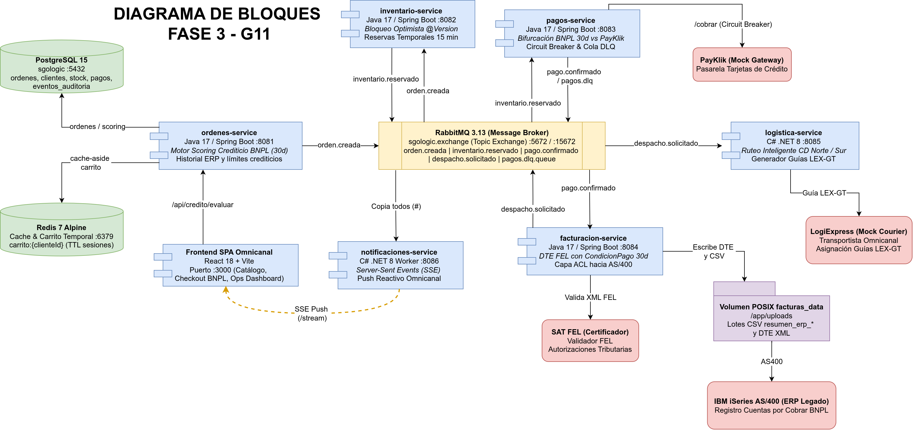

# Actualizacion de Diagramas de Arquitectura — SGO-Logic Fase 3

**Proyecto:** Sistema de Gestión de Órdenes y Logística Omnicanal (SGO-Logic)  

**Equipo No. 11**  

---

## 1. Proposito y Evolucion Arquitectonica

Este documento muestra el progreso de la arquitectura del sistema MegaStore SGO-Logic entre la Fase 2 y la Fase 3. Durante esta fase se incorporo el modelo de financiamiento propio **Buy Now Pay Later (BNPL) 30 dias (0% interes)**, el motor desacoplado de evaluacion de scoring crediticio, la gestion y trazabilidad reactiva via Server-Sent Events (SSE), la persistencia transaccional optimista en inventario distribuido y la infraestructura cloud en Google Cloud Platform (GCP).

---

## 2. Diagrama de Despliegue en GCP (Topologia Cloud)

### Justificacion Tecnica
El sistema opera en Google Cloud Platform (GCP) en la region `us-central1` sobre una instancia Compute Engine `e2-standard-4` (4 vCPUs, 16 GB RAM y 100 GB SSD). Se implementa una red VPC (`megastore-vpc`) con reglas de firewall restringidas a puertos de operacion publica (80 HTTP, 443 HTTPS) y puerto 22 SSH para despliegue automatizado continuo mediante GitHub Actions Runner.

Un contenedor Nginx actua como Reverse Proxy de alto rendimiento y terminador SSL, aislando los microservicios en una subred interna privada de Docker Bridge (`megastore-net`).

---

## 3. Diagrama de Componentes (UML)

### Justificacion Tecnica
Este diagrama describe la descomposicion funcional del sistema en microservicios autonomos orientados a eventos. Destaca la inclusion del `CreditoController` y `CreditoService` en `ordenes-service`, la Capa Anticorrupcion (`LegacyErpAdapter`) hacia el ERP legado IBM AS/400 en `facturacion-service`, y el Hub de difusion reactiva Server-Sent Events (`NotificationBroadcaster`) en `notificaciones-service`.

---

## 4. Diagrama de Secuencia — Flujo Integral BNPL 30 Dias (0% Interes)

### Justificacion Tecnica
Modela la interaccion asincrona completa de la compra diferida bajo la campana Buy Now Pay Later 30 dias mediante una secuencia estructurada de bloques rectangulares y transiciones directas:
1. El cliente inicia Checkout e invoca scoring crediticio.
2. `ordenes-service` evalua historial y confirma aprobacion (Score >= 70, saldo >= total).
3. React presenta la opcion de credito propio eximiendo el ingreso de tarjeta.
4. El cliente confirma orden diferida y el bus RabbitMQ orquesta reserva, cobro diferido, facturacion SAT y guia courier.
5. El cliente recibe actualizacion reactiva en tiempo real via Server-Sent Events (SSE).

---

## 5. Diagrama de Bloques / C4 de Contenedores

### Justificacion Tecnica
Proporciona la vista de nivel 2 del modelo C4, ilustrando los contenedores que conforman el limite del sistema SGO-Logic, sus responsabilidades de almacenamiento y procesamiento, y sus interacciones con sistemas externos heredados y gubernamentales.

---

## 6. Resumen de Decisiones y Criterios de Diseno

1. **Aislamiento de Pagos vs Financiamiento:** La campana BNPL opera bajo un modelo de cuenta corriente interna MegaStore respaldado por el motor de scoring desacoplado, eximiendo al cliente de ingresar datos de tarjeta y reduciendo friccion de conversion.
2. **Resiliencia ante Fallos Externos:** En caso de degradacion en PayKlik, entra en operacion Circuit Breaker (Resilience4j) enrutando transacciones a cola de contingencia `pagos.dlq`.
3. **Integracion no Invasiva con AS/400:** El ERP heredado no recibe peticiones sincronas; la capa ACL exporta lotes consolidados en formato CSV cada 30 minutos sin alterar los procedimientos batch de IBM iSeries.
4. **Despliegue Estandarizado:** La composicion en Docker Compose y Kubernetes permite ejecucion identica en entornos locales y en Google Cloud Platform Compute Engine.
