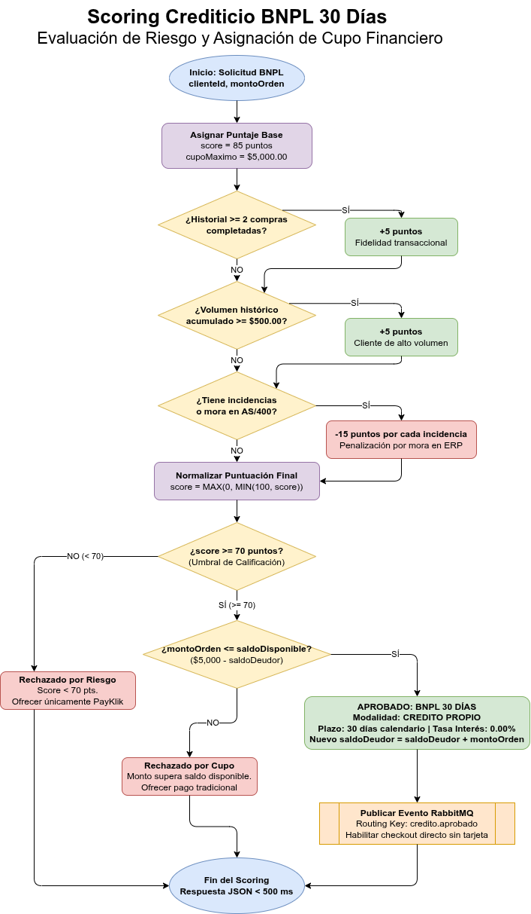
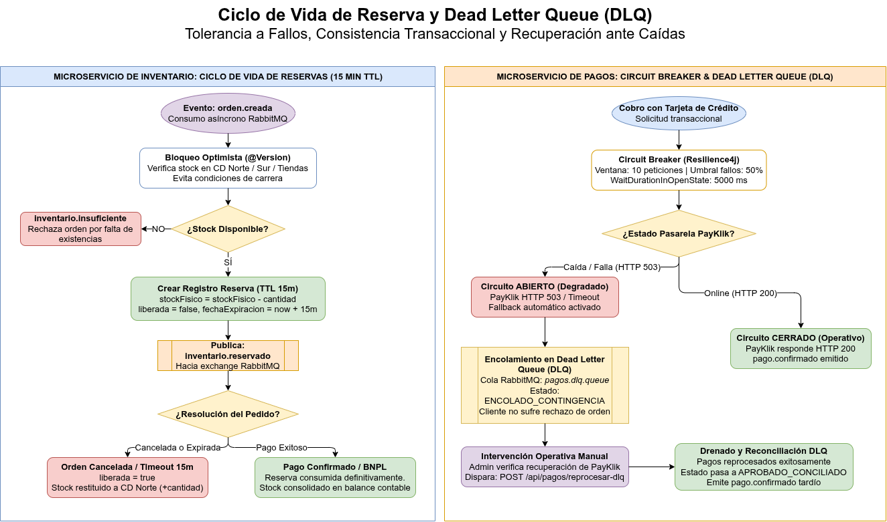

# Manual Tecnico de Arquitectura y Desarrollo — SGO-Logic Fase 3

**Proyecto:** Sistema de Gestión de Órdenes y Logística Omnicanal (SGO-Logic)  

**Equipo No. 11**  

## 1. Informacion General y Responsabilidades del Equipo

El presente documento constituye el Manual Tecnico formal de la **Fase 3** del sistema MegaStore SGO-Logic. En esta fase se implemento la campana de financiamiento propio **Buy Now Pay Later (BNPL) 30 dias con 0% de interes**, el motor desacoplado de evaluacion de riesgo y scoring crediticio, la gestion y trazabilidad reactiva mediante Server-Sent Events (SSE), la persistencia con bloqueo optimista ante alta concurrencia, la Capa Anticorrupcion (ACL) para el ERP legado IBM iSeries AS/400, la facturacion electronica SAT (FEL), la suite integral de 25 pruebas automatizadas y el despliegue de infraestructura cloud en Google Cloud Platform (GCP).

### Integrantes del Equipo y Asignacion de Roles
| Carne | Nombre Completo | Rol Asignado | Componentes Principales y Entregable de Calidad |
| :--- | :--- | :--- | :--- |
| **202300712** | Melvin Geovanni Garcia Sumala | Scrum Master / Tech Lead | Frontend Omnicanal React, Checkout BNPL 30d, 5 Pruebas Unitarias, CI/CD |
| **202112109** | Carlos David de Leon Barrios | Backend Facturacion / Scoring | Motor Scoring de Credito, ACL AS/400, Docs Tecnicos, 5 Pruebas E2E Cypress |
| **202300378** | Maria Fernanda Morales Lima | QA / Backend Logistica | Microservicio Logistica (.NET 8), Mock Courier LogiExpress, 5 Pruebas de Carga |
| **202000576** | Susana Paola Gonzalez Contreras | Backend Pagos | Microservicio Pagos (Spring Boot), Circuit Breaker Resilience4j, 5 Pruebas de Estres |
| **202307272** | Bryan Alejandro Anona Paredes | Backend Inventario | Microservicio Inventario (Spring Boot), Bloqueo Optimista, 5 Pruebas de Integracion |

---

## 2. Contexto, Drivers Arquitectonicos y Escenarios de Calidad

### Nuevos Actores y Drivers de Negocio
- **Gerencia General y Mercadeo:** Origina la campana de fidelizacion comercial "Compra ahora y paga en 30 dias sin intereses" con el fin de incrementar el ticket promedio en un 40% sin alterar los flujos tradicionales existentes.
- **Departamento de Finanzas:** Exige que el otorgamiento de lineas de credito propio se base estrictamente en el comportamiento transaccional del cliente, historial de compras, puntualidad y prevencion de morosidad registrada en el ERP.
- **Cliente Omnicanal:** Visualiza la disponibilidad de credito propio segun su score crediticio y limites vigentes, accediendo al financiamiento sin obligarle a ingresar datos de tarjetas bancarias.
- **ERP Legado IBM AS/400:** Registra las cuentas por cobrar generadas bajo el modelo BNPL sin requerir modificaciones invasivas en su codigo fuente de los anos noventa.
- **Driver de Rendimiento:** La evaluacion crediticia debe responder en menos de 500 ms en el checkout para garantizar una experiencia fluida sin fricciones de compra.
- **Driver de Resiliencia:** Caidas o degradaciones en la pasarela externa PayKlik no deben bloquear las compras; las ordenes se procesan bajo contingencia en colas de reintentos (DLQ).

### Escenarios de Atributos de Calidad
| ID | Atributo | Estimulo | Respuesta Esperada | Medida de Exito |
| :--- | :--- | :--- | :--- | :--- |
| **QA-1** | Rendimiento | Cliente navega hacia la pantalla de Checkout | Evaluacion crediticia ejecutada asincronamente en `ordenes-service` | Latencia inferior a 500 ms |
| **QA-2** | Disponibilidad | La pasarela externa PayKlik queda fuera de servicio (HTTP 503) | El Circuit Breaker conmuta a fallback, encolando el cobro en `pagos.dlq.queue` | Cero transacciones perdidas |
| **QA-3** | Modificabilidad | Se ajustan las reglas de scoring crediticio o umbrales de aprobacion | El cambio se aplica exclusivamente en `CreditoService.java` | Cero impacto en otros servicios |
| **QA-4** | Interoperabilidad | Se confirma una orden bajo la modalidad BNPL | El adaptador ACL genera el archivo CSV conciliado para el comando `CPYFRMIMPF` | Ingesta batch en AS/400 exitosa |
| **QA-5** | Eficiencia de Red | Se actualiza el estado de despacho logistico de una orden | El frontend recibe la notificacion push reactiva mediante SSE | Cero sondeo periodico por HTTP |

---

## 3. Especificacion de Componentes y Microservicios

### 3.1. Frontend Omnicanal (`fase3/frontend/`)
- **Tecnologias:** React 18, Vite 5.4, React Router v7, Tailwind CSS, Lucide Icons.
- **Capacidades Operativas:**
  - Evaluacion asincrona de scoring en Checkout antes de renderizar formas de pago.
  - Seleccion automatica y anteposicion de la campana `credito_propio` cuando el score supera 70 puntos.
  - Exencion total de ingreso de numero de tarjeta, vencimiento y codigo CVV para pedidos BNPL.
  - Control estricto de rutas: acceso a `/carrito`, `/checkout`, `/seguimiento` y `/dashboard` restringido exclusivamente a usuarios autenticados.
  - Panel administrativo Ops Dashboard (`/dashboard`) con monitoreo en tiempo real y panel de deshabilitacion de servicios para pruebas de resiliencia y contingencia.
  - Manejo resiliente ante fallos de backend: transicion suave a modo fuera de linea sin bloqueos de interfaz ni exposicion de errores internos.

### 3.2. Servicio de Ordenes y Scoring (`fase3/ordenes-service/`)
- **Tecnologias:** Java 17, Spring Boot 3.2, Spring Data JPA, Spring AMQP, PostgreSQL.
- **Capacidades Operativas:**
  - Gestion del ciclo de vida de la orden: `CREADA -> EN_PREPARACION -> EN_TRANSITO -> ENTREGADA -> CANCELADA`.
  - Motor de evaluacion crediticia desacoplado en `CreditoService.java` (`POST /api/credito/evaluar`).
  - Validacion en servidor para denegar pedidos BNPL a clientes no aprobados (HTTP 400).
  - Bloqueo estricto de cancelacion para pedidos que ya alcanzaron el estado logistico terminal `ENTREGADA`.

### 3.3. Servicio de Inventario Central (`fase3/inventario-service/`)
- **Tecnologias:** Java 17, Spring Boot 3.2, Spring Data JPA, PostgreSQL.
- **Capacidades Operativas:**
  - Visibilidad unificada de existencias en Centros de Distribucion (CD Norte, CD Sur) y 32 tiendas fisicas.
  - Control de concurrencia optimista con anotacion `@Version` para garantizar consistencia transaccional y evitar sobreventas.
  - Consumo del evento `orden.creada` y publicacion de `inventario.reservado` o `inventario.insuficiente`.
  - Mecanismo de reserva temporal con expiracion automatica de 15 minutos si el pago no se consolida.

### 3.4. Servicio de Pagos y Resiliencia (`fase3/pagos-service/`)
- **Tecnologias:** Java 17, Spring Boot 3.2, Resilience4j, Spring AMQP, PostgreSQL.
- **Capacidades Operativas:**
  - Bifurcacion inteligente de metodos de pago: enruta `CREDITO_PROPIO_30D` directamente a confirmacion sin pasar por pasarela externa.
  - Pasarela PayKlik para pagos con tarjeta tradicional, protegida por Circuit Breaker (umbral 50% fallos en ventana de 10 peticiones).
  - Tolerancia a fallos: encolamiento de cobros no procesados en `pagos.dlq.queue` y reprocesamiento manual/automatico (`POST /api/pagos/reprocesar-dlq`).
  - Cumplimiento PCI-DSS: almacenamiento restringido a ultimos 4 digitos enmascarados y franquicia bancaria.

### 3.5. Servicio de Facturacion SAT y AS/400 (`fase3/facturacion-service/`)
- **Tecnologias:** Java 17, Spring Boot 3.2, Spring Scheduling, PostgreSQL.
- **Capacidades Operativas:**
  - Emision de Facturas Electronicas DTE segun la normativa FEL de SAT Guatemala.
  - Inyeccion del nodo `<CondicionPago Modalidad="CREDITO_PROPIO_30D" PlazoDias="30" TasaInteres="0.00%" FechaVencimiento="..."/>` para ventas financiadas.
  - Capa Anticorrupcion (ACL) para IBM iSeries AS/400: exportacion periodica cada 30 minutos de archivos `resumen_erp_*.csv` con columnas `METODO_PAGO` y `PLAZO_DIAS` para ingesta batch mediante `CPYFRMIMPF`.

### 3.6. Servicio de Logistica (`fase3/logistica-service/`)
- **Tecnologias:** C# .NET 8 Web API, Entity Framework Core, RabbitMQ.Client.
- **Capacidades Operativas:**
  - Consumo del evento `despacho.solicitado` emitido por facturacion.
  - Ruteo optimo basado en cercania de centros logisticos (CD Norte / CD Sur).
  - Asignacion automatica de guias de rastreo omnicanal bajo el patron `LEX-[0-9]{6}-GT`.
  - Autómata finito para control de transiciones logisticas estrictas.

### 3.7. Servicio de Notificaciones Reactivas (`fase3/notificaciones-service/`)
- **Tecnologias:** C# .NET 8, BackgroundService, Server-Sent Events (SSE).
- **Capacidades Operativas:**
  - Transmision unidireccional y reactiva cliente-servidor mediante el endpoint `/api/notificaciones/stream`.
  - Consumo wildcard (`#`) del exchange topic en RabbitMQ para bitacora de auditoria centralizada.
  - Actualizacion automatica del timeline de seguimiento en el frontend en tiempo real.

---

## 4. Motor de Scoring Crediticio (BNPL)

### Ubicacion Arquitectonica
Implementado en `fase3/ordenes-service/src/main/java/com/megastore/ordenes/CreditoService.java` y expuesto a traves de `CreditoController.java`.

### Algoritmo y Reglas de Puntuacion
El modelo evalua el riesgo financiero calculando una ponderacion aditiva y sustractiva acotada entre 0 y 100 puntos:

| Criterio de Evaluacion | Condicion de Negocio | Impacto en Puntuacion |
| :--- | :--- | :--- |
| **Puntaje Base Inicial** | Asignacion predeterminada a todo cliente registrado | 85 puntos |
| **Fidelidad Transaccional** | El cliente cuenta con 2 o mas compras previas completadas | +5 puntos |
| **Volumen de Facturacion** | Monto acumulado historico en compras >= $500.00 USD | +5 puntos |
| **Historial de Morosidad** | Incidencias en auditoria o mora registrada en ERP AS/400 | -15 puntos por cada incidencia |
| **Rango de Normalizacion** | Limite matematico de salida del algoritmo | Acotado entre 0 y 100 puntos |

### Reglas de Aprobacion y Asignacion de Cupo
Una solicitud de financiamiento bajo la campana BNPL es aprobada si y solo si se cumplen simultaneamente dos condiciones:
1. **Umbral de Calificacion:** `score >= 70` puntos.
2. **Capacidad Financiera:** `montoOrden <= saldoDisponible`, donde el cupo maximo autorizado es de **$5,000.00 USD** menos el saldo deudor vigente no liquidado.

### Matriz de Casos de Prueba del Scoring
| Caso | Ordenes Previas | Incidencias ERP | Score Resultante | Resultado Evaluacion |
| :--- | :--- | :--- | :--- | :--- |
| **Cliente Frecuente Sin Incidencias** | 3 ordenes | 0 incidencias | 95 / 100 | Aprobado con cupo total disponible |
| **Cliente Estandar Inicial** | 0 ordenes | 0 incidencias | 85 / 100 | Aprobado con cupo total disponible |
| **Cliente con 1 Incidencia Leve** | 2 ordenes | 1 incidencia | 75 / 100 | Aprobado (supera umbral minimo de 70) |
| **Cliente Riesgo con Mora en ERP** | 0 ordenes | 2 incidencias | 55 / 100 | Rechazado (score inferior a 70) |

### Diagrama de Flujo del Algoritmo de Scoring BNPL



---

## 5. Estrategia de Calidad y Suite de Pruebas Automatizadas

La arquitectura se encuentra respaldada por una suite integral de **25 pruebas automatizadas**, distribuidas en 5 categorias especializadas asignadas equitativamente entre los integrantes del equipo:

---

### 5.1. Pruebas Unitarias del Frontend
- **Responsable:** Melvin Geovanni Garcia Sumala (Carne: **202300712**)
- **Ubicacion:** `fase3/frontend/test/checkout.test.js`
- **Componentes Validados:** Funciones puras de logica financiera y checkout en `fase3/frontend/src/utils/checkoutUtils.js`:
  1. `validarElegibilidadCredito`: evaluacion de fronteras para score crediticio (70 exacto, menores y mayores) y limites de saldo disponible.
  2. `calcularVencimientoCredito`: calculo exacto del plazo de 30 dias contemplando cambios de mes, anos bisiestos y transiciones anuales.
  3. `formatearDetalleBNPL`: desglose de orden con recargo de interes al 0.00% y formateo de moneda con precision de dos decimales.
  4. `filtrarMetodosPagoDisponibles` y `esMetodoCreditoPropio`: clasificacion estricta entre pasarela bancaria tradicional y linea de credito propio.
  5. `validarFormularioCheckout`: exencion de validacion de campos de tarjeta de credito cuando el cliente selecciona financiamiento propio.

#### Comando de Ejecucion:
```bash
cd fase3/frontend && npm test
```

---

### 5.2. Pruebas de Integracion de Microservicios
- **Responsable:** Bryan Alejandro Anona Paredes (Carne: **202307272**)
- **Ubicacion:** `fase3/logistica-service.Tests/LogisticaIntegrationTests.cs`
- **Componentes Validados:** Integracion entre la capa Web API de Logistica, Entity Framework Core y persistencia relacional en memoria:
  1. `CrearDespacho_ConCreditoPropio_PersisteMetodoPagoYRastreoInicial`: despacho confirmado bajo credito propio persiste metodo y genera tracking inicial.
  2. `CrearDespacho_SinMetodoPago_AsumePayKlikPorDefecto`: compatibilidad hacia atras, asignando PayKlik como pasarela predeterminada si no se envia parametro.
  3. `SeleccionDeOrigen_EsLaMismaParaPayKlikYCreditoPropio`: determinacion de centro de distribucion optimo (CD Norte, CD Sur, Tienda) invariable ante la forma de pago.
  4. `OrdenACredito_RecorreMaquinaDeEstadosCompletaHastaEntregado`: flujo integral a traves del automata de estados (`PENDIENTE -> PREPARADO -> EN_TRANSITO -> ENTREGADO`).
  5. `TransicionesInvalidas_RetornanBadRequestYNoAlteranElDespacho`: rechazo con HTTP 400 Bad Request ante saltos ilegales de estado o intentos de retroceso desde estados terminales.

#### Comando de Ejecucion:
```bash
docker run --rm -v $(pwd)/fase3:/fase3 -w /fase3 mcr.microsoft.com/dotnet/sdk:8.0 dotnet test logistica-service.Tests/logistica-service.Tests.csproj
```

---

### 5.3. Pruebas End-to-End (E2E)
- **Responsable:** Carlos David de Leon Barrios (Carne: **202112109**)
- **Ubicacion:** `fase3/frontend/cypress/e2e/`
- **Flujos Validados:** Recorridos completos de usuario interactuando sobre el DOM del navegador web:
  1. `01_autenticacion_y_sesion.cy.js`: inicio de sesion de cliente, almacenamiento seguro en LocalStorage, cierre de sesion y proteccion de rutas privadas.
  2. `02_catalogo_carrito_multiproducto.cy.js`: exploracion de productos, filtrado reactivo por categoria, acumulacion en carrito y actualizacion de subtotales.
  3. `03_checkout_tradicional_payklik.cy.js`: finalizacion de compra con pasarela PayKlik, validacion de campos de tarjeta y emision de comprobante.
  4. `04_checkout_credito_propio_bnpl.cy.js`: evaluacion en tiempo real del scoring BNPL, despliegue del banner informativo de 30 dias y confirmacion sin tarjeta.
  5. `05_admin_dashboard_y_gestion_estados.cy.js`: panel de control operativo, transicion de estados logisticos, devolucion automatica de existencias en inventario ante cancelacion y control del panel de resiliencia.

#### Comandos de Ejecucion:
```bash
cd fase3/frontend && npm run test:e2e:open
```

---

### 5.4. Pruebas de Estres con k6
- **Responsable:** Susana Paola Gonzalez Contreras (Carne: **202000576**)
- **Ubicacion:** `fase3/pruebas-estres/`
- **Escenarios Validados:** Comportamiento y estabilidad de los microservicios bajo condiciones extremas de demanda:
  1. `prueba1_concurrencia_inventario_stock.js`: 120 usuarios virtuales (VUs) concurrentes compitiendo por la misma unidad de stock, verificando la consistencia transaccional del bloqueo optimista `@Version`.
  2. `prueba2_scoring_credito_bnpl.js`: 250 VUs pico sometiendo el motor de evaluacion crediticia, garantizando el cumplimiento del umbral critico de latencia (`p(95) < 500 ms`).
  3. `prueba3_notificaciones_reactivas_stream.js`: 200 conexiones simultaneas de streaming Server-Sent Events sobre el servidor Kestrel de .NET 8 sin agotamiento de descriptores de sockets.
  4. `prueba4_resiliencia_payklik_circuit_breaker.js`: 200 VUs saturando la pasarela PayKlik para verificar la apertura automatica del Circuit Breaker y enrutamiento a la cola `pagos.dlq`.
  5. `prueba5_flujo_integral_omnicanal.js`: 200 VUs ejecutando el ciclo de compra completo (catalogo, scoring, creacion de orden y recepcion de evento push).

#### Comando de Ejecucion:
```bash
docker run --rm -i --network host grafana/k6 run - < fase3/pruebas-estres/suite_estres_k6.js
```

---

### 5.5. Pruebas de Carga con k6
- **Responsable:** Maria Fernanda Morales Lima (Carne: **202300378**)
- **Ubicacion:** `fase3/pruebas-estres/load_test_pagos.js`
- **Escenarios Validados:** Evaluacion del ciclo de vida de rendimiento sobre el endpoint transaccional `/api/pagos/procesar`:
  1. `smoke_test`: verificacion de sanidad minima con 1 a 3 VUs durante 60 segundos para validar conectividad y contratos.
  2. `load_test`: carga nominal esperada con rampa hasta 50 VUs sostenidas durante 5 minutos para validar rendimiento en operacion ordinaria.
  3. `stress_test`: sobrecarga gradual hasta 150 VUs para identificar degradaciones suaves en tiempos de respuesta.
  4. `spike_test`: pico subito de trafico (de 0 a 200 VUs en 10 segundos), verificando absorcion y recuperacion elastica.
  5. `breakpoint_test`: incremento progresivo continuo hasta 300 VUs sin descenso para determinar el limite maximo de saturacion del servicio.

#### Comando de Ejecucion:
```bash
docker run --rm -i --network host grafana/k6 run - < fase3/pruebas-estres/load_test_pagos.js
```

---

## 6. Despliegue en Google Cloud Platform (GCP) y Pipeline CI/CD

### Topologia de Infraestructura Cloud
- **Proveedor:** Google Cloud Platform (GCP).
- **Region:** `us-central1`.
- **Instancia:** Compute Engine `e2-standard-4` (4 vCPUs, 16 GB memoria RAM, 50 GB disco SSD persistente).
- **Sistema Operativo:** Ubuntu 22.04 LTS optimizado con Docker Engine 26 y Docker Compose v2.
- **Acceso y Seguridad:** Red VPC dedicada con reglas de Cloud Firewall restringidas a puertos publicos HTTP (80) y HTTPS (443), y puerto SSH (22) restringido para automatizacion continua.
- **Proxy Inverso:** Contenedor Nginx configurado como terminador SSL de alto rendimiento, balanceando el trafico entrante hacia el frontend SPA y los microservicios aislados en la red interna de Docker (`megastore-net`).

### Pipeline de Entrega Continua (GitHub Actions)
La definicion del pipeline automatizado se encuentra en `.github/workflows/ci-cd.yml`, estructurada en tres etapas obligatorias conforme al enunciado:

1. **Etapa 1: Build (Compilacion y Empaquetado)**
   - Compilacion y empaquetado del bundle optimizado de la SPA en React con Vite.
   - Compilacion de los 4 microservicios Java 17 Spring Boot mediante Maven.
   - Compilacion de los 2 microservicios C# .NET 8 mediante Dotnet SDK.

2. **Etapa 2: Test (Compuerta de Calidad Automatizada)**
   - Ejecucion obligatoria de las 5 pruebas unitarias financieras del frontend (`npm test`).
   - Ejecucion de pruebas de resiliencia y pagos en Spring Boot (`mvn test`).
   - Ejecucion de pruebas de bloqueo optimista en inventario (`mvn test`).
   - Ejecucion de las 5 pruebas de integracion de logistica en .NET 8 (`dotnet test`).
   - *Regla estricta:* Si cualquiera de las suites falla, el pipeline aborta de inmediato impidiendo el paso a produccion.

3. **Etapa 3: Deploy (Despliegue Continuo a GCP)**
   - Activado exclusivamente en ramas protegidas (`develop`, `main`) y tags de release (`v*`).
   - Establece conexion autenticada via SSH hacia la maquina virtual en Compute Engine mediante secretos de repositorio (`SSH_HOST`, `SSH_USER`, `SSH_PRIVATE_KEY`).
   - Sincroniza el codigo fuente y ejecuta `docker compose up -d --build` para desplegar la arquitectura completa sin tiempo de inactividad perceptivo.

---

## 7. Arquitectura de Resiliencia: Ciclo de Vida de Reserva y Dead Letter Queue (DLQ)

Para salvaguardar la consistencia de inventario y la continuidad del negocio ante fallos de proveedores externos, el sistema implementa dos mecanismos desacoplados de resiliencia:

1. **Bloqueo Optimista y Reservas Temporales de 15 Minutos:**  
   Al emitirse `orden.creada`, el servicio de inventario bloquea temporalmente el stock fisico utilizando control de concurrencia optimista (`@Version`). La reserva retiene las existencias con `liberada = false` durante una ventana maxima de 15 minutos. Si el pago se confirma, la reserva se consolida definitivamente. Si la orden es cancelada o expira el tiempo prudencial, el stock se retorna inmediatamente al almacen fisico marcando `liberada = true`.

2. **Circuit Breaker y Dead Letter Queue (DLQ) en Pagos:**  
   Las transacciones con tarjeta bancaria se canalizan a la pasarela PayKlik bajo la proteccion de Resilience4j. Si la pasarela experimenta degradacion o caida (HTTP 503), el Circuit Breaker abre el circuito y activa el fallback automatico, derivando el mensaje hacia la cola de contingencia `pagos.dlq.queue` en RabbitMQ y persistiendo el registro en estado `ENCOLADO_CONTINGENCIA`. La orden de compra del cliente nunca es rechazada; una vez restablecido el servicio externo, el operador administrativo puede drenar y reprocesar manualmente los cobros retenidos.



---

## 8. Enlaces Directos de Diagnostico

A continuacion se detallan los enlaces directos de observabilidad disponibles para verificar en tiempo real el comportamiento, consistencia y tolerancia a fallos del sistema desde cualquier navegador web sin configuraciones adicionales:

| Componente / Servicio | Enlace Directo | Que Inspecciona y Valida |
| :--- | :--- | :--- |
| **Inventario — Reservas** | [http://localhost:8082/api/inventario/reservas](http://localhost:8082/api/inventario/reservas) | Muestra las reservas de existencias en tiempo real, unidades retenidas, fecha de expiracion (TTL 15 min) y bandera de liberacion (`liberada: true/false`). |
| **Inventario — Stock Unificado** | [http://localhost:8082/api/inventario/unificado](http://localhost:8082/api/inventario/unificado) | Desglose unificado de existencias por producto en CD Norte, CD Sur y tiendas fisicas con estado de stock (`Optimo`, `Bajo`, `Critico`). |
| **Pagos — Contingencia (DLQ)** | [http://localhost:8083/api/pagos/contingencia](http://localhost:8083/api/pagos/contingencia) | Muestra los pagos retenidos en cola cuando la pasarela PayKlik se encuentra deshabilitada o en simulacion de caida (`ENCOLADO_CONTINGENCIA`). |
| **Facturacion — Conciliacion AS/400** | [http://localhost:8084/api/facturas/as400/ultimo-csv](http://localhost:8084/api/facturas/as400/ultimo-csv) | Descarga el archivo CSV generado para el comando batch `CPYFRMIMPF` del ERP AS/400, identificando las cuentas por cobrar a 30 dias plazo. |
| **Ordenes — Listado General** | [http://localhost:8081/api/ordenes](http://localhost:8081/api/ordenes) | Listado integral de todas las ordenes emitidas, cliente, articulos, metodo de pago y estado logistico. |
| **Scoring — Evaluacion Crediticia** | [http://localhost:8081/api/credito/estado/1](http://localhost:8081/api/credito/estado/1) | Diagnostico crediticio del cliente en frio: score obtenido (0-100), estatus de aprobacion, cupo asignado ($5,000) y saldo disponible. |
| **Auditoria — Bitacora de Incidencias** | [http://localhost:8081/api/ordenes/incidencias](http://localhost:8081/api/ordenes/incidencias) | Bitacora centralizada de eventos criticos del sistema: cancelaciones de pedidos, degradaciones de servicios y activacion de contingencias. |
| **Notificaciones — Bitacora Push** | [http://localhost:8086/api/notificaciones/logs](http://localhost:8086/api/notificaciones/logs) | Historial de los ultimos eventos push emitidos de forma reactiva a traves del canal Server-Sent Events (SSE) hacia los navegadores clientes. |
