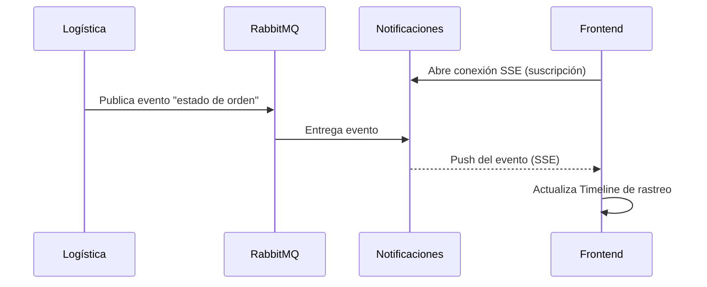
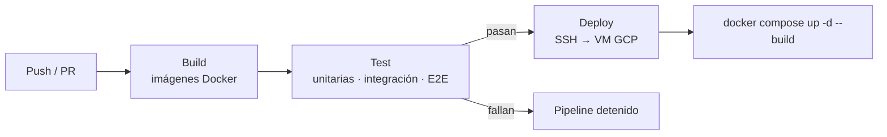

# Manual Técnico y de Arquitectura — SGO-Logic (Fase 3)

**Curso:** Análisis y Diseño de Sistemas 2 — Facultad de Ingeniería, USAC
**Proyecto:** Sistema de Gestión de Órdenes y Logística Omnicanal (SGO-Logic)
**Fase:** 3 — Crédito propio BNPL, notificaciones reactivas, pruebas y CI/CD

---

## Tabla de contenido

- [Manual Técnico y de Arquitectura — SGO-Logic (Fase 3)](#manual-técnico-y-de-arquitectura--sgo-logic-fase-3)
  - [Tabla de contenido](#tabla-de-contenido)
  - [1. Contexto y alcance](#1-contexto-y-alcance)
    - [Nuevos actores y drivers identificados](#nuevos-actores-y-drivers-identificados)
    - [Escenarios de calidad](#escenarios-de-calidad)
  - [2. Arquitectura y nuevo estilo reactivo](#2-arquitectura-y-nuevo-estilo-reactivo)
    - [Problema anterior](#problema-anterior)
    - [Solución reactiva](#solución-reactiva)
    - [Comparativa polling vs. push](#comparativa-polling-vs-push)
  - [3. Motor de scoring de crédito (BNPL)](#3-motor-de-scoring-de-crédito-bnpl)
    - [Ubicación arquitectónica](#ubicación-arquitectónica)
    - [Algoritmo](#algoritmo)
    - [Regla de decisión](#regla-de-decisión)
    - [Ejemplos](#ejemplos)
    - [Rendimiento](#rendimiento)
  - [4. Anti-Corruption Layer (ACL) hacia AS/400](#4-anti-corruption-layer-acl-hacia-as400)
    - [Implementación](#implementación)
    - [Ejemplo de filas](#ejemplo-de-filas)
  - [5. Endpoints añadidos](#5-endpoints-añadidos)
    - [`POST /api/credito/evaluar`](#post-apicreditoevaluar)
  - [6. Estrategia de pruebas](#6-estrategia-de-pruebas)
    - [6.1 Pruebas E2E con Cypress](#61-pruebas-e2e-con-cypress)
      - [Uso de mocks (`cy.intercept`)](#uso-de-mocks-cyintercept)
      - [Ejecución local](#ejecución-local)
  - [7. CI/CD y despliegue en GCP](#7-cicd-y-despliegue-en-gcp)
    - [Etapas del pipeline](#etapas-del-pipeline)
    - [Secretos de GitHub](#secretos-de-github)
    - [Verificación posterior al deploy](#verificación-posterior-al-deploy)
  - [8. Control de versiones (git-flow)](#8-control-de-versiones-git-flow)
  - [9. Decisiones arquitectónicas y trade-offs](#9-decisiones-arquitectónicas-y-trade-offs)

---

## 1. Contexto y alcance

Con el MVP de SGO-Logic operando, la Gerencia General solicitó lanzar la campaña de crédito propio **"Compra ahora, paga en 30 días"** sin detener lo ya existente. Esto implica que, en el checkout, el sistema debe decidir primero **cómo** podrá pagar el cliente:

- Si el cliente es elegible, se le muestra **crédito propio** como alternativa junto a **PayKlik**.
- Si no es elegible, la opción de crédito simplemente no aparece.
- En ambos casos la orden termina **confirmada o rechazada**, con el cliente notificado, y ninguna ruta bloquea a la otra.

Este documento describe las extensiones realizadas sobre la arquitectura de las Fases 1 y 2 (no un módulo aislado):

| Área                  | Cambio                                                     | Servicio afectado                     |
| --------------------- | ---------------------------------------------------------- | ------------------------------------- |
| Evaluación de crédito | Motor de scoring con respuesta `< 500 ms`                  | `ordenes-service`                     |
| Integración legacy    | Nuevas columnas en el CSV batch hacia AS/400               | `facturacion-service`                 |
| Notificaciones        | Estilo reactivo (push) en lugar de polling                 | Servicio de Notificaciones / Frontend |
| Calidad               | Suite E2E con Cypress (5 pruebas)                          | `frontend`                            |
| Entrega               | Pipeline Build → Test → Deploy en GitHub Actions hacia GCP | Repositorio / infraestructura         |

### Nuevos actores y drivers identificados

| Actor / Driver                     | Descripción                                                                           |
| ---------------------------------- | ------------------------------------------------------------------------------------- |
| **Gerencia de Marketing**          | Origina la campaña; requiere adaptación rápida del sistema.                           |
| **Finanzas**                       | Exige que el crédito se otorgue con criterio basado en comportamiento real de compra. |
| **Cliente elegible / no elegible** | Ve u oculta la opción de crédito según su score.                                      |
| **ERP AS/400 (legacy)**            | Debe registrar las Cuentas por Cobrar (CXC) sin modificar su código.                  |
| **Driver de rendimiento**          | La decisión de crédito no puede congelar el checkout (`< 500 ms`).                    |
| **Driver de modificabilidad**      | La nueva regla debe incorporarse sin comprometer lo construido en Fases 1 y 2.        |
| **Driver de interoperabilidad**    | Convivencia con un ERP de los años 90 mediante intercambio por archivos.              |

### Escenarios de calidad

| ID   | Atributo                     | Estímulo                                | Respuesta esperada                                 | Medida                         |
| ---- | ---------------------------- | --------------------------------------- | -------------------------------------------------- | ------------------------------ |
| QA-1 | Rendimiento                  | El cliente llega al checkout            | Se evalúa elegibilidad de crédito                  | `< 500 ms`                     |
| QA-2 | Disponibilidad / aislamiento | Falla el flujo de crédito               | El pago tradicional (PayKlik) sigue operando       | Sin impacto en la ruta alterna |
| QA-3 | Modificabilidad              | Cambian las reglas del score            | Se ajusta la regla en un solo punto                | Sin cambios en otros servicios |
| QA-4 | Interoperabilidad            | Orden pagada con crédito propio         | El CSV hacia AS/400 incluye método de pago y plazo | CXC registrada automáticamente |
| QA-5 | Eficiencia de red            | Cambia el estado logístico de una orden | El cliente ve el cambio sin consultar al servidor  | Cero polling periódico         |

---

## 2. Arquitectura y nuevo estilo reactivo

El sistema mantiene su base **SOA modular impulsada por eventos (EDA)**, con **RabbitMQ** para desacoplar transacciones. Para cumplir el requisito de notificaciones eficientes en tiempo real se incorporó un **estilo arquitectónico reactivo (push)**, que convive con la arquitectura anterior.

### Problema anterior

El frontend hacía _polling HTTP_ constante (una consulta cada 5 segundos) para conocer el estado de la orden. Esto generaba:

- Tráfico innecesario cuando el estado no cambiaba.
- Carga creciente en el backend proporcional al número de clientes conectados.
- Latencia de hasta 5 segundos en percibir un cambio.

### Solución reactiva

Se implementó **Server-Sent Events (SSE)** en el servicio de Notificaciones. _(Si finalmente se usó WebSockets, reemplazar este texto y la tabla de abajo por la tecnología realmente implementada; el manual debe describir una sola.)_

Flujo:

1. Logística cambia el estado de una orden y publica un evento en **RabbitMQ**.
2. El servicio de Notificaciones consume el evento.
3. El servidor **empuja** el evento unidireccionalmente a los clientes suscritos.
4. El frontend actualiza el _Timeline_ de rastreo al instante.



### Comparativa polling vs. push

| Criterio                  | Polling (antes)             | Reactivo / Push (ahora)            |
| ------------------------- | --------------------------- | ---------------------------------- |
| Peticiones al backend     | 1 cada 5 s por cliente      | 1 conexión persistente por cliente |
| Latencia de actualización | Hasta 5 s                   | Inmediata                          |
| Consumo de red            | Alto (respuestas repetidas) | Solo cuando hay cambios            |
| Complejidad               | Baja                        | Media (gestión de conexiones)      |

---

## 3. Motor de scoring de crédito (BNPL)

Motor de evaluación crediticia con tiempo de respuesta objetivo **`< 500 ms`**.

### Ubicación arquitectónica

Vive dentro de `ordenes-service` (clase `CreditoController`). Se eligió ahí porque tiene acceso directo a la base transaccional y al historial de compras del cliente (`OrdenRepository`), evitando llamadas de red adicionales que comprometerían el tiempo de respuesta.

### Algoritmo

| Regla                                      | Efecto en el score                |
| ------------------------------------------ | --------------------------------- |
| Puntaje base                               | **85** puntos                     |
| Historial recurrente (≥ 2 órdenes previas) | **+5** puntos                     |
| Incidencias o disputas previas             | **−15 × cantidad de incidencias** |

```
score = 85
      + (ordenesPrevias >= 2 ? 5 : 0)
      - (15 * incidencias)
```

### Regla de decisión

El crédito se aprueba únicamente si se cumplen **ambas** condiciones:

1. `score >= 70`
2. `montoOrden <= saldoDisponible` (con un límite de crédito de **Q5,000 GTQ**)

### Ejemplos

| Caso                                 | Órdenes previas | Incidencias | Score | Monto                 | Resultado                         |
| ------------------------------------ | --------------- | ----------- | ----- | --------------------- | --------------------------------- |
| Cliente recurrente sin incidencias   | 3               | 0           | 90    | Q1,500                | ✅ Aprobado                       |
| Cliente nuevo sin incidencias        | 0               | 0           | 85    | Q1,500                | ✅ Aprobado                       |
| Cliente con una incidencia           | 3               | 1           | 75    | Q1,500                | ✅ Aprobado                       |
| Cliente con dos incidencias          | 3               | 2           | 60    | Q1,500                | ❌ Rechazado (score < 70)         |
| Score válido pero monto excede saldo | 3               | 0           | 90    | Q4,000 (saldo Q3,500) | ❌ Rechazado (saldo insuficiente) |

> **Nota:** una sola incidencia no rechaza al cliente (85 − 15 = 70 cumple `>= 70`). Con dos incidencias el score cae por debajo del umbral.

### Rendimiento

La evaluación consiste en lecturas de historial y aritmética simple, sin dependencias externas, lo que permite cumplir `< 500 ms`. Si el motor falla o excede el tiempo, el checkout **no debe bloquearse**: simplemente no se ofrece crédito y el cliente continúa con PayKlik (escenario QA-2).

---

## 4. Anti-Corruption Layer (ACL) hacia AS/400

Para proteger la integridad del ERP legacy (AS/400) sin modificar su código, se amplió el adaptador _batch_ existente en `facturacion-service`. El AS/400 no conoce el dominio de crédito de SGO-Logic: el ACL traduce nuestro modelo al formato plano que el ERP ya sabe consumir.

### Implementación

La tarea programada (`@Scheduled`, en `FacturacionService.java`) exporta cada **30 minutos** el archivo `resumen_erp_YYYYMMDD_HHmm.csv`. Se agregaron dos columnas:

| Columna       | Descripción                   | Valores                                      |
| ------------- | ----------------------------- | -------------------------------------------- |
| `METODO_PAGO` | Forma en que se pagó la orden | `PAYKLIK`, `CREDITO_PROPIO_30D`              |
| `PLAZO_DIAS`  | Días de plazo para pagar      | `0` (pago inmediato) / `30` (crédito propio) |

_(Ajustar los valores de pago tradicional a los que realmente exporta el código.)_

### Ejemplo de filas

```csv
...,METODO_PAGO,PLAZO_DIAS
...,PAYKLIK,0
...,CREDITO_PROPIO_30D,30
```

Con esto el ERP registra automáticamente las **Cuentas por Cobrar (CXC)** de las órdenes a crédito, sin cambios en su código y manteniendo el patrón de integración por archivos que ya existía.

---

## 5. Endpoints añadidos

### `POST /api/credito/evaluar`

Evalúa la elegibilidad del cliente para crédito a 30 días.

**Request**

| Campo        | Tipo   | Descripción               |
| ------------ | ------ | ------------------------- |
| `clienteId`  | string | Identificador del cliente |
| `montoOrden` | number | Monto del carrito en GTQ  |

```json
{ "clienteId": "1", "montoOrden": 1500.0 }
```

**Response (aprobado)**

```json
{
  "clienteId": "1",
  "aprobado": true,
  "limiteCredito": 5000.0,
  "saldoDisponible": 3500.0,
  "score": 90,
  "plazoDias": 30,
  "mensaje": "Crédito propio aprobado por 30 días sin intereses"
}
```

| Campo             | Descripción                                         |
| ----------------- | --------------------------------------------------- |
| `aprobado`        | `true` si el cliente puede pagar con crédito propio |
| `limiteCredito`   | Límite máximo de crédito (Q5,000)                   |
| `saldoDisponible` | Crédito aún disponible para el cliente              |
| `score`           | Puntaje calculado por el motor                      |
| `plazoDias`       | Plazo otorgado (30)                                 |
| `mensaje`         | Texto legible para mostrar al cliente               |

**Response (rechazado)** — _completar con el JSON real que devuelve el endpoint; ejemplo de referencia:_

```json
{
  "clienteId": "1",
  "aprobado": false,
  "score": 60,
  "mensaje": "Crédito no disponible para este cliente"
}
```

**cURL de prueba**

```bash
curl -X POST http://localhost:<puerto>/api/credito/evaluar \
  -H "Content-Type: application/json" \
  -d '{"clienteId":"1","montoOrden":1500.00}'
```

---

## 6. Estrategia de pruebas

El enunciado exige un mínimo de 5 pruebas por tipo (25 en total). Este manual documenta en detalle las **pruebas E2E**; las demás secciones deben completarse con el material del integrante responsable.

| Tipo                 | Herramienta   | Mínimo | Documentado por              |
| -------------------- | ------------- | ------ | ---------------------------- |
| Unitarias            | _(completar)_ | 5      | _(completar)_                |
| Integración          | _(completar)_ | 5      | _(completar)_                |
| **End-to-End (E2E)** | **Cypress**   | **5**  | **Integrante 3 (202112109)** |
| Carga                | _(completar)_ | 5      | _(completar)_                |
| Estrés               | _(completar)_ | 5      | _(completar)_                |

### 6.1 Pruebas E2E con Cypress

Archivo: `fase3/frontend/cypress/e2e/sgo-logic-flujos.cy.js`

| #   | Flujo                | Qué valida                                                       |
| --- | -------------------- | ---------------------------------------------------------------- |
| 1   | Login                | Un usuario puede autenticarse y accede al sistema                |
| 2   | Carrito              | Se agregan productos y se refleja el total                       |
| 3   | Checkout normal      | La orden se confirma pagando con PayKlik                         |
| 4   | Checkout con crédito | Para un cliente elegible aparece y funciona el crédito a 30 días |
| 5   | Tracking             | El Timeline de rastreo muestra el estado de la orden             |

#### Uso de mocks (`cy.intercept`)

Las pruebas usan interceptores para simular las respuestas del backend (por ejemplo, el login). Esto aporta:

- **Determinismo:** el resultado no depende de datos presentes en la base de Docker.
- **Aislamiento:** un fallo de un servicio externo no rompe la prueba de interfaz.
- **Estabilidad en CI:** el pipeline corre sobre contenedores limpios y con bases vacías.

> **Limitación conocida:** al estar mockeado el backend, estas pruebas validan el comportamiento del _frontend_, no la integración real entre servicios. Esa cobertura corresponde a las pruebas de integración.

#### Ejecución local

```bash
cd fase3/frontend
npm install                 # instala Cypress y dependencias
docker compose up -d        # levanta el sistema
npx cypress open            # modo interactivo → "E2E Testing"
npx cypress run             # modo headless (el que usa el pipeline)
```

---

## 7. CI/CD y despliegue en GCP

El sistema se despliega mediante **GitHub Actions** hacia una VM de **Google Cloud Platform (Compute Engine)**, con **Docker** tanto en backend como en frontend.

### Etapas del pipeline

| Etapa      | Qué hace                                                              | Condición                                            |
| ---------- | --------------------------------------------------------------------- | ---------------------------------------------------- |
| **Build**  | Construye las imágenes Docker (Java, .NET, Node.js)                   | Debe compilar sin errores                            |
| **Test**   | Ejecuta la suite de pruebas, incluida Cypress                         | **Si falla, se detiene el pipeline y no hay deploy** |
| **Deploy** | Copia por SSH a la VM de GCP y ejecuta `docker compose up -d --build` | Solo si Build y Test pasaron                         |



### Secretos de GitHub

Las credenciales de acceso a la VM se almacenan como **GitHub Secrets** y nunca en el repositorio. Ejemplo de nombres _(ajustar a los reales)_:

| Secreto       | Uso                   |
| ------------- | --------------------- |
| `GCP_HOST`    | IP o dominio de la VM |
| `GCP_USER`    | Usuario SSH           |
| `GCP_SSH_KEY` | Llave privada SSH     |

### Verificación posterior al deploy

```bash
ssh <usuario>@<host>
docker compose ps           # todos los contenedores en estado "Up"
docker compose logs -f      # revisar errores de arranque
```

---

## 8. Control de versiones (git-flow)

- Ramas principales: `main` y `develop`. Ramas de soporte: `feature/*`, `hotfix/*`.
- Cada feature nace de `develop` y, al terminar, se fusiona a `develop` y se elimina.
- Al cerrar el sprint, `develop` se fusiona a `main` y se publica un **release mediante tag** (`v1`, `v2`, `v3`, `v4`…). Mínimo **4 releases**.
- Formato de commit: `#carnet: mensaje` (ej. `202112109: agregar motor de scoring`).

| Release | Contenido principal |
| ------- | ------------------- |
| v1      | _(completar)_       |
| v2      | _(completar)_       |
| v3      | _(completar)_       |
| v4      | _(completar)_       |

---

## 9. Decisiones arquitectónicas y trade-offs

| Decisión                                  | Alternativa descartada                       | Justificación                                                   | Costo asumido                                                                |
| ----------------------------------------- | -------------------------------------------- | --------------------------------------------------------------- | ---------------------------------------------------------------------------- |
| Scoring dentro de `ordenes-service`       | Microservicio independiente de crédito       | Acceso directo al historial; evita latencia de red (`< 500 ms`) | Mayor acoplamiento con el dominio de órdenes; si crece, convendría extraerlo |
| Reglas de scoring simples y deterministas | Modelo estadístico / ML                      | Explicable para Finanzas, rápido y sin dependencias             | Menor poder predictivo                                                       |
| Extender el CSV batch existente           | Modificar el AS/400 o crear una API hacia él | No toca el código legacy; reutiliza el patrón vigente           | La CXC se refleja con hasta 30 minutos de retraso                            |
| Push (SSE) para notificaciones            | Seguir con polling                           | Menos tráfico y actualización instantánea                       | Conexiones persistentes que gestionar                                        |
| Mocks en E2E                              | Pruebas contra base real                     | Determinismo y estabilidad del pipeline                         | No cubre integración real entre servicios                                    |
| Deploy a una VM con Docker Compose        | Kubernetes / servicios administrados         | Simplicidad y menor costo para el alcance del proyecto          | Escalado y alta disponibilidad limitados                                     |
