# Manual de Usuario — SGO-Logic (Fase 3)

**Curso:** Análisis y Diseño de Sistemas 2 — Facultad de Ingeniería, USAC   
**Proyecto:** Sistema de Gestión de Órdenes y Logística Omnicanal (SGO-Logic) — MegaStore

---

## Tabla de contenido

1. [Introducción](#1-introducción)
2. [Requisitos para usar el sistema](#2-requisitos-para-usar-el-sistema)
3. [Conceptos importantes](#3-conceptos-importantes)
4. [Ingreso al sistema](#4-ingreso-al-sistema)
5. [Mi cuenta y perfil](#5-mi-cuenta-y-perfil)
6. [Explorar el catálogo](#6-explorar-el-catálogo)
7. [Carrito de compras](#7-carrito-de-compras)
8. [Finalizar compra (checkout)](#8-finalizar-compra-checkout)
9. [Compra con Crédito Propio "Paga en 30 días"](#9-compra-con-crédito-propio-paga-en-30-días)
10. [Compra con PayKlik y otros métodos](#10-compra-con-payklik-y-otros-métodos)
11. [Confirmación de la orden](#11-confirmación-de-la-orden)
12. [Seguimiento de pedidos](#12-seguimiento-de-pedidos)
13. [Centro de ayuda y reporte de incidencias](#13-centro-de-ayuda-y-reporte-de-incidencias)
14. [Preguntas frecuentes y solución de problemas](#14-preguntas-frecuentes-y-solución-de-problemas)

---

## 1. Introducción

Este manual explica, paso a paso, cómo un cliente de **MegaStore** realiza una compra desde la tienda web de SGO-Logic, desde que inicia sesión hasta que recibe su pedido.

En esta fase se agregó la campaña de crédito propio **"Compra ahora, paga en 30 días"**. Por eso, además del pago tradicional con **PayKlik**, ahora algunos clientes pueden llevarse sus productos y pagarlos 30 días después, **sin intereses ni recargos**. El sistema decide automáticamente si el cliente puede usar esta opción en el momento de pagar, así que el usuario no tiene que llenar ninguna solicitud aparte.

El manual está pensado para el **cliente final**, por lo que todo se hace desde el navegador web, sin necesidad de conocimientos técnicos.

---

## 2. Requisitos para usar el sistema

| Requisito | Detalle |
| --- | --- |
| Navegador | Google Chrome, Mozilla Firefox o Microsoft Edge en su versión más reciente |
| Conexión | Acceso a internet (o a la red donde esté desplegado el sistema) |
| Dirección web | `http://localhost:3000` si se ejecuta localmente con Docker, o la dirección pública del despliegue en GCP |
| Cuenta | Un usuario registrado, o una de las cuentas de demostración (ver sección 4.3) |

---

## 3. Conceptos importantes

| Término | Significado |
| --- | --- |
| **Omnicanal** | Puedes iniciar una compra en un canal (web, tienda, call center) y continuarla en otro. Tu sesión, carrito y pedidos son los mismos en todos los canales. |
| **PayKlik** | Pasarela de pago con tarjeta de crédito o débito (Visa, Mastercard, Amex). Es el método de pago tradicional. |
| **Crédito Propio MegaStore** | Opción de "compra ahora, paga después" (BNPL). Te llevas el producto hoy y lo pagas en un plazo de **30 días**, con **0 % de interés**. |
| **Score crediticio** | Puntaje de 0 a 100 que el sistema calcula con tu historial de compras para decidir si te ofrece crédito. |
| **Cupo disponible** | Monto máximo que puedes financiar con crédito propio. |
| **Código de rastreo** | Código que te permite seguir tu paquete con la empresa de envíos LogiExpress. |
| **Factura FEL** | Factura electrónica que se emite ante la SAT por cada compra. |

---

## 4. Ingreso al sistema

### 4.1 Iniciar sesión

1. Abre el navegador e ingresa a la dirección del sistema.
2. Haz clic en el botón **Ingresar** (esquina superior derecha).
3. En la pestaña **Iniciar Sesión**, escribe tu **correo electrónico** y tu **contraseña**.
4. Presiona **Ingresar**. El sistema te llevará al catálogo.

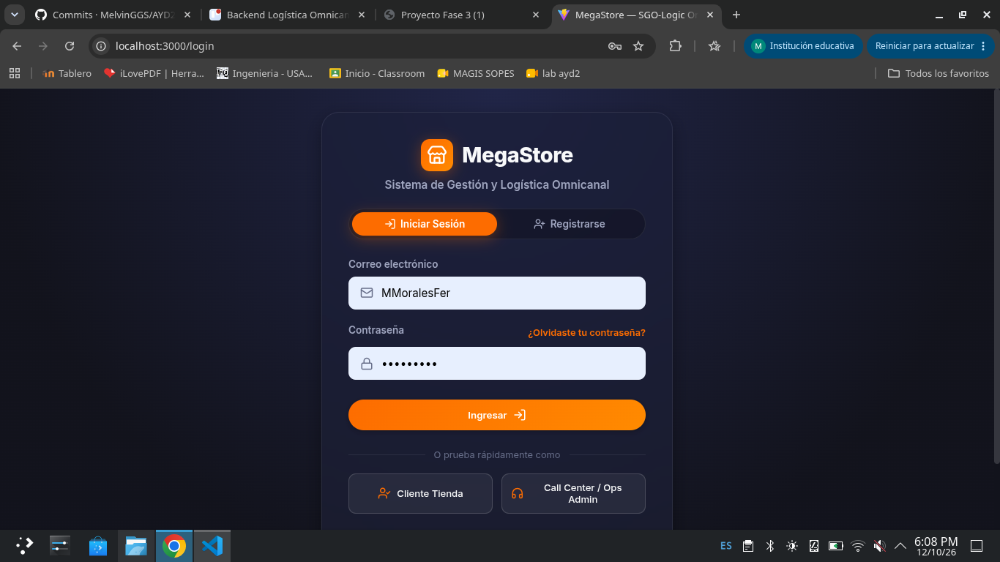

> Si olvidaste tu contraseña, haz clic en **¿Olvidaste tu contraseña?** y se enviará un enlace de recuperación a tu correo.

### 4.2 Crear una cuenta nueva

1. En la pantalla de ingreso, selecciona la pestaña **Registrarse**.
2. Llena los campos:
   - **Nombre completo** (obligatorio)
   - **Correo electrónico** (obligatorio)
   - **Contraseña** (obligatorio)
   - **Teléfono de contacto** (opcional)
   - **Dirección de entrega** (opcional, pero recomendada para que el checkout se llene solo)
3. Presiona **Crear Cuenta**. Aparecerá el mensaje *"¡Usuario registrado exitosamente!"* y entrarás automáticamente.

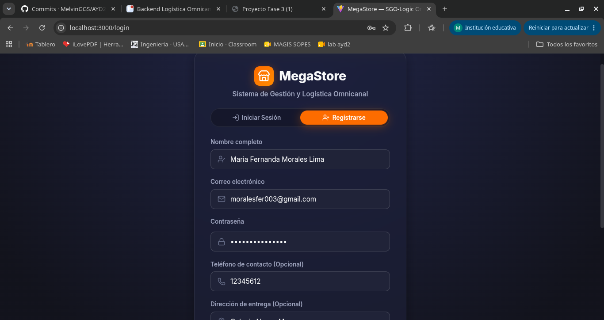

### 4.3 Acceso rápido de demostración

Debajo del formulario, en la sección **"O prueba rápidamente como"**, hay dos botones para entrar sin escribir datos:

| Botón | Para qué sirve |
| --- | --- |
| **Cliente Tienda** | Entra como un cliente normal para hacer compras. Es el que se usa en este manual. |
| **Call Center / Ops Admin** | Entra como operador; muestra además el panel **Ops Dashboard**. |

---

## 5. Mi cuenta y perfil

Una vez dentro, en la barra superior aparece tu nombre. Al hacer clic sobre él se abre la ventana **Mi Cuenta y Perfil Omnicanal**.

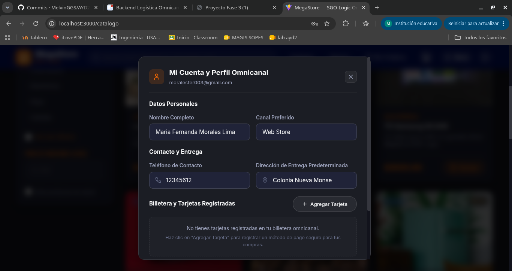

Desde aquí puedes:

- **Datos personales:** cambiar tu nombre completo y tu **canal preferido**.
- **Contacto y entrega:** actualizar tu teléfono y tu **dirección de entrega predeterminada**. Esta dirección se usa automáticamente al pagar.
- **Billetera y tarjetas registradas:** guardar tarjetas para pagar con PayKlik más rápido.

Cuando termines de editar tus datos, presiona **Guardar Cambios**. Verás el mensaje *"Datos actualizados correctamente en tu perfil."*

### 5.1 Registrar una tarjeta

1. En la sección **Billetera y Tarjetas Registradas**, haz clic en **Agregar Tarjeta**.
2. Ingresa el **número de tarjeta**, el **vencimiento (MM/AA)** y el **nombre del titular** tal como aparece en la tarjeta.
3. Presiona **Guardar Tarjeta**. La tarjeta aparecerá en tu billetera y podrás elegirla en el checkout.

> Para eliminar una tarjeta, usa el ícono de basurero que aparece junto a ella.

---

## 6. Explorar el catálogo

El catálogo es la pantalla principal de la tienda. Muestra el inventario **unificado** de todas las bodegas y tiendas.

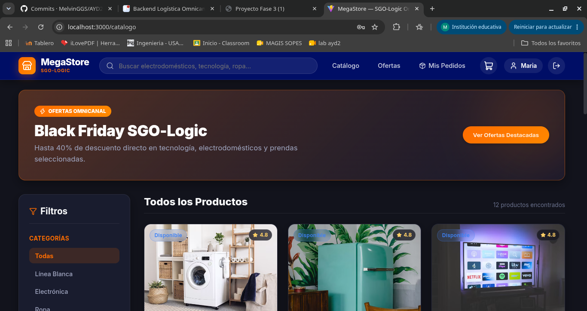

### 6.1 Buscar productos

- Usa la **barra de búsqueda** de la parte superior ("Buscar electrodomésticos, tecnología, ropa...") y presiona *Enter*.

### 6.2 Filtrar productos

En el panel izquierdo **Filtros** puedes:

- Elegir una **categoría**.
- Marcar **Ver solo Ofertas** (también disponible en el menú **Ofertas** o con el botón **Ver Ofertas Destacadas** del banner).
- Escribir un **precio máximo**.
- Marcar **Solo productos en stock** para no ver productos agotados.

### 6.3 Agregar productos al carrito

1. Busca el producto que deseas.
2. Haz clic en **Agregar**. El botón cambiará a **¡Agregado!** y el ícono del carrito mostrará la cantidad de artículos.

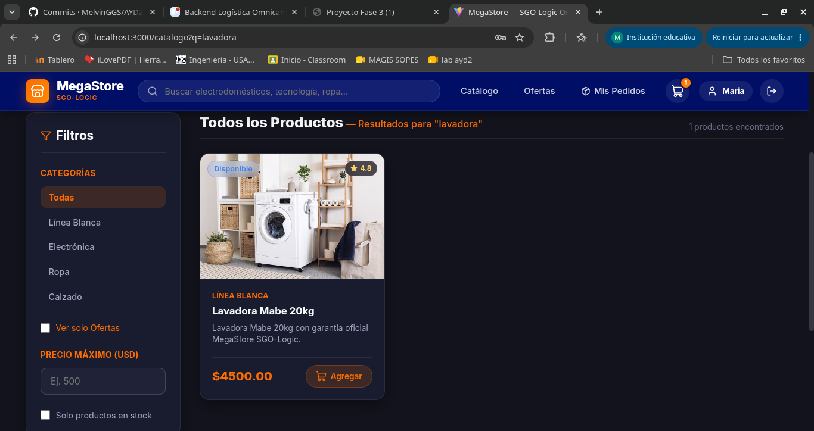

---

## 7. Carrito de compras

Haz clic en el ícono del **carrito** en la barra superior para ver tus artículos.

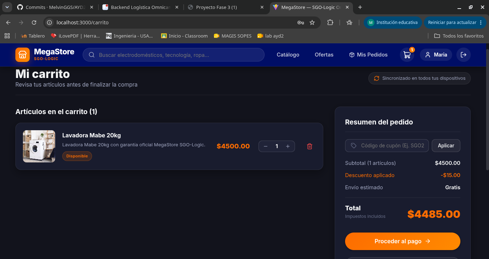

En esta pantalla puedes:

1. **Cambiar la cantidad** de cada producto o **eliminarlo**.
2. **Aplicar un cupón:** escribe el código en el campo *"Código de cupón"* y presiona **Aplicar**. Si es válido, verás la línea **Descuento aplicado**.
3. Revisar el **Resumen del pedido**: subtotal, envío estimado y total. Las compras mayores a 150 tienen **envío gratis**.
4. Presionar **Proceder al pago** para ir al checkout.

> Tu carrito está **sincronizado en todos tus dispositivos**, así que si lo armas en la computadora lo puedes terminar en el celular.
>
> Si no has iniciado sesión, al presionar **Proceder al pago** el sistema te pedirá ingresar y luego te regresará al checkout.

---

## 8. Finalizar compra (checkout)

La pantalla **Finalizar Compra** tiene tres partes: método de entrega, método de pago y resumen del pedido.

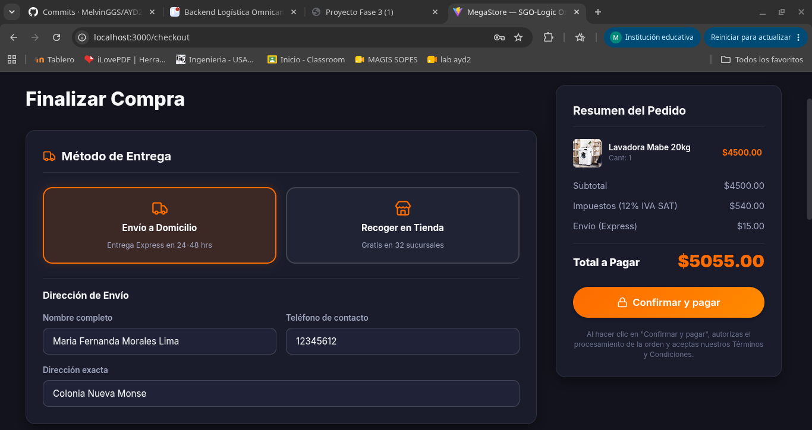

### 8.1 Método de entrega

| Opción | Descripción | Costo |
| --- | --- | --- |
| **Envío a Domicilio** | Entrega Express en 24 a 48 horas | $15.00 |
| **Recoger en Tienda** | Recoges tu pedido en cualquiera de las 32 sucursales | Gratis |

Si eliges **Envío a Domicilio**, completa la sección **Dirección de Envío**:

- **Nombre completo**
- **Teléfono de contacto**
- **Dirección exacta**

Si ya guardaste estos datos en tu perfil, aparecerán llenos automáticamente.

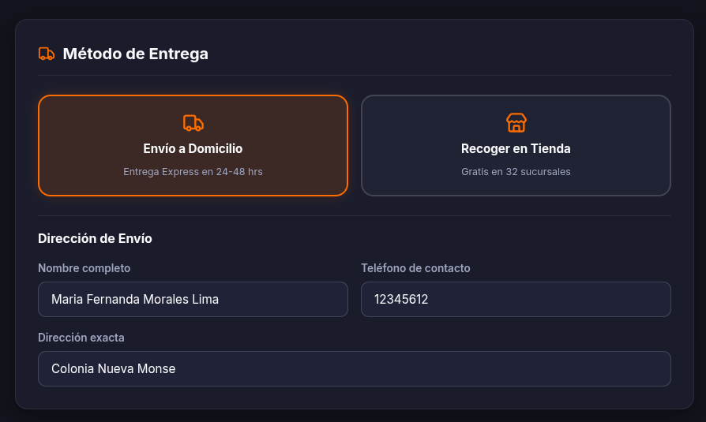

> **¿Desde dónde sale mi pedido?** El sistema elige automáticamente el centro de distribución más conveniente según tu dirección (por ejemplo, las direcciones del sur y la costa salen del **CD Sur**). Esto es igual sin importar si pagas con PayKlik o con crédito propio.

### 8.2 Resumen del pedido

En el lado derecho verás:

- **Subtotal** de los productos.
- **Impuestos (12 % IVA SAT)**.
- **Envío** (Express o En tienda).
- **Total a Pagar**.

### 8.3 Método de pago

Al llegar al checkout, el sistema **evalúa automáticamente** si calificas para crédito propio. Esto tarda menos de medio segundo, por lo que la pantalla no se queda esperando. Según el resultado verás una de estas dos situaciones:

| Si calificas | Si no calificas |
| --- | --- |
| Aparece primero la opción **Crédito Propio MegaStore — PAGA EN 30 DÍAS**, ya seleccionada como recomendada. | La opción de crédito **no aparece**. En su lugar se muestra un aviso y puedes pagar con PayKlik, transferencia o billetera. |

Los métodos de pago disponibles son:

1. **Crédito Propio MegaStore** (solo si calificas) — sección 9.
2. **PayKlik Pasarela Unificada** — sección 10.1.
3. **Transferencia Bancaria Directa** — sección 10.2.
4. **Billetera Digital Omnicanal** — sección 10.2.

---

## 9. Compra con Crédito Propio "Paga en 30 días"

### 9.1 ¿Cómo sabe el sistema si califico?

No necesitas llenar ninguna solicitud. El sistema calcula un **score crediticio** usando tu comportamiento real de compra en MegaStore:

| Regla | Efecto en tu puntaje |
| --- | --- |
| Puntaje inicial | 85 puntos |
| Si ya tienes 2 o más compras anteriores | +5 puntos |
| Por cada incidencia o disputa en compras anteriores | −15 puntos |

Para que se te ofrezca crédito se deben cumplir **las dos** condiciones:

1. Tener un score de **70 puntos o más**.
2. Que el total de la compra **no supere tu cupo disponible** (el límite de crédito es de **Q5,000**).

**Ejemplos:**

| Cliente | Score | Monto de la compra | ¿Se ofrece crédito? |
| --- | --- | --- | --- |
| Cliente frecuente, sin problemas | 90 | Q1,500 | Sí |
| Cliente nuevo | 85 | Q1,500 | Sí |
| Cliente con 1 incidencia | 75 | Q1,500 | Sí |
| Cliente con 2 incidencias | 60 | Q1,500 | No (score menor a 70) |
| Buen score, pero la compra supera el cupo | 90 | Q4,000 con cupo de Q3,500 | No (cupo insuficiente) |

> **Tip:** si no calificas por el monto, puedes quitar algunos productos del carrito para que el total quede dentro de tu cupo disponible.

### 9.2 Pasos para comprar con crédito propio

1. En **Método de Pago**, selecciona **Crédito Propio MegaStore** (si calificas, ya viene seleccionado).
2. Revisa la información que aparece debajo:
   - **Fecha límite de pago:** 30 días a partir de hoy.
   - **Cupo disponible:** cuánto crédito tienes.
   - **Monto financiado:** el total de tu compra.
   - **Score Crediticio:** tu puntaje y la palabra *(Aprobado)*.
3. **No necesitas ingresar datos de tarjeta.**
4. Presiona el botón **Confirmar Compra con Crédito Propio (Paga en 30 días)**.
5. Espera el mensaje *"Procesando crédito..."* y serás enviado a la pantalla de confirmación.

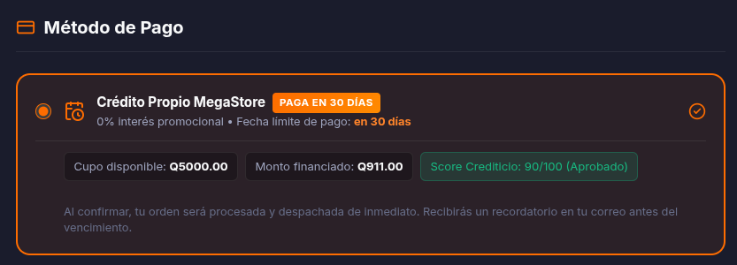

> Tu orden se procesa y se despacha **de inmediato**, igual que una compra pagada con tarjeta. Recibirás un recordatorio en tu correo antes de la fecha de vencimiento.

### 9.3 Condiciones del crédito

| Condición | Valor |
| --- | --- |
| Plazo | 30 días |
| Interés | 0 % (promocional) |
| Recargo por apertura | Q0.00 |
| Monto máximo | Hasta tu cupo disponible (límite Q5,000) |

### 9.4 Si no calificas

Si el sistema determina que no calificas, verás el aviso:

> *"Crédito propio a 30 días no disponible: Historial de compras insuficiente o límite superado. Puedes abonar mediante PayKlik o transferencia bancaria."*

Tu compra **no se bloquea**: simplemente continúa con cualquiera de los otros métodos de pago.

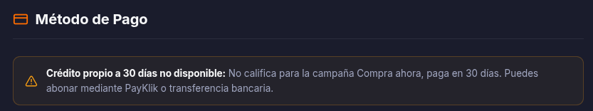

---

## 10. Compra con PayKlik y otros métodos

### 10.1 PayKlik (tarjeta de crédito o débito)

1. Selecciona **PayKlik Pasarela Unificada**.
2. Elige una opción:
   - **Tarjeta registrada:** selecciónala en la lista *Seleccionar Tarjeta Registrada* y escribe solo el **CVV**.
   - **Otra tarjeta:** elige *"Usar otra tarjeta distinta..."* y llena **Número de tarjeta**, **Vencimiento (MM/AA)** y **CVV**.
3. Presiona **Confirmar y pagar**. Verás *"Procesando con PayKlik..."*.

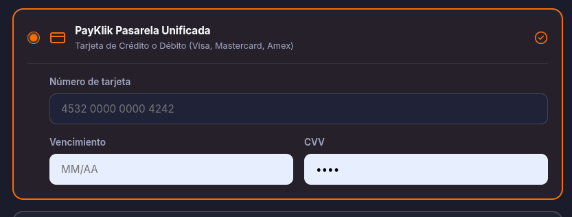

> Los datos de tu tarjeta están **protegidos con tokenización segura**.

**Errores comunes al pagar con tarjeta:**

| Mensaje | Qué hacer |
| --- | --- |
| *Número de tarjeta inválido* | Revisa que el número tenga al menos 15 dígitos. |
| *Fecha de vencimiento requerida (MM/AA)* | Escribe la fecha con el formato mes/año, por ejemplo `12/28`. |
| *Código CVV requerido* | Escribe los 3 o 4 dígitos de la parte de atrás de tu tarjeta. |

### 10.2 Transferencia bancaria y billetera digital

- **Transferencia Bancaria Directa:** la acreditación es automática e inmediata.
- **Billetera Digital Omnicanal:** pago express usando el saldo registrado en tu cuenta.

En ambos casos solo selecciona la opción y presiona **Confirmar y pagar**.

---

## 11. Confirmación de la orden

Después de confirmar, verás la pantalla **"Orden confirmada exitosamente"**. Mientras se genera la factura puede aparecer brevemente el mensaje *"Generando factura electrónica y unificando orden..."*.

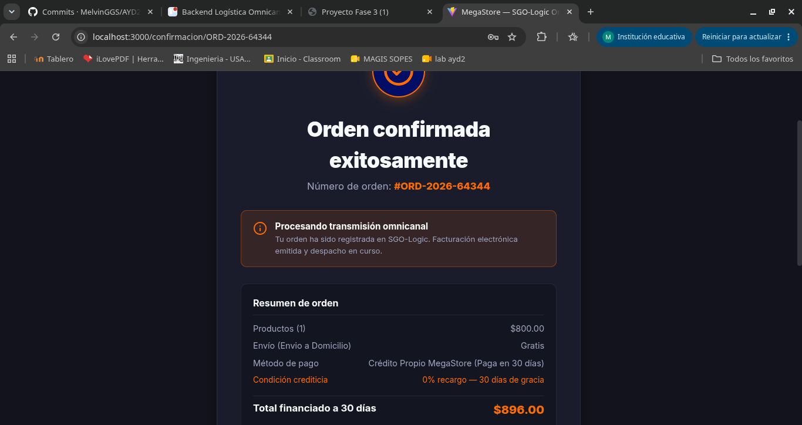

En el **Resumen de orden** se muestra:

- Número de orden (guárdalo, lo necesitarás para el seguimiento).
- Subtotal y costo de envío.
- **Método de pago:**
  - Con crédito: *"Crédito Propio MegaStore (Paga en 30 días)"*, junto con la **condición crediticia** *"0 % recargo — 30 días de gracia"* y el **Total financiado a 30 días**.
  - Con PayKlik: *"PayKlik"* y el **Total pagado**.
- **Entrega estimada.**

Para ver cómo avanza tu pedido, presiona **Ver estado de mi orden**.

---

## 12. Seguimiento de pedidos

Entra a **Mis Pedidos** en la barra superior, o presiona **Ver estado de mi orden** desde la confirmación.

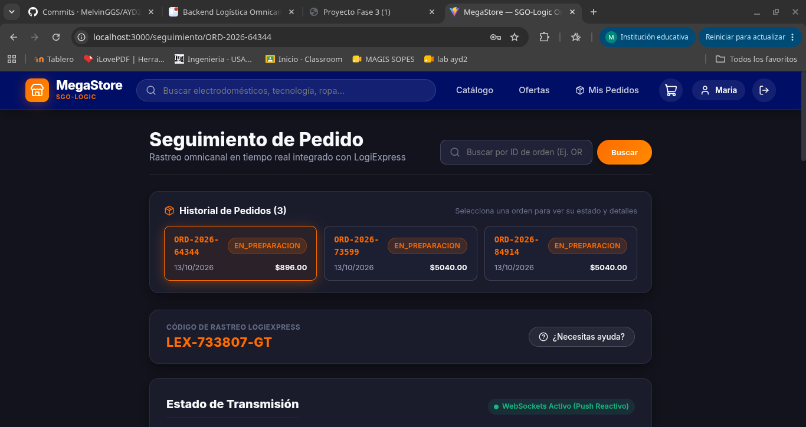

### 12.1 Buscar un pedido

- Si iniciaste sesión, verás tu **Historial de Pedidos** con todas tus compras.
- También puedes escribir el número de orden en el buscador (por ejemplo `ORD-2026-65381`) y presionar **Buscar**.

### 12.2 Estados de un pedido

La línea de tiempo muestra en qué etapa está tu pedido:

| Estado | Significado |
| --- | --- |
| **CREADA** | La orden fue registrada. |
| **PAGADA** | El pago (o el crédito) fue aprobado. |
| **FACTURADA** | Se emitió la factura electrónica FEL ante la SAT. |
| **EN_PREPARACION** | El centro de distribución está preparando tu paquete. |
| **EN_TRANSITO** | El paquete va en camino con LogiExpress. |
| **ENTREGADA** | El pedido fue entregado. |

Las compras con crédito propio pasan exactamente por **los mismos estados** que las compras con PayKlik.

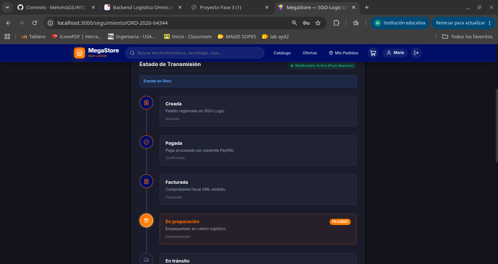

### 12.3 Actualizaciones en tiempo real

No necesitas recargar la página. Cuando tu pedido cambia de estado, el sistema te avisa **automáticamente**:

- Si ves la etiqueta verde **"WebSockets Activo (Push Reactivo)"**, las actualizaciones llegan al instante.
- Cuando ocurre un cambio aparece un aviso azul con el título del evento y una descripción.
- Si la conexión en vivo no está disponible, la etiqueta cambia a **"Polling Respaldo"** y la página sigue actualizándose cada cierto tiempo.

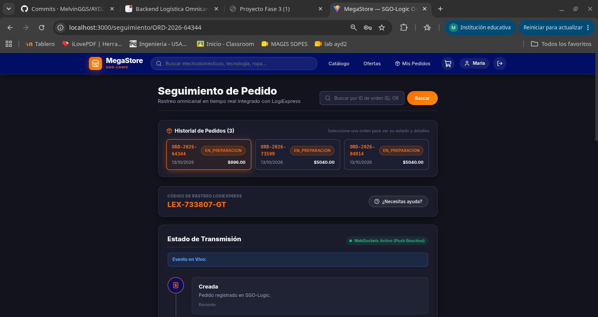

### 12.4 Detalle del pedido

En la misma pantalla también encuentras:

- **Código de rastreo LogiExpress** de tu paquete.
- **Cliente, canal de origen y dirección de entrega.**
- **Método de pago** y, si compraste con crédito, la fecha de **Vencimiento del crédito**.
- **Facturación Electrónica SAT (FEL):** botón **Descargar Factura XML** para obtener tu comprobante oficial.

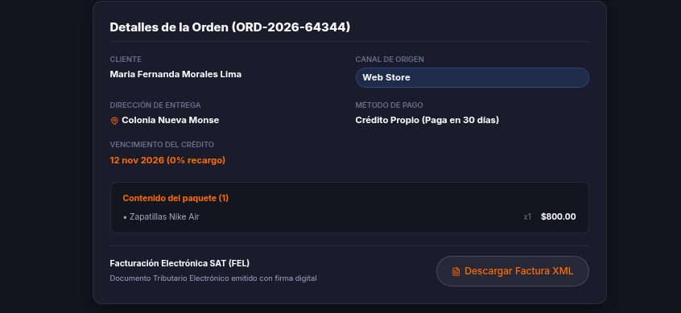

---

## 13. Centro de ayuda y reporte de incidencias

El centro de ayuda se abre desde el detalle de un pedido:

1. Entra a **Mis Pedidos** en la barra superior.
2. Selecciona un pedido de tu **Historial de Pedidos** (o búscalo por su número).
3. Junto a la tarjeta del **Código de Rastreo LogiExpress**, presiona el botón **¿Necesitas ayuda?**.
4. Se abrirá la ventana **Centro de Ayuda y Soporte Omnicanal**.

> El botón solo aparece cuando tienes un pedido abierto, ya que la ayuda queda asociada a esa orden.

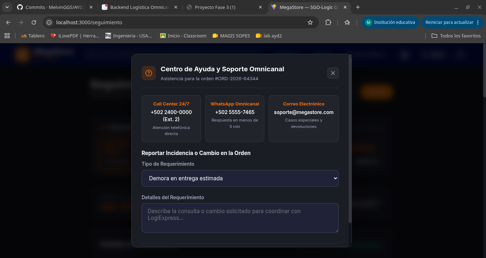

### 13.1 Canales de contacto

| Canal | Dato | Uso |
| --- | --- | --- |
| Call Center 24/7 | +502 2400-0000 (Ext. 2) | Atención telefónica directa |
| WhatsApp Omnicanal | — | Respuesta en menos de 5 minutos |
| Correo electrónico | soporte@megastore.com | Casos especiales y devoluciones |

### 13.2 Reportar una incidencia

1. En **Reportar Incidencia o Cambio en la Orden**, elige el **Tipo de Requerimiento**:
   - Demora en entrega estimada
   - Corrección de dirección de entrega
   - Cambio o devolución de producto
   - Aclaración de cargo PayKlik
   - **Consulta o prórroga de Crédito Propio (30 días)**
2. Describe tu caso en **Detalles del Requerimiento**.
3. Envía la solicitud. Verás el mensaje **"Incidencia Registrada"** y el Call Center te contactará.

> **Importante:** las incidencias y disputas se toman en cuenta en el score crediticio (−15 puntos cada una), por lo que pueden afectar la posibilidad de usar crédito propio en compras futuras.

---

## 14. Preguntas frecuentes y solución de problemas

**¿Por qué no me aparece la opción de crédito propio?**
Puede ser porque tu score es menor a 70 o porque el total de la compra supera tu cupo disponible. Revisa la sección 9.1. También puedes intentar con un monto menor.

**¿Tengo que pagar intereses por usar el crédito propio?**
No. La campaña es con 0 % de interés y sin recargo, siempre que pagues antes de la fecha límite.

**¿Mi pedido tarda más si lo pago con crédito?**
No. Las órdenes con crédito propio se despachan de inmediato y siguen el mismo proceso logístico que las pagadas con PayKlik.

**¿Dónde veo cuándo vence mi crédito?**
En la pantalla de checkout antes de confirmar, y después en el detalle del pedido, en **Vencimiento del crédito** (sección 12.4).

**Al confirmar me aparece una "Alerta de Inventario".**
Significa que algún producto se agotó mientras comprabas. Cierra la alerta, revisa tu carrito y vuelve a intentarlo.

**Me pide iniciar sesión al pagar.**
El checkout solo está disponible para usuarios con sesión iniciada. Ingresa con tu cuenta y el sistema te regresará al checkout automáticamente.

**No veo las actualizaciones de mi pedido.**
Revisa tu conexión a internet. Si la etiqueta dice **"Polling Respaldo"**, las actualizaciones siguen llegando, solo que con un pequeño retraso.

**¿Cómo cierro sesión?**
Usa el ícono de salida que está a la derecha de tu nombre en la barra superior.
